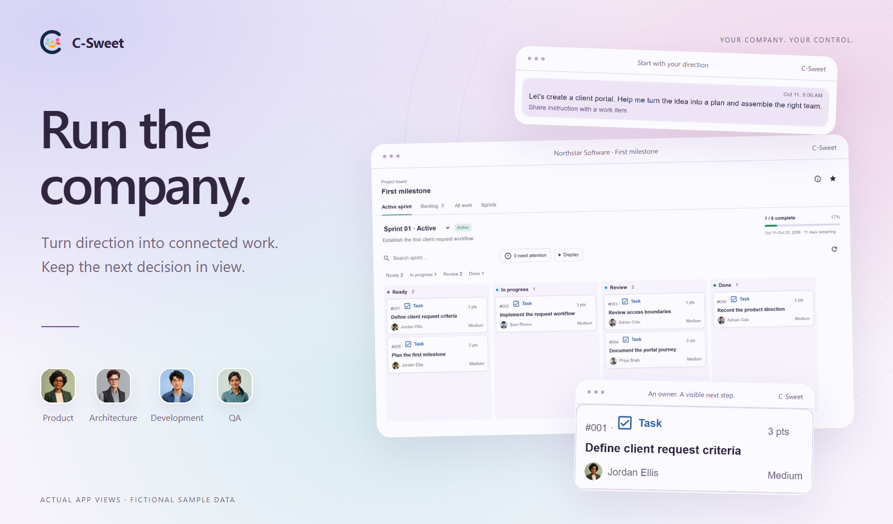
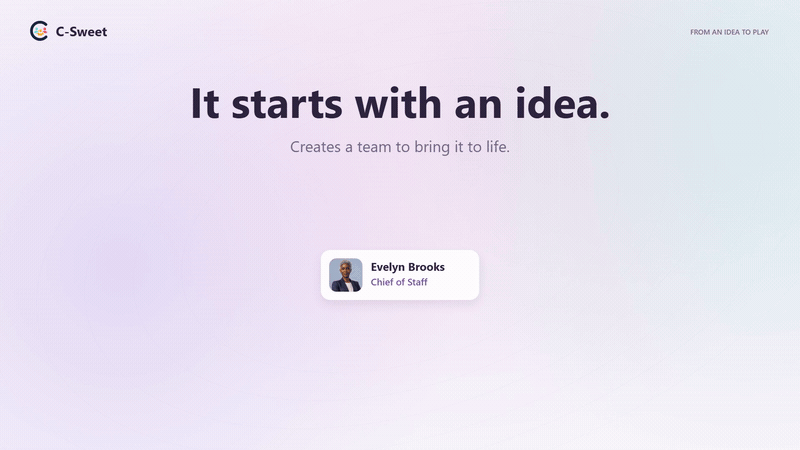
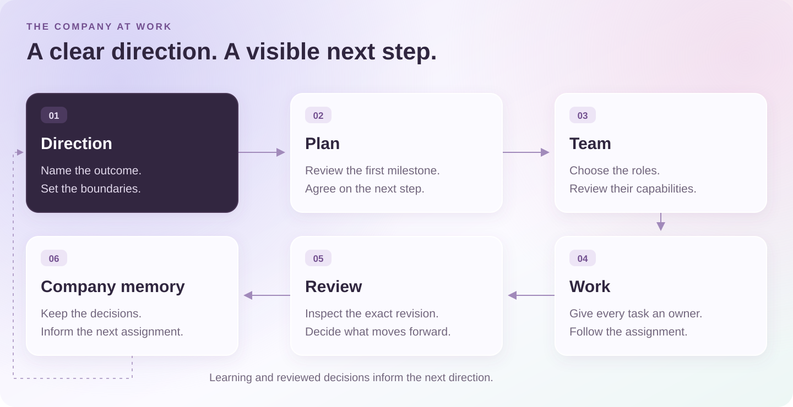
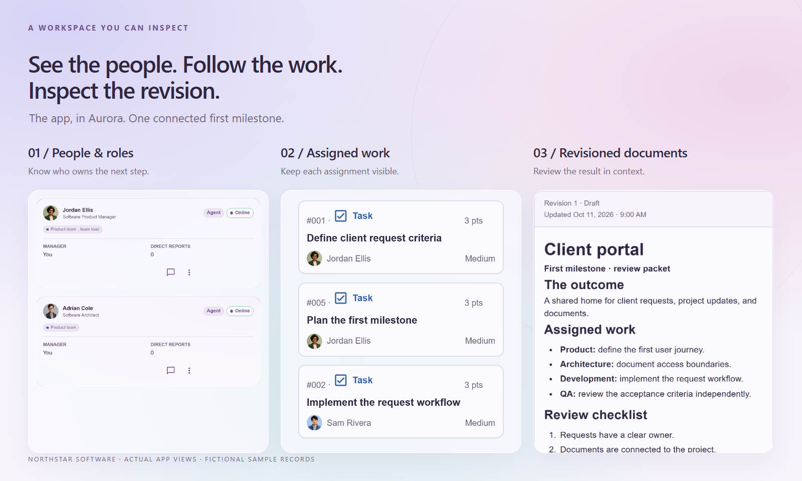
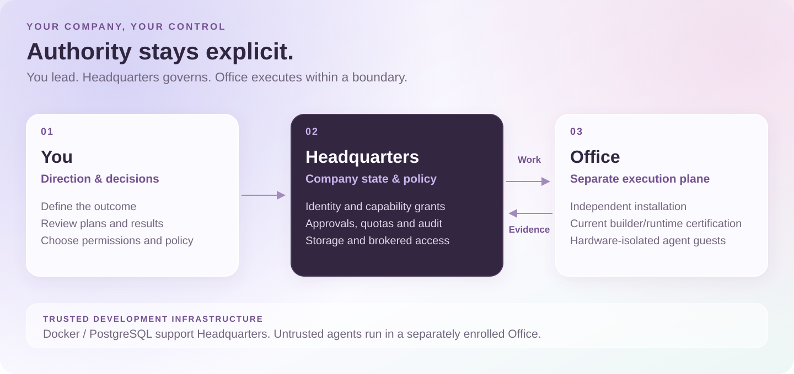

<div align="center">
  <h1>C-Sweet</h1>
  <p><strong>Your idea. Your company. Your workforce.</strong></p>
  <p>A self-hostable workspace for leading a company with people and AI agents.</p>
  <p>
    <a href="#from-an-idea-to-play">Watch the explainer</a> ·
    <a href="#run-c-sweet-locally">Run locally</a> ·
    <a href="#your-first-session">Your first session</a> ·
    <a href="#what-you-can-do">Explore the workspace</a> ·
    <a href="#how-it-fits-together">Architecture</a>
  </p>
  <p><strong>Developer preview</strong> · Self-hostable · .NET 10</p>
</div>

<picture>
  <source media="(max-width: 600px)" srcset="assets/readme/csweet-aurora-hero-mobile.png" />
  
</picture>

You set the direction. C-Sweet connects that direction to conversations, plans, a team, assigned work, and reviewable deliverables. Your Personal Assistant helps you get oriented; a business's Chief of Staff coordinates its work. You remain in charge of the objectives, permissions, and important decisions.

**Start small:** one business, one clear outcome, one assignment you can inspect. C-Sweet is an active developer preview. Agent execution needs configured models, installed agents, and a ready C-Sweet Office; creating a workspace does not automatically give you a running workforce.

## From an idea to play

[](assets/readme/explainer/from-idea-to-play.mp4)

**[Watch the full film with music](assets/readme/explainer/from-idea-to-play.mp4)** · [30-second vertical cut](assets/readme/explainer/from-idea-to-play.vertical.mp4) · [Transcript](assets/readme/explainer/transcript.txt) · [Player, playable demo and source](tools/csweet-explainer/README.md)

Hire your Chief of Staff. Choose **Creative & Product**. Bring in a Creative Director, Producer and specialists. Follow a game idea through planning, a Kanban sprint, implementation, technical review, integration and QA—then see the browser game come to life. **What will you build?**

*112 seconds · 1080p · Original arcade-pop soundtrack. Real app components with fictional sample data illustrate a condensed workflow. Prism Break is a playable example authored for the film, not a recording of an autonomous agent delivery. The embedded animation is a 12-second preview; the linked MP4 contains the full film and music.*

## Run C-Sweet locally

The recommended source-development path is **Windows + .NET + Docker Desktop**. Headquarters runs through Aspire; agent execution uses a separately installed Office.

### 1. Prepare your machine

| Requirement | What it is for |
|---|---|
| **.NET 10 SDK** | Build and run the source. Follow the SDK and roll-forward policy in [`global.json`](global.json). |
| **Docker Desktop, Linux engine running** | Run PostgreSQL and SearXNG for the development stack. `docker info` must succeed. |
| **Git** | Clone the source and support repository workflows. |
| **An OpenAI-compatible model endpoint** | Configure AI features during setup. Use a compatible local server or hosted provider; LM Studio is the default local preset. |
| **C-Sweet Office, for agent execution** | Install and enroll an [Office](https://github.com/CrosswiredStudios/CSweet.Office) with a supported hardware-isolation provider. Local Hyper-V execution requires Windows Professional, Enterprise, or Education and hardware virtualization. |

### 2. Launch Headquarters

Start Docker Desktop, then run:

```powershell
git clone https://github.com/CrosswiredStudios/csweet.git
cd csweet
.\Start-CSweet.cmd
```

You can also double-click [`Start-CSweet.cmd`](Start-CSweet.cmd). The launcher checks .NET and Docker, attempts to start Docker Desktop if needed, prepares the local HTTPS development certificate with an HTTP fallback, and launches the app. **Keep its terminal open while using C-Sweet.** The first run restores packages, builds services, and initializes the database; wait for the app to become ready.

<details>
<summary><strong>Prefer a terminal or IDE?</strong></summary>

Run AppHost after Docker's Linux engine is ready:

```powershell
dotnet run --project src/CSweet.AppHost/CSweet.AppHost.csproj --launch-profile https
```

AppHost starts the trusted Headquarters services, PostgreSQL, and SearXNG search automatically. No separate search installation, API key, or instance URL is required. The first launch downloads the pinned search image. This currently provisions search infrastructure; agent search tools will be connected separately. AppHost does not start Office. The Aspire dashboard provides service health and logs; its URL appears in the console. See the [debug and local development guide](docs/implementation/debug-guide.md) for IDE startup and port conflicts.

</details>

### 3. Complete guided setup

Create the root administrator, save the **ten offline recovery codes**, and configure your model provider and Personal Assistant. Email and marketplace discovery are optional. For agents, follow **Agent Execution** setup to install Office, verify its signed package, create a one-use enrollment, compare the machine fingerprint, and approve it. Wait for healthy status and current builder/runtime certification before expecting agent work to run.

> [!IMPORTANT]
> The first visitor to a fresh instance can claim the root administrator account. Complete registration and onboarding on a trusted network before exposing the app publicly.

<details>
<summary><strong>Other deployment paths and startup help</strong></summary>

- **Windows build ZIP:** the [Windows build workflow](docs/deployment/windows-build.md) produces self-contained backend executables and browser assets. It still needs deployment configuration; it is not yet a configured, one-click installer.
- **Docker Compose:** the checked-in topology is an incomplete deployment path for the trusted core. It does not provide an end-to-end Office execution deployment. Follow the [Docker infrastructure guide](docs/deployment/docker.md) for configuration and persistence limits.
- **Docker is open, but startup fails:** run `docker info`. A visible Docker Desktop window does not mean the engine is ready.
- **The app runs, but agents do not:** check provider/model configuration, the agent's build and permissions, and Office health/certification. An unavailable Office blocks untrusted execution. Use the [Office operations guide](Documentation/Operations/DISTRIBUTED_EXECUTION_FLEET.md).
- **A chat turn fails:** use the [chat diagnostics guide](docs/implementation/chat-turn-diagnostics.md) to find the persisted error, execution trace, and relevant logs.

</details>

## Your first session

1. **Create a business from Enterprise.** Name it and describe what you want to accomplish. You can start fresh or use the repository onboarding flow for an existing app, game, or website. Your Personal Assistant can help prepare a brief.
2. **Configure the people and agents you need.** Follow business onboarding for your Chief of Staff and workforce. Review suggested roles, install/configure the relevant packages, and approve their required capabilities.
3. **Give the Chief of Staff one bounded outcome.** Ask for a plan and clear owners before expanding the scope.
4. **Follow the work, then inspect the result.** Use Communications for discussion, boards for assignments and status, and documents/review surfaces for deliverables and decisions.

For example:

> “Plan a client portal for a small studio. Define the first milestone, suggest the team we need, and show me the plan before implementation begins.”

### What to expect

| As you explore | What happens |
|---|---|
| **Company workspace** | Businesses, people, conversations, planning, and review surfaces give the work a shared home. |
| **Assistant and agent work** | Execution depends on the configured model, a built/ready agent, granted capabilities, and certified Office capacity. Catalog discovery is not the same as having installed staff. |
| **External integrations** | GitHub, YouTube, hosted models, and other services need their own connections and permissions. Review requirements depend on the action and policy. |
| **Progress and delivery** | A task's status is one part of the story. Inspect its documents, revision, checks, and review evidence before deciding what moves forward. |

## From direction to reviewed work

<picture>
  <source media="(max-width: 600px)" srcset="assets/readme/csweet-company-workflow-mobile.svg" />
  
</picture>

**Direction → Plan → Team → Work → Review → Company memory.** The workspace keeps the conversation and the work connected so you can see owners, inspect outcomes, and carry decisions into the next assignment.

## What you can do

| Your goal | Where to start | What the preview supports |
|---|---|---|
| **Lead the business** | Overview and Communications | Company objectives, attention items, durable human/agent conversations, and executive briefings. |
| **Build a team** | Employees and hiring | Reporting relationships, role-driven hiring suggestions, package discovery/import, and reviewed capability grants. |
| **Keep delivery organized** | Projects and work boards | Assigned work, Kanban, sprints, estimates, capacity planning, and linked project resources. |
| **Inspect the output** | Documents, reviews, and repositories | Document revisions, access controls, review decisions, brokered Git workspaces, and pull-request handoffs. |
| **Plan and learn** | Calendar and memory | Business scheduling, conversation history, persistent memory, and retained work/decision records. |
| **Extend the workspace** | Providers, agents, and plugins | Configurable model/media providers, local ComfyUI workflows, communication integrations, and SDK extension points. Available operations depend on the configured provider or package. |

<picture>
  <source media="(max-width: 600px)" srcset="assets/readme/csweet-aurora-workspace-mobile.png" />
  
</picture>

*Actual app components, shown with fictional Northstar Software sample records.*

### What will you build?

- **A software product:** connect requirements, architecture, implementation, and QA to owned work and reviewable changes.
- **A content business:** organize a content plan and calendar, configure a YouTube Account Manager, review proposed community replies, and inspect channel reports. Provider access is required for live channel operations.
- **A game studio:** bring creative direction, production, design, engineering, art, audio, and quality roles together around shared plans and sprint work. Specialist packages require installation and configuration.

Start with the [example companies and workflows](docs/12-example-scenarios.md). These are ways to use the workspace, not guarantees of autonomous business success, audience growth, or a finished game.

<details>
<summary><strong>Explore the first-party agent catalog</strong></summary>

The [embedded catalog](src/CSweet.Api/first-party-agents.json) includes executive coordination, software product delivery, game production/specialists, Namecheap infrastructure, and YouTube account management. Entries are discoverable source packages. Review each repository, license, dependencies, required capabilities, and readiness before assigning work.

The optional [Marketplace connection](docs/MARKETPLACE_INTEGRATION.md) adds in-app discovery and Chief-of-Staff capability matching. It is disabled by default; installed packages and the embedded catalog remain discoverable without it. Purchases follow listing links; automatic entitlement synchronization and a verified install handoff remain future work.

</details>

## Your company, your control

Self-host Headquarters and its data stores on infrastructure you operate. Choose compatible local or hosted model endpoints. Use application-enforced capability grants, tenant scope, approval rules, quotas, and audit records to define what an agent can do.

<picture>
  <source media="(max-width: 600px)" srcset="assets/readme/csweet-security-mobile.svg" />
  
</picture>

**Headquarters owns company state and policy. Office owns isolated execution.** Docker hosts trusted development infrastructure such as PostgreSQL. Untrusted agent builds/runtimes use separately installed Offices with certified hardware-isolation providers; they do not fall back to ordinary host processes or Docker containers when Office is unavailable.

Runtime guests are designed without guest network devices or host shares. Agents access approved capabilities through the broker rather than receiving company database credentials or general host access. See the [runtime threat model](Documentation/Security/AGENT_RUNTIME_THREAT_MODEL.md) and [Office operations guide](Documentation/Operations/DISTRIBUTED_EXECUTION_FLEET.md) before enabling untrusted workloads. Isolation limits exposure; it does not make granted capabilities harmless or establish production certification.

Self-hosting also gives you a choice of dependencies. Local models and available local artifacts can support local work. Hosted models, repository imports, marketplace discovery, and external integrations need their respective services and network access.

## How it fits together

<details>
<summary><strong>Services and architecture</strong></summary>

| Component | Responsibility |
|---|---|
| `CSweet.App` + `CSweet.UI` | Blazor web experience and shared UI |
| `CSweet.Api` | Authentication, setup, company operations, conversations, planning, and provider APIs |
| `CSweet.WorkerHost` | Durable background work and execution-fleet orchestration |
| `CSweet.AgentHost` | Policy enforcement and brokered MCP capabilities |
| `CSweet.ExecutionGateway` | Office enrollment, placement, leases, artifact grants, and broker relay |
| `CSweet.GitHost` | Trusted Git operations, internal repository storage, and brokered workspaces |
| `CSweet.SourceControlProvisionerHost` | Separate trusted managed GitHub repository provisioning |
| `CSweet.Migrator` + PostgreSQL | Migrations and persistent company state |
| [C-Sweet Office](https://github.com/CrosswiredStudios/CSweet.Office) | Independent execution plane for hardware-isolated builds/runtimes, capacity, and health |

The stack uses .NET 10, ASP.NET Core, Blazor WebAssembly, MudBlazor, PostgreSQL/EF Core, and Aspire. Agent SDK and plugin SDK contracts provide extension points. Protocol-v2 agents use a transport-neutral SDK, private brokered MCP runtime, and durable work inbox; guests communicate through Office and ExecutionGateway rather than directly accessing company infrastructure.

Read the [MCP runtime architecture](Documentation/Architecture/MCP_AGENT_RUNTIME.md), [Software Developer runtime](Documentation/Architecture/SOFTWARE_DEVELOPER_RUNTIME.md), and [operations runbook](Documentation/Operations/MCP_AGENT_RUNTIME_RUNBOOK.md). For repository storage and current offline-workflow limits, see [internal Git hosting](docs/implementation/internal-git-hosting.md). The retired WebHost proof of concept is covered by the [compute migration](docs/implementation/compute-migration.md).

</details>

<details>
<summary><strong>Build and test from source</strong></summary>

Use the SDK selected by `global.json`:

```powershell
dotnet restore CSweet.slnx
dotnet build CSweet.slnx --no-restore
dotnet test tests/CSweet.UnitTests/CSweet.UnitTests.csproj
dotnet test tests/CSweet.IntegrationTests/CSweet.IntegrationTests.csproj
```

[`Directory.Build.props`](Directory.Build.props) detects supported sibling Agent SDK, Memory, WorkManagement Contracts, Office Contracts, and Isolation checkouts. Otherwise, projects use the package pins in [`Directory.Packages.props`](Directory.Packages.props). Restore with the same dependency switches you use to build.

For Visual Studio sibling-project restore errors, restore the portable solution, then reload it. When developing across repositories, run `powershell -File scripts/New-LocalSolution.ps1` and open the generated, Git-ignored `CSweet.Local.slnx`. Regenerate after changing sibling checkouts or dependency switches. See the [debug guide](docs/implementation/debug-guide.md) for details and separate build configurations.

</details>

## Project status

C-Sweet is an **active developer preview**, not yet production-ready. APIs, deployment requirements, and data models may change. Current workflows coexist with unfinished deployment and delivery paths; vision and roadmap documents also describe future work. `CSweet` is a working name pending final brand and trademark review.

The broader vision includes remote agents, human professionals, and hybrid services. The employee model includes humans and agents today; a complete marketplace for engaging every workforce type remains part of that vision.

## Explore and contribute

| Next step | Read more |
|---|---|
| **Understand the product** | [Product vision](docs/00-product-vision.md) · [Example companies](docs/12-example-scenarios.md) |
| **Run and troubleshoot** | [Debug guide](docs/implementation/debug-guide.md) · [Docker infrastructure](docs/deployment/docker.md) · [Office operations](Documentation/Operations/DISTRIBUTED_EXECUTION_FLEET.md) |
| **Build an agent or plugin** | [Plugin platform](docs/plugin-platform/README.md) · [Runtime architecture](Documentation/Architecture/MCP_AGENT_RUNTIME.md) |
| **Explore current work** | [Implementation index](docs/implementation/README.md) · [Documentation index](docs/README.md) · [Prototype roadmap](docs/09-prototype-roadmap.md) |

Try a focused workflow and [tell us where it breaks down](https://github.com/CrosswiredStudios/csweet/issues). Contributions to agents, plugins, accessibility, security, documentation, and deployment are welcome.

<div align="center">
  <p><strong>Run the company. What will you build?</strong></p>
  <p>
    <a href="#run-c-sweet-locally">Start your workspace</a> ·
    <a href="https://github.com/CrosswiredStudios/csweet">Star C-Sweet</a> ·
    <a href="https://ko-fi.com/O7F226H4A2">Support development on Ko-fi</a>
  </p>
</div>
