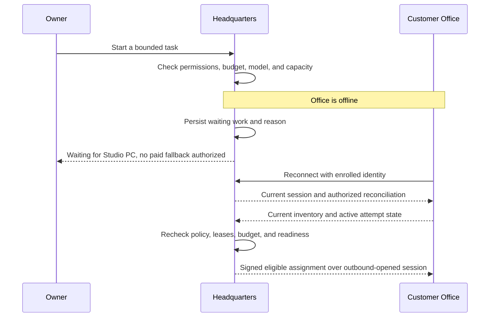

# Product and customer journeys

[Overview](README.md) · [Architecture](02-architecture-and-tenancy.md) · [Pricing](06-pricing-and-economics.md)

**Status: Proposed experience.** Product direction is agreed; screens, quotas, and
prices below are examples for review, not existing UI or final commercial terms.

## Customer promise

"Keep your company workspace online. Run its workforce on your computers, ours, or
both. Choose your models and control your spending."

The service removes the need to administer Headquarters while retaining choices
about execution hardware and inference. It does not promise autonomous business
success, unlimited computation, or that every model can perform every agent role.

## Vocabulary

| Term | Meaning in this feature |
|---|---|
| Customer account | Billing, ownership, subscription, and membership boundary. |
| Headquarters | A separately deployed company-management environment; it may contain multiple businesses. |
| Business | An existing organizational scope within Headquarters; not a substitute for a SaaS customer boundary. |
| Office | Enrolled execution node with certified isolation and bounded capacity. |
| Employee / agent seat | A distinct hired agent identity; package upgrades do not create a new employee. |
| Workload | One bounded runtime, builder, or toolchain execution; it consumes Office capacity. |
| Model profile | Model/provider settings plus the connection and billing route. |
| Model connector | A separately enrolled service that reaches approved private inference endpoints. |
| Linked | An enrollment is retained; not necessarily connected or ready right now. |

## Configuration matrix

All rows are intended product configurations. Live support must be established by
the [acceptance matrix](10-acceptance-scenarios.md).

| Example customer | Headquarters | Execution | Inference | Who pays model cost? |
|---|---|---|---|---|
| Solo founder | Hosted | Own PC | BYOK public API | Customer pays provider |
| Local-model enthusiast | Hosted | Own PC | Private GPU computer | Customer pays hardware/electricity |
| Small studio | Hosted | Mix of local and hosted Offices | Per-agent mix | Depends on each profile |
| Fully managed customer | Hosted | Hosted Offices | Managed API | C-Sweet purchases, customer pays metered tariff |
| Hosted compute with private models | Hosted | Hosted Offices | Customer model connector | Customer operates model; C-Sweet relays |
| Existing self-hosted user | Self-hosted | Own Offices | Supported local or external providers | Existing self-hosted arrangement |

## Journey A: founder with a PC and API key

**Example:** Maya wants a Chief of Staff and two specialists. She has a compatible
Windows PC and an API account, but does not want to operate a web application.

1. Maya enters through `www.c-sweet.com`, creates an account, and verifies ownership.
2. She reviews the Headquarters plan and recurring fees. Provisioning creates her
   isolated database, service configuration, keys, and owner membership.
3. Her workspace shows two separate readiness cards: **Execution** and **Models**.
4. She chooses **Connect my computer**, installs Office, enters a one-use code,
   checks the machine fingerprint, and approves resource limits.
5. Office connects outward. Headquarters shows whether its image and isolation
   certification are ready, rather than treating "connected" as "can execute."
6. Maya chooses **Use my API key**, saves it to protected Headquarters storage,
   selects a model, and runs a small connection/capability test with its cost disclosed.
7. She hires three agents. Before the first work, the UI shows the potential $30
   active-agent fee and obtains authorization within her staffing budget.
8. Work runs on her PC. Headquarters remains available from another device when
   that PC sleeps; execution waits until Office returns.

**Illustrative monthly C-Sweet bill:** $99 Headquarters + $9 Office + $30 agents =
$138. Model-provider charges are separate. Installing Office itself does not
authorize unlimited workloads, model spending, or local filesystem access.

## Journey B: separate machine for a private model

**Example:** Luis runs Office on a laptop, but inference on a GPU workstation.

1. Luis installs **Model Connector only** on the workstation. Hyper-V is not required.
2. He links it to Headquarters with its own one-use enrollment and local approval.
3. Locally he registers `http://127.0.0.1:1234/v1` and a display name, "Studio GPU."
   This is an example address, not a claim that a particular model server is installed.
4. Headquarters receives an approved endpoint identity and advertised capabilities,
   not a general right to call any workstation URL.
5. Luis tests streaming and the required tool/structured-output behavior before
   assigning the profile to an agent.
6. Agents on either his laptop or a hosted Office use that profile through Headquarters.

**What the screen must explain:** inference is on Luis's hardware, but prompts and
results pass through hosted Headquarters. Shutting down the workstation makes the
model unavailable. No managed model is substituted unless Luis has approved that
fallback and its budget/data rules.

## Journey C: studio with mixed capacity

**Example:** Northstar has two local Offices and wants temporary hosted capacity.

The owner connects both PCs, sets a preferred local Office pool, and adds a hosted
Office with an explicit monthly limit. A project requiring a specific toolchain
is placed only where that toolchain, resources, and certification are available.

An owner policy may say "local only" or "local first, approved hosted fallback."
The scheduler must not interpret a local PC going offline as permission to incur
cloud charges. A developer's local model and a premium review model can coexist;
model availability is evaluated separately from execution placement.

**Illustrative bill with one Standard hosted Office and eight active agents:**
$99 + (2 × $9) + $69 + (8 × $10) = **$266**, plus managed inference and authorized
hosted overage. Local execution hours do not create hosted-compute charges.

## Journey D: reconnect after an overnight shutdown

Reconnection does not blindly replay every missed notification. Current durable
state determines what can run. Work already completed or cancelled stays so.

## Readiness and owner actions

| State shown to customer | Meaning | Useful action |
|---|---|---|
| Office connected, runtime unavailable | Network works; certification, image, or host requirements do not | Open a bounded diagnostic and repair guide |
| Office offline | Enrolled machine is not connected | Start it, wait, or explicitly choose allowed capacity |
| Model connector connected, endpoint unavailable | Connector works; local server or model does not | Start the model server and retest |
| API key rejected | Provider authentication failed | Replace the key; no silent change to managed billing |
| Capacity busy | Eligible resources are occupied | Queue, cancel other work, or approve more capacity |
| Spending limit reached | Further chargeable admission is blocked | Review usage and raise the limit intentionally |
| Usage unresolved | A dispatched call has no trustworthy final receipt | Show reconciliation status, not fabricated zero usage |

## Public launch and private testing

The product entry point is `www.c-sweet.com`; application and gateway addresses are
configuration, not hardcoded public DNS requirements. The owned-PC environment
uses private Tailscale addresses while the service is under development.

External customer connectivity must eventually be tested against a public gateway
from another network without Tailscale. Neither users nor their agent guests join
the C-Sweet operator tailnet as a normal onboarding step.

## Boundaries of the first offer

Support approved agent packages and model capabilities rather than claiming every
plugin/model combination works. Customer-owned hardware must meet Office isolation
requirements. A model-only connector remains usable on a machine that cannot run
Office. Self-hosting remains a supported deployment choice and does not acquire a
mandatory dependency on the commercial billing service.
