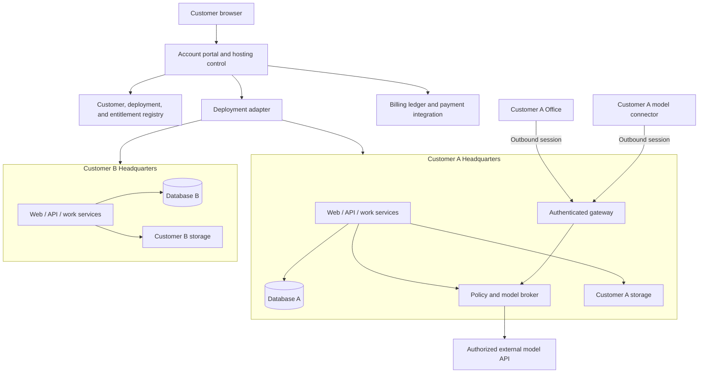
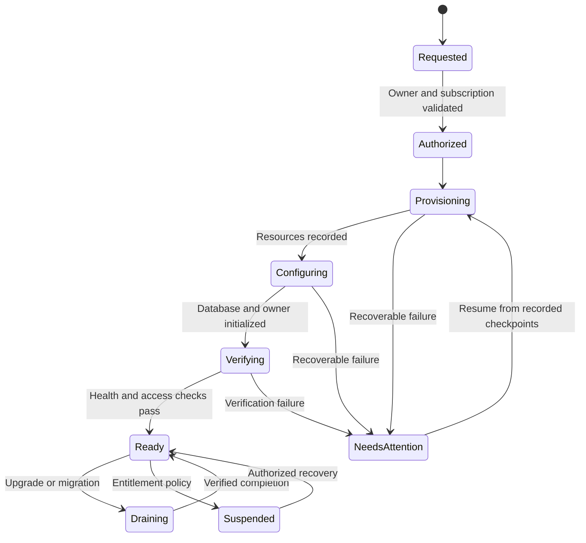

# Architecture and customer isolation

[Overview](README.md) · [Office](03-office-connectivity.md) · [Models](04-model-connectivity.md) · [Security](05-security-and-data.md)

**Status: Proposed hosted architecture.** Existing symbols are identified in the
[source map](11-evidence-and-sources.md); new components below are design concepts.

## Three responsibilities

1. **Hosting control:** who owns a subscription, what it permits, where a customer's
   Headquarters is deployed, and whether provisioning/migration is complete.
2. **Headquarters:** business state, human identity/roles, conversations, work,
   approvals, policy, brokered capabilities, and model dispatch.
3. **Execution and connectivity:** Offices execute bounded workloads; model
   connectors reach approved private inference services.

Do not collapse these responsibilities into a single internet-facing privileged
service. A billing webhook cannot become an execution grant, and a connector
credential cannot become an Office credential.

A shared ingress or database server is possible. Neither diagram grouping nor
hostname routing is an authorization boundary by itself.

## Customer isolation model

The proposed initial hosted model is **separate application deployment and database
per Headquarters**, with shared physical/cloud infrastructure. This avoids treating
the current application's business/organization filters as proof of SaaS isolation.

| Resource | Proposed isolation |
|---|---|
| Application processes | Customer-specific service/task configuration and resource limits |
| Database | Separate database and restricted role; shared PostgreSQL server permitted |
| Mutable repositories | Customer-specific protected storage roots or mounts and writer ownership |
| Immutable artifacts/media | Scoped object-storage identity/prefix or bucket; server-enforced authorization |
| Provider keys | Customer-scoped protected secrets; agent guests never receive them |
| Assignment signing and application keys | Persisted, protected, customer-specific identity material |
| Office/connector enrollment | Bound to exact Headquarters and customer; not inferred from a request header |
| Accounts | Explicit membership and roles; operator access separate from customer owner access |
| Billing | Immutable usage attribution and distinct payer/entitlement identity |

For the first version, each Office and connector enrollment belongs to one
Headquarters. A computer may have additional independently isolated installations
only through a supported deployment mechanism; the current machine-wide Office
installer is not assumed to provide multi-instance installation.

## Headquarters packaging

The development topology includes API, AgentHost, WorkerHost, ExecutionGateway,
GitHost, SourceControlProvisionerHost, Migrator, and the web application. A cost
estimate for only a static website or a single API is incomplete.

The existing Windows ZIP contains backend executables and web assets but still
needs service registration, configuration, persistent paths, TLS, and startup
coordination. The checked-in Compose topology contains historical wiring and is
not the production deployment specification. See [Windows packaging](../../deployment/windows-build.md)
and [Docker status](../../deployment/docker.md).

Deployment packaging must provide migrations before dependent services, health
checks, restart behavior, protected settings, drain/upgrade, and restore procedures.
It must not expose a Docker socket or run untrusted builds in ordinary app containers.

## Provisioning as a durable operation

These names are illustrative product states, not an existing enum or final API.
Each operation has an idempotency key, customer scope, desired specification,
recorded resources, and revision. External resource creation and a database commit
cannot generally be one transaction: use durable checkpoints and reconciliation.
Persist local state changes and notification outboxes atomically.

**Failure example:** a database is created, but the process stops before the web
service is created. Recovery discovers the database by the recorded operation and
resource identity; it does not create another database or a second subscription.
Cleanup never deletes resources belonging to an unrelated operation/customer.

## Hosted bootstrap and authentication

The current first-visitor administrator claim is unsuitable for publicly exposed
fresh tenants. Provision the authorized owner before publishing the route, and
disable open first-run claiming in hosted mode. Customer authentication remains
required even behind Tailscale or a reverse proxy.

Use an OIDC-capable account boundary so a provider such as Cognito is replaceable.
The exact initial identity provider is an open decision. Customer membership,
subscription, and Headquarters-local privileges remain separate checks. Cookies
must not inadvertently grant sibling tenant access through a shared parent domain.

## Model selection is independent of placement

An agent receives a model profile reference and approved capabilities. Headquarters
resolves credentials, model transport, policy, and usage attribution. The Office
does not receive a provider master key or select a different billing route.

This preserves local agent + public API, hosted agent + private LLM, and mixed
profiles. Private inference initially returns through Headquarters; a direct
guest-to-local-model shortcut is outside this proposal because it would change
authorization, accounting, and privacy semantics.

## Provider-independent deployment contract

Proposed operations: **inspect capacity, provision, inspect deployment, start,
stop, drain, upgrade, export, restore, delete**. Inputs include customer and
Headquarters identity, deployment version, resource class, desired region, and
references to protected configuration. Outputs include an operation identity,
state, public/private endpoints, resource references, and bounded diagnostics.

Owned Windows, a budget Linux host, and AWS implement that contract differently.
Persist provider-specific resource references in the deployment layer rather than
adding EC2 instance IDs or Windows paths to work items and model profiles.

Application data remains in PostgreSQL and portable artifact formats. Mutable Git
repositories need real filesystem semantics; object storage is not automatically
a live Git filesystem. Private keys and filesystem permissions need explicit
export/restore handling, not a promise that copying a folder is sufficient.

## Availability boundaries

Headquarters can stay available while a customer's Office sleeps. A connected
Office can be unable to execute; a connected model connector can have an unavailable
model. Represent all three separately. A single owned PC remains one failure
domain even when it runs several services or VMs.

Gateway session routing must preserve long-lived HTTP/2 streams and certificate
identity. Existing certificate-recovery exchanges can require affinity. Before
horizontal scaling, test session ownership, routing, recovery challenges, and
fencing across gateway instances; adding a load balancer is not proof of readiness.
