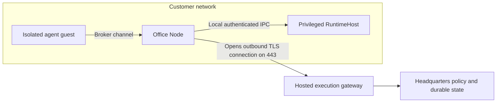
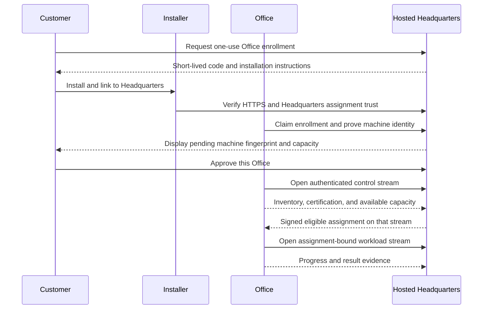
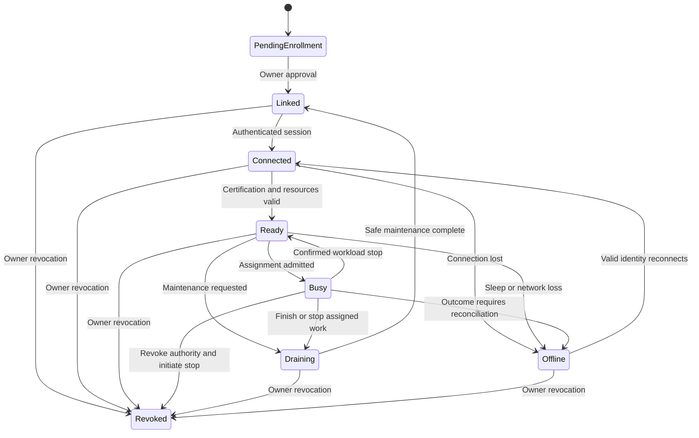

# Customer-owned Office connectivity

[Overview](README.md) · [Architecture](02-architecture-and-tenancy.md) · [Private models](04-model-connectivity.md)

**Status: Existing transport foundation; proposed hosted onboarding and operating behavior.**

## The problem and the existing solution

A customer PC usually has a private address behind a router. Headquarters cannot
assume it can initiate a connection to that address. Asking customers to configure
port forwarding also makes setup harder and exposes an unnecessary service.

Office already solves the connection-direction problem. `OfficeWorker` creates
an authenticated outbound channel to `OfficeGateway`. Its RPCs are `Connect`,
`OpenWorkloadTunnel`, and `DownloadArtifact`. The two first RPCs are bidirectional
streams: the customer initiates the connection, but Headquarters can send work
over the established session. [Code and protocol evidence](11-evidence-and-sources.md#c02-office-network-and-protocol)

**No new general-purpose VPN is required for this feature.** Hosted delivery still
needs public gateway deployment, onboarding, operational verification, and load tests.

RuntimeHost has no public management listener. Agent guests do not join the
customer LAN. Existing reviewed public-egress support does not authorize access
to local machines or private model endpoints.

## Connection direction versus work direction

The UI ordering above is the intended hosted experience. The exact current
enrollment API ordering and certificate issuance are defined by the existing
fleet implementation. Adapt the UI to those checks rather than bypassing them.

## Enrollment and trust

- Enrollment codes are single-use, expiring, customer-bound credentials. Do not put
  reusable secrets in installer URLs, logs, or command-line arguments.
- Installation verifies the signed package and Headquarters TLS identity. The
  persistent assignment trust pin is distinct from a renewable transport certificate.
- Owner approval binds the displayed machine identity and requested capacity.
- Office renewal/recovery retains its enrolled identity; revocation blocks access.
- A new machine or lost private key requires explicit re-enrollment. Restoring a
  customer database must not accidentally clone a usable Office identity onto two PCs.

The current security invariants remain authoritative. This feature does not
relax certificate checks to make corporate proxies or staging tunnels work.

## Lifecycle visible to the customer

This diagram is a customer-facing projection; transport state, maintenance state,
certification, and assignment state should not be forced into one overloaded enum.
"Offline" neither deletes work nor proves that the last workload stopped.

## Reconnection and uncertain work

Use notifications as wake hints. Reconnection reads bounded current state and
reconciles exact assignment IDs, epochs, leases, and teardown receipts.

| Event | Required behavior |
|---|---|
| PC sleeps before work starts | Leave eligible work waiting; show the missing Office |
| Network disappears during execution | Preserve the attempt; enforce lease/fencing rules and reconcile before replacement |
| Old session reconnects | Reject stale session/assignment authority |
| Completion notification is duplicated | Record one logical completion and billing effect |
| User revokes Office while connected | Stop admitting work and invalidate its authority, including live sessions |
| Certificate expires while PC is off | Use supported identity-proof recovery; never reuse an enrollment token |
| Hosted fallback is available | Use it only if the owner's placement/spend policy already authorizes it |

Do not promise exactly-once external effects. A network failure after a tool acted
can leave an uncertain outcome; use existing capability idempotency or explicit
reconciliation before repeating a consequential operation.

## Capacity and machine ownership

Expose resource controls in the linking workflow: allocatable CPU, memory, disk,
maximum concurrent workloads, supported work types, and maintenance preference.
The customer sees estimated local impact before approval.

An agent seat is not a reserved core. Placement must check both workload count and
aggregate memory/CPU requirements. For example, a builder requiring at least 4 GB
cannot be placed merely because an Office has an unused nominal slot.

Customer-owned Office computers may be mixed-use. Report that posture honestly;
do not label them hardened dedicated hosts. Hardware certification remains required
in every posture. Never substitute a normal process or Docker container when
certified isolation is unavailable.

## Networks and gateways

The supported first transport is outbound TLS/gRPC over HTTP/2 on port 443. Home
NAT is compatible with this connection direction. Some corporate networks block
HTTP/2, long-lived streams, or client certificates; diagnose those conditions.
A WebSocket fallback is an open extension, not claimed initial support.

Hosted ingress must preserve client-certificate evidence to the validating gateway
and support long-lived streams, bounded frames, backpressure, and cancellation.
Do not trust externally supplied certificate headers. If ingress termination is
introduced, it needs a separately reviewed authenticated forwarding design.

The operator can use Tailscale for private staging management. The customer Office
must not need to become a peer in the operator's tailnet. A local test where both
ends use Tailscale is not the public no-port-forwarding acceptance test.

## Example diagnostics

Proposed messages, not existing error codes:

- **Connected; execution unavailable:** "This Office needs a certified runtime image."
- **Connection blocked:** "The gateway could not establish the required HTTP/2 connection."
- **Identity revoked:** "This Office was disconnected by an owner. Relink it to use it again."
- **Capacity unavailable:** "This build needs 4 GB; the Office currently has 2 GB available."

Diagnostics should identify the remedy and correlation ID without exposing tokens,
private keys, provider responses, or other customers' resource names.
