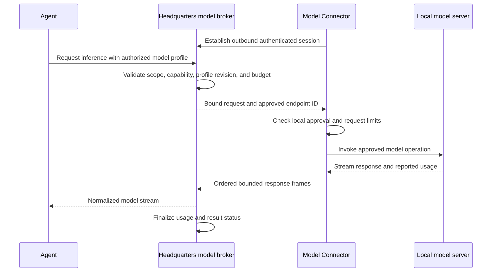
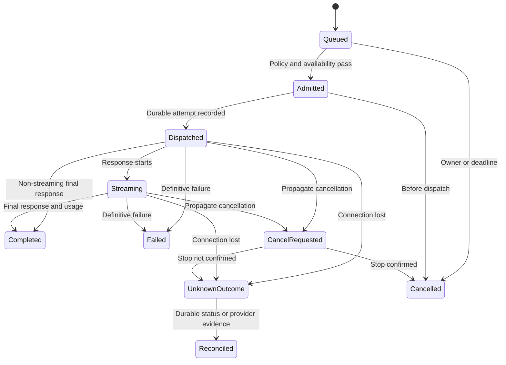

# Managed models, BYOK, and private model connectors

[Overview](README.md) · [Office connectivity](03-office-connectivity.md) · [Security](05-security-and-data.md)

**Status: Proposed connector and commercial routing.** Direct compatible-provider
connections already exist. A provider name in the enum is not proof that its native
API, every model capability, or the new connector route is implemented.

## Three ways to obtain inference

| Mode | Where requests go | Credential location | C-Sweet token bill |
|---|---|---|---|
| Managed | Approved provider API | Protected C-Sweet service secret | Metered published tariff |
| BYOK | Customer-selected supported provider API | Customer-scoped Headquarters secret | None; customer pays provider |
| Private model | Registered model connector, then approved endpoint | Endpoint secret stays on connector | None for customer-hosted inference |

Execution location is independent. A hosted Office can use a model running on the
customer's GPU workstation, and a customer Office can use a managed public model.

Current `OpenAiCompatibleLlmProviderFactory` creates a direct `ChatClient` against
`LlmProviderProfile.BaseUrl`. A value such as `http://localhost:1234/v1` refers to
the caller's machine, not the customer's remote PC. Making that profile reachable
requires the new connector transport, not merely another URL preset.

## Connector product boundary

The proposed **C-Sweet Model Connector** is a small, unprivileged service with:

- Independent enrollment and device identity; no need for an Office or Hyper-V.
- An outbound authenticated connection to Headquarters.
- A local configuration surface for specific endpoint registrations.
- Protected local storage for endpoint credentials.
- Streaming request execution, bounded buffers, cancellation, and diagnostics.

The Office installer can offer it as an optional component, but uninstalling or
revoking Office must not silently revoke a separately enrolled model connector.
Shared update packaging must preserve this independent lifecycle.

## What is being tunneled

The connection is an application relay for approved inference operations, not a
general TCP tunnel. Headquarters identifies an endpoint by its registered ID;
the connector resolves that ID to locally approved settings.



There is no inbound listener on the connector machine. The local model server may
listen on loopback. If it already runs on a LAN server, an owner may explicitly
approve that endpoint instead; this does not grant access to the rest of the LAN.

## Example configuration, not a final wire schema

Headquarters stores an approved logical reference:

```json
{
  "displayName": "Studio GPU - planning",
  "transport": "connector",
  "connectorId": "connector-studio-gpu",
  "endpointId": "endpoint-local-chat",
  "model": "customer-selected-model",
  "billingMode": "customerHosted",
  "maximumConcurrentRequests": 1
}
```

The connector stores local details separately:

```json
{
  "endpointId": "endpoint-local-chat",
  "baseUrl": "http://127.0.0.1:1234/v1",
  "allowedOperations": ["models.list", "chat.generate"],
  "credentialReference": "local-secret-reference",
  "configurationRevision": 3
}
```

These identifiers are readable placeholders. Production identities must be opaque
and validated. The examples deliberately contain no real secret and do not grant
Headquarters authority to replace the endpoint URL remotely.

Connection identity, protocol adapter, model capabilities, and billing mode are
separate dimensions. Avoid an enum whose every new combination needs another value.

## Operations and compatibility

Initially target approved OpenAI-compatible model endpoints. Define operations for
model listing, connection testing, chat generation, streaming, and embeddings;
enable only those actually supported by the endpoint and selected model.

Preserve the application `IChatClient` abstraction and existing response handling.
Add a transport boundary rather than creating a different agent programming model.
Native Anthropic and other non-compatible APIs need explicit adapters and tests;
they are not made compatible by relaying their HTTP traffic.

Capability probes must verify relevant behavior: streaming, tool calling,
structured output, context/output limits, embeddings, usage reporting, and
cancellation. A successful "hello" request is not enough for a development agent.
Record model/server configuration evidence and retest when it changes.

## Endpoint security and limits

Proposed initial behavior:

- Loopback endpoints by default. A LAN endpoint requires separate local approval
  of scheme, host, port, and base path. No LAN scanning or automatic discovery.
- Validate resolved addresses against the locally approved destination policy on
  every connection. Rebinding and redirects must not broaden the destination.
- Reject redirects by default, arbitrary absolute request URLs, CONNECT requests,
  proxy headers, administrative endpoints, and arbitrary path traversal.
- Use HTTP only for explicitly approved local/private endpoints; validate HTTPS
  server identity for TLS endpoints. Do not disable certificate validation globally.
- Use endpoint-local credentials, never cloud-supplied arbitrary authorization
  headers. Permit a bounded supported set of model options.
- Set explicit request/frame/buffer limits, concurrency, queue bounds, and
  deadlines before implementation. Exact numeric limits are open decision Q-06.

The proposed relay envelope includes customer/Headquarters identity, connector and
endpoint identity, request ID, session epoch, profile/endpoint revision, operation,
deadline, and authorized limits. Frames carry ordering and terminal state. This is
a contract requirement, not a final protobuf definition.

## Offline behavior and replay



Request deduplication prevents duplicate local dispatch for the same retained
request ID. It cannot force a model server to support recovery after a crash.
Record known/unknown outcomes honestly. After a request may have been dispatched,
do not automatically regenerate it on another endpoint just because a stream broke.

Reconcile and expose the uncertainty; an explicitly authorized new attempt has a
new identity and potentially new usage. Never concatenate a new generation onto a
partial old generation as if it were a continued response.

## Fallback policy example

"Use Studio GPU for planning. If it is offline before dispatch, allow the managed
standard model up to $5/day. Never move confidential project X to a public model."

That policy must be evaluated before the request, against current entitlements,
data rules, and budget. Without it, show **Waiting for Studio GPU**. A cheap model
is not an acceptable fallback if it lacks required capabilities.

## Accounting and privacy

Record inference attribution for all modes, but charge C-Sweet tokens only for
managed usage. Usage counts from a customer-controlled model are advisory; they
must not mint credits or alter trusted managed-provider settlements.

Streaming usage often contains cumulative totals. Settle one canonical result per
attempt rather than charging each update. Cached input and reasoning can be subsets;
follow the actual provider tariff instead of adding every field together.

Prompts and results traverse hosted Headquarters and may be retained there for
history, work evidence, and memory. Do not market the connection as end-to-end
encrypted against Headquarters or as a local-only data mode. A future direct path
would require a distinct threat model and accounting design.
