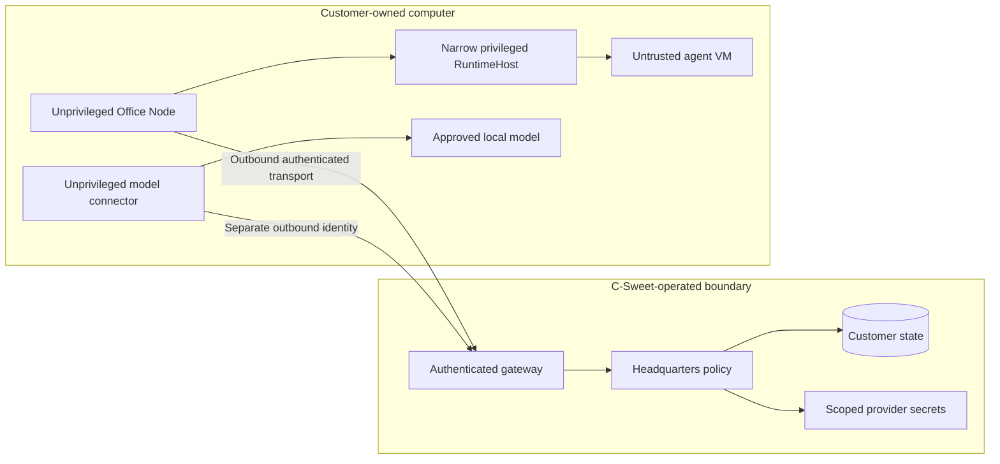

# Security, privacy, and operating boundaries

[Overview](README.md) · [Architecture](02-architecture-and-tenancy.md) · [Acceptance](10-acceptance-scenarios.md)

**Status: Proposed hosted controls, preserving existing Office invariants.** This
document describes requirements and risks; it does not assert an audit, certification,
legal compliance, or completed control implementation.

## Trust model

| Component / actor | Trusted for | Not trusted for |
|---|---|---|
| Customer owner | Approving staff, endpoints, spending, and device links within their account | Acting for another customer |
| Headquarters | Policy, authentication, durable company state, model routing | Treating incoming device data as authorization |
| Hosting control | Provisioning and subscription entitlement | Bypassing task/capability approval |
| Office Node | Authenticated transport and bounded lifecycle coordination | Granting itself execution authority |
| RuntimeHost | Narrow privileged lifecycle operations with independent verification | General remote administration |
| Agent guest / imported package | Requesting approved broker capabilities | Host filesystem, database, network, or provider-key access |
| Model connector | Reaching locally approved inference endpoints | General LAN access or Office execution |
| External model provider | Processing authorized inference under its service terms | Receiving data outside approved routing policy |
| C-Sweet operator | Maintaining the service under controlled procedures | Routine unrestricted browsing of customer content |

## Preserve the existing isolation floor

Imported agent code and repository-controlled builds require certified hardware
isolation. Docker is acceptable for trusted application infrastructure, not as a
substitute for the agent VM boundary. Local testing does not create an exception.

Preserve assignment signatures, workload identity, specification digests, replay
state, fencing epochs, capability checks, and guest-channel authentication.
The normative reference is the [Office security invariants](../../../../CSweet.Office/docs/20-security/11-security-invariants.md).

Customer-owned or mixed-use computers must be labeled accurately. A VM boundary
does not protect the customer from the host administrator, firmware, or host
hypervisor compromise. Do not advertise a personal PC as a dedicated hardened host.

## Device enrollment is not a general tunnel grant

An Office enrollment permits its Office protocol and approved workload operations.
A model connector enrollment permits approved inference endpoints. Neither grants
browser access to localhost administration panels, file shares, cloud metadata,
SSH, RDP, or arbitrary LAN ports.

For a private model, explicitly approved loopback/LAN access is necessary. Scope
that exception to the registered endpoint; do not weaken the public-internet
destination policy for agent guests. Model endpoint approval is checked both at
Headquarters and locally, so a mistaken cloud profile cannot silently broaden it.

## Data inventory

| Data | Proposed location | Access / handling |
|---|---|---|
| Conversations, task history, approvals | Headquarters database | Customer roles; audited operator access |
| Source repositories and authored artifacts | Customer-scoped persistent storage | Scoped broker operations; protected backups |
| BYOK public-provider credentials | Protected Headquarters secret store | Model service only; never guest or diagnostic text |
| Managed-provider credentials | Protected C-Sweet secret store | Service identity; per-customer budgets and attribution |
| Local model credentials | Connector machine's protected store | Connector process; do not upload by default |
| Office/connector private keys | Device-protected identity storage | Relevant service identity; no cloning across devices |
| Headquarters assignment/application keys | Protected deployment storage | Backup/restore with explicit trust handling |
| Metering and billing receipts | Durable billing records | Content-minimized; customer attribution and reconciliation |
| Prompts and results | Transit through Headquarters; retention by policy | Not excluded merely because the model is local |

The current file-based LLM secret store serializes a JSON dictionary. Its interface
is useful, but it is not evidence of encrypted managed-hosting storage. Hosted
deployment needs protected secret storage, rotation, and backup access controls.

## Threat examples and expected controls

| Attempt / incident | Expected control |
|---|---|
| Customer A submits Customer B's connector ID | Server-derived tenant binding and connector authorization reject it |
| A model response includes a request to contact a router admin URL | Agent output remains data; connector operation/destination policy blocks arbitrary forwarding |
| DNS for an approved endpoint changes | Revalidate actual destination against local policy; reject unexpected addresses |
| A stale device session sends completion after revocation | Verify current authority and exact attempt; do not grant new work |
| Owner clicks a forged link containing enrollment data | One-use short-lived credentials, explicit local/owner confirmation, no reusable URL secrets |
| First public visitor races the new customer owner | Hosted bootstrap binds owner before public routing; open first-user claiming disabled |
| Operator restores a backup into another customer's deployment | Restore validates customer identity, storage scopes, and key ownership |
| Billing webhooks arrive out of order | Durable idempotent processing; current subscription state governs entitlements |
| Payment fails while tasks run | Defined grace/drain policy; no abrupt destructive deletion |
| Network disappears after model dispatch | Unknown outcome retained; no fabricated usage or silent paid replay |

## Access and certificate management

Enforce app authentication independently of Tailscale membership. Restrict customer
and operator privileges separately, require strong administrator authentication,
and audit sensitive actions. Review exact MFA/support-access requirements before
the paid pilot; they are not automatically supplied by choosing AWS.

Keep TLS hostname verification and mutual authentication. Certificate expiry,
revocation, leaf certificate renewal, and durable assignment-key rotation are
different events. Existing Office leaf pinning behavior needs a tested renewal
procedure; replacing a certificate must not require disabling validation or
silently accepting a different Headquarters signing key.

Public ingress must not accept customer-crafted certificate identity headers.
Private-key and enrollment material must not appear in URL query strings,
telemetry, normal exports, screenshots, or support bundles.

## Retention, cancellation, and deletion

Before launch, choose explicit periods for operational logs, content history,
backups, cancelled-customer retention, and billing records (Q-04). Explain which
exports contain source/content and which contain protected configuration.

Cancellation should stop new chargeable admission according to the documented
subscription policy, allow a controlled drain, and offer data export. Deletion
must cover active data and a disclosed backup-expiration schedule. Legal and tax
retention requirements need review for the actual business/jurisdictions; this
proposal does not invent them.

## Geographic claims

"US-hosted Headquarters" describes application/data placement, not necessarily
where a public model provider processes requests. Regional inference options,
cross-region fallback, and provider retention settings need independent controls.
An EU budget host changes data placement and requires an explicit offering choice.

## What must not be claimed yet

- That the new model connector exists or has passed security testing.
- That any AWS/OVH/Hetzner instance is Office-certified because it supports virtualization.
- That local inference means prompts never leave the customer's computer.
- That application containers alone isolate untrusted agent code.
- That restoring a database alone recovers Git state, protected keys, or device trust.
- That the owned test PC provides a commercial availability SLA.
