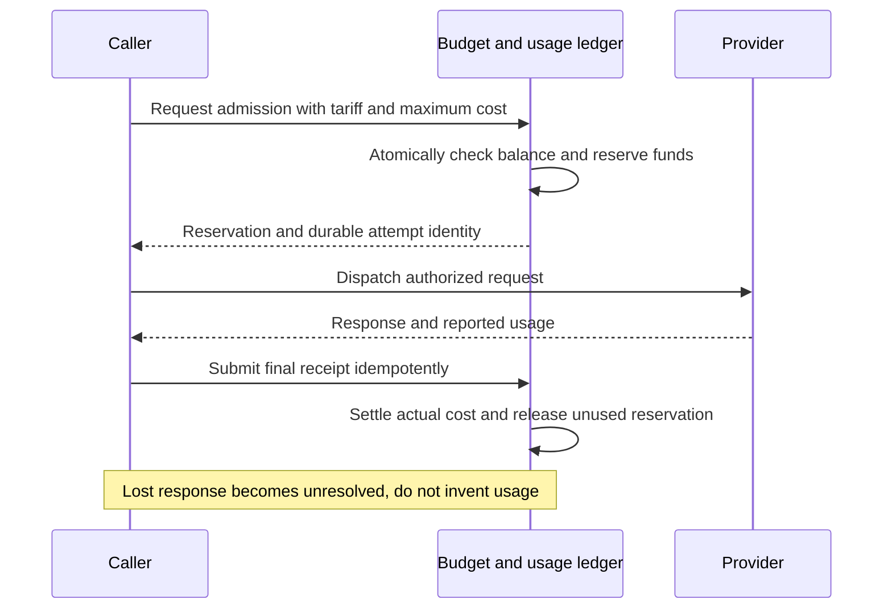

# Pricing, metering, and unit economics

[Overview](README.md) · [Journeys](01-product-and-journeys.md) · [Hosting](08-hosting-and-migration.md) · [Decisions](09-decisions-and-questions.md)

**Status: Commercial model agreed; prices and allowances are proposals.** All
amounts are USD unless stated otherwise. Research date: **2026-10-15**. Rounded
examples are explanatory; invoices need deterministic decimal arithmetic and a
versioned rate card. These scenarios are not supplier quotes or demand forecasts.

## What customers pay for

```text
Monthly C-Sweet bill = Headquarters subscription
                    + linked customer-owned Office subscriptions
                    + hosted Office subscriptions
                    + distinct agents active in this billing period
                    + settled managed inference
                    + approved hosted capacity overage
                    - explicit credits
                    + applicable tax
```

Customer-owned hardware and BYOK remove the relevant C-Sweet compute/provider
purchase, not the costs of Headquarters, relay traffic, storage, operations, or
support. Do not charge hosted execution hours for work on the customer's machine.

## Proposed price card

| Item | Monthly price | Proposed inclusion / rule |
|---|---:|---|
| Standard Headquarters | $99 | Always-available application; 25 GB customer data; two model connectors |
| Business Headquarters | $199 | Larger allocation; 100 GB customer data; ten model connectors; priority support |
| Customer-owned Office | $9 each | Connection, management, diagnostics, and bounded relay service |
| Standard hosted Office | $69 each | 100 active Office-hours; up to two concurrent workloads within resource limits |
| Team hosted Office | $249 each | 300 active Office-hours; up to four concurrent workloads within resource limits |
| Active agent | $10 each | Full month if employee performs customer work during the billing period |
| Standard / Team hosted overage | $0.60 / $1.20 per hour | Owner-authorized limit required |
| Managed inference | Supplier rate × 1.30 | Versioned tariff; input/output/cache/tool distinctions retained |
| BYOK / private inference | $0 in C-Sweet token fees | Provider or customer hardware costs paid outside C-Sweet |

Storage, traffic, and connector quotas are bounded. Exact traffic and request
limits remain Q-06. Do not launch a plan labeled unlimited, or silently add an
unreviewed relay/storage overage charge. Additional private model connections do
not automatically create Office subscriptions.

These figures are candidates for review, not individually accepted prices. The
user selected a smaller customer-owned Office fee, not specifically $9.

## Four worked customer bills

### A. Own PC and BYOK

One Standard Headquarters, one linked PC, and three agents that worked:

`99 + 9 + (3 × 10) = $138`

C-Sweet token charge: $0. A provider invoice is additional and paid directly by the
customer. A $0 C-Sweet token line is not a claim of free inference.

### B. Own PC and separate local-model computer

The same setup plus one included model connector:

`99 + 9 + (3 × 10) = $138`

No extra Office fee applies merely because the model connector runs on another
machine. Local power, GPU, maintenance, and model-license costs remain the customer's.

### C. Fully hosted, moderate inference

One Standard Headquarters, one Standard hosted Office within 100 active hours,
three active agents, and a hypothetical model tariff of $2/million input tokens
and $10/million output tokens. With 10 million uncached input and 2 million output:

```text
Supplier inference cost = (10 × $2) + (2 × $10) = $40
C-Sweet inference charge = $40 × 1.30 = $52
Customer bill = $99 + $69 + $30 + $52 = $250
```

The $2/$10 rate is an illustrative base-rate scenario. It is not a prediction of
tokens per task, and it excludes cache, long-context, regional, media, and tool
surcharges. Actual billing uses the selected provider/model tariff.

### D. Mixed studio, heavier execution

One Standard Headquarters, two customer-owned Offices, one Standard hosted Office,
eight active agents, 140 hosted Office-hours, and the same $52 managed inference:

```text
Base = $99 + (2 × $9) + $69 + (8 × $10) = $266
Hosted overage = max(140 - 100, 0) × $0.60 = $24
Total = $266 + $24 + $52 = $342
```

If the owner did not authorize overage, new admission pauses at the included limit
subject to the explicitly designed reservation/drain behavior; it does not silently
incur the extra $24. Local Office activity adds no hosted hours.

## What constitutes billable activity

**Agent:** the agreed principle is full monthly billing once an employee works.
Proposed trigger: first admitted customer-work execution, deduplicated by customer,
employee identity, and billing period. Package upgrades, retries, and moving the
employee between Offices preserve that identity. Whether a pre-execution failure
counts, and how automatic background work activates a seat, must be resolved in
Q-03 before a production invoice is generated.

An owner-approved staffing budget must cover automated hiring/activation. Creating
many unused employee records should not create fees; routine package maintenance
must not masquerade as chargeable customer work. A Personal Assistant or Chief
that actually works is not automatically exempt from the proposed seat model.

**Customer-owned Office:** proposed subscription applies while linked, including
offline periods. Unlinking stops future billing. Proration and period-end treatment
need Q-03; temporary network loss must not destroy enrollment.

**Hosted Office:** active hours are the union of intervals in which that Office
retains active customer workloads, not the sum of concurrent workload durations.
Example: two simultaneous 30-minute workloads consume 0.5 Office-hours. Two
sequential 30-minute workloads consume 1 Office-hour. Different Offices accumulate
separately. Work waiting on a model counts while it retains workload capacity.

Cold starts, idle shutdown grace, and infrastructure repair are proposed as
C-Sweet-funded overhead. The proposed entry-Office idle grace is ten minutes
(P-11), subject to measured restart cost and latency. Builds and tests use the same capacity pool; first-party
package rollout overhead needs explicit treatment in Q-03. Never advertise a
workload count without a corresponding CPU/memory/resource envelope.

**Inference:** meter each provider attempt, including an authorized formatting
repair or retry. Settle cumulative streaming counters once; cached input and
reasoning subsets must not be added again as independent tokens. Retain usage
coverage and uncertainty rather than converting unknown usage into zero.

## Budget admission and financial integrity



Managed inference should begin with prepaid balance and optional capped automatic
replenishment. Reservations across concurrent agents must prevent each agent from
spending the same remaining funds. The receipt binds the exact tariff version,
provider/model, payer, customer, agent/work attribution, and attempt.

Provider invoice reconciliation catches unreported or inconsistent usage. A
customer-supplied model's token counts are analytics, not evidence for managed
provider charges or credits. Correct invoices through explicit adjustments, not
silent edits to settled receipts. Payment webhooks need idempotency, ordering
recovery, and authoritative subscription reads.

## Markup is not gross margin

For a $40 supplier cost and $52 sale, markup is 30%, but model-only margin is:

`($52 - $40) / $52 = 23.08%`

That margin is before payment fees, failed/unreconciled calls, relay, support,
refunds, or tax handling. High token revenue can reduce the blended percentage
margin even while adding positive dollars. Do not promise a 30% inference margin.

## Stage 1: owned-PC development cost

| Item | Treatment |
|---|---|
| Server rental | $0 incremental rental using the owned machine |
| Electricity | Measure average incremental watts; do not assume the PC costs nothing |
| Backup | Use a destination off the PC; price chosen capacity and retention separately |
| Managed model tests | Proposed $50/month internal cap; scripted responses for routine tests |
| Tailscale / internet | Existing service costs or additional seats; verify applicable plan |
| Public connectivity test | Temporary gateway allocation later; not required for every coding session |
| Labor / hardware wear | Track separately; excluded from a claim about rental alone |

Power example with hypothetical inputs: 80 W average incremental draw × 24 hours
× 30 days / 1000 × $0.20/kWh = **$11.52/month**. This is not a measured power figure
or the user's electricity tariff. Initial capital cost is already incurred, but
commercial pricing should eventually account for depreciation/replacement.

## Stage 2: low-cost hosted pilot allowance

With primarily customer-owned Offices, the first rented host only needs to run
trusted Headquarters and connectivity services. It does not need local KVM access
unless C-Sweet also runs hosted Office workloads there.

Illustrative planning envelope, not a quote:

| Monthly item | Low allowance | High allowance |
|---|---:|---:|
| Trusted app/database server | $30 | $100 |
| Separate backup storage | $10 | $30 |
| Monitoring, mail, ingress, and other overhead | $10 | $30 |
| Total, before staffing and inference | **$50** | **$160** |

If hosted Office capacity is offered, add an independently certified execution
host and its storage/network costs. Do not claim that the above total includes
unlimited tenants, dedicated customer hardware, or high availability.

OVHcloud's US offers page advertised SYS-1 from $30/month when reviewed. This is a
candidate starting point only: configuration, region, stock, setup fees, renewal
terms, and certification remain unverified. [Offer source](https://us.ovhcloud.com/deals/)

At a hypothetical $100 fixed infrastructure bill and ten BYO customers paying
$138, revenue is $1,380. Subtract $200 modeled support and $52.68 payment fees:
contribution is **$1,027.32** before other variable costs and overhead. This is an
arithmetic illustration, not proof that a $100 server can serve ten customers.

## Stage 3: AWS reference economics

Retain an AWS comparison so cheap pilot hosting does not hide migration cost.
Assume 730 hours/month and one Linux/x86 Fargate allocation of 1 vCPU + 4 GiB per
Headquarters. AWS's published Northern Virginia example gives $0.000011244 per
vCPU-second and $0.000001235 per GB-second:

`730 × 3600 × (0.000011244 + 4 × 0.000001235) = $42.531552/month`

This is app compute only, not a complete deployment quote. [Fargate pricing](https://aws.amazon.com/fargate/pricing/)

Other model inputs:

| Input | Assumption, not benchmark/quote |
|---|---|
| Shared infrastructure | $450/month at 10–25 customers; $1,000 at 100 |
| Customer storage/backups | $10/customer/month |
| BYO Office connection/relay allowance | $5/customer/month in the one-Office scenario |
| Hosted Office capacity allowance | $25/customer/month for 100 active hours; replaces the BYO allowance |
| Support | $20/customer/month: 15 minutes at $80/hour |
| Payment + subscription processing | 3.6% of revenue + $0.30 per monthly payment |
| Model revenue/costs | Excluded from table; compare base subscription economics |

Shared infrastructure must cover database capacity, gateway/ingress, network
charges, control service, monitoring, secrets, and backup overhead without double
counting the per-customer allowances. Build a SKU-level bill of materials before
buying infrastructure. The $25 hosted allowance is not a verified EC2 quote.

The Headquarters allocation is an aggregate sizing hypothesis for its application
services. It does not establish that every required service fits in one task, or
that separately deployed tasks cost the same. Measure the packaged topology and
sum actual task allocations before using this figure as a deployment budget.

Hosted billing hours also differ from supplier rental hours. A customer may use
100 active hours while an allocated host or independently installed Office VM
costs C-Sweet money all month. Sleeping only saves rental if the underlying paid
capacity can actually stop or serve other eligible demand. The current
machine-wide Office installation does not establish a shared multi-customer
execution pool. Model independent certified installations, host memory/CPU,
peak concurrency, idle capacity, disks, and startup overhead before accepting the
$25 allowance or selling the proposed hosted concurrency. If measured cost is
higher, revise the hosted price or capacity inclusion; keep the BYO offer separate.

The payment assumption combines 2.9% + $0.30 domestic card processing and 0.7%
Stripe Billing. Separate top-ups, foreign cards, taxes, FX, disputes, and different
payment methods change it. [Payments](https://stripe.com/pricing) · [Billing](https://stripe.com/billing/pricing)

| Customers | Configuration per customer | Revenue | Infrastructure | Support | Payment fees | Contribution | Contribution margin |
|---:|---|---:|---:|---:|---:|---:|---:|
| 10 | $138 BYO example | $1,380.00 | $1,025.32 | $200.00 | $52.68 | $102.00 | 7.4% |
| 25 | $138 BYO example | $3,450.00 | $1,888.29 | $500.00 | $131.70 | $930.01 | 27.0% |
| 100 | $138 BYO example | $13,800.00 | $6,753.16 | $2,000.00 | $526.80 | $4,520.04 | 32.8% |
| 10 | $198 hosted example | $1,980.00 | $1,225.32 | $200.00 | $74.28 | $480.40 | 24.3% |
| 25 | $198 hosted example | $4,950.00 | $2,388.29 | $500.00 | $185.70 | $1,876.01 | 37.9% |
| 100 | $198 hosted example | $19,800.00 | $8,753.16 | $2,000.00 | $742.80 | $8,304.04 | 41.9% |

```text
Infrastructure = shared fixed cost + N × (HQ compute + storage + Office allowance)
Fees = 0.036 × revenue + 0.30 × number of monthly payments
Contribution = revenue - infrastructure - support - fees
Contribution margin = contribution / revenue
```

This is contribution before engineering, sales, general administration, taxes,
and contingency, not company profit. Budget an additional 20% infrastructure
reserve separately; if spent, subtract it from contribution. At ten BYO customers,
that reserve alone exceeds the modeled $102 contribution.

## Sensitivity and pricing review gates

| What changes? | Consequence |
|---|---|
| HQ requires 2 vCPU + 8 GiB rather than the assumed allocation | About $42.53 extra per customer; ten-customer BYO contribution becomes negative |
| Support takes one hour instead of 15 minutes | $60 additional cost per customer under the labor assumption |
| Customer activates more agents | More seat revenue, but measure corresponding support, storage, and work overhead |
| Customers run private models with large contexts/media | No token revenue; relay bandwidth and memory pressure may increase |
| Hosted Office spends many hours waiting for inference | Capacity cost persists; verify billable-hour semantics and idle overhead |
| Users sleep local PCs frequently | Lower customer compute availability; potentially higher connection support demand |
| One bare-metal host fills | Capacity cost rises in steps; per-customer averages cannot be extrapolated indefinitely |

As an illustration, $138 revenue less $57.53 variable infrastructure, $20 support,
and $5.27 payment cost leaves approximately $55.20 before shared fixed cost. A $450
shared bill therefore needs roughly nine such customers to cover this limited
cost model. It does not cover engineering or prove usable host capacity.

Before publishing prices, measure idle Headquarters RAM, peak working set, database
connections, relay bytes, hosted active/idle time, support time, provider usage
coverage, and successful task outcomes. Review the 50th, 90th, and high-usage
customer cases, not only a favorable average. Preserve the entry-price goal while
adjusting unvalidated inclusions or deployment density explicitly.
