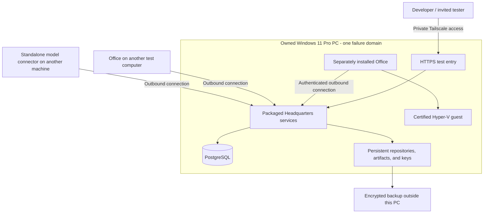

# Development and validation on the owned Windows PC

[Overview](README.md) · [Acceptance](10-acceptance-scenarios.md) · [Migration](08-hosting-and-migration.md)

**Status: Proposed first deployment.** The remote PC has not been inspected or
modified as part of this documentation work.

## Known hardware and unknowns

The owner reports **Windows 11 Pro, 32 GB RAM, approximately 2 TB SSD**, already
on the network and connected through Tailscale. CPU model, available cores, free
disk space, firmware virtualization, current workloads, power policy, and installed
Hyper-V state are not yet verified.

Windows 11 Pro is compatible with the Windows Hyper-V path, subject to hardware
requirements. [Microsoft installation requirements](https://learn.microsoft.com/en-us/windows-server/virtualization/hyper-v/get-started/Install-Hyper-V)

Do not turn a reported 2 TB drive into a 2 TB free-storage assumption. Do not install
large model weights or assume the PC has a suitable GPU merely because it has 32 GB RAM.

## Purpose of this environment

Use the machine as a real deployment target, separate from a developer's IDE. It
should prove packaged startup, persistence, enrollment, lifecycle, metering, and
recovery while avoiding cloud rental. It is a private validation environment,
not the initial promise of a public production service.

The same-host Office is useful for initial smoke tests. A separate Office computer
is necessary to exercise the intended remote-customer behavior. Private model
tests can use a scripted endpoint before introducing a real model server.

## Initial sizing proposal

| Allocation | Initial allowance |
|---|---:|
| Windows and operating headroom | 8 GB |
| Headquarters, PostgreSQL, and hosting control | 8 GB |
| Office workload capacity | 8 GB |
| Unallocated reserve | 8 GB |

Start at one concurrent workload and measured resource limits. The table is not
proof that every project build fits. A builder may need at least 4 GB, while a
larger toolchain can require more. Keep reserve for host overhead and upgrades.

Running inference on this same PC is optional and competes for that budget. If
memory or CPU pressure is high, move execution to a separate customer-style test
Office or use scripted inference rather than oversubscribing the server.

## Deployment shape

Use the existing Windows distribution as the packaging foundation. Add the
missing configuration and service-management layer; do not depend on an open
AppHost terminal for the installed test environment.

The deployment must configure:

- PostgreSQL, restricted database identities, migration ordering, and health checks.
- API, AgentHost, WorkerHost, ExecutionGateway, GitHost, source provisioner, and web entry.
- Protected service identities, secrets, persistent application keys, and data paths.
- Automatic service startup/restart and bounded logs.
- Explicit release version, immutable binaries, upgrade/drain, and rollback handling.
- A separately installed and enrolled Office package with matching certification.

Native PostgreSQL is a candidate for unattended Windows operation; Docker-backed
PostgreSQL remains a development option. Final database service packaging is Q-10.
Neither choice changes the Office hardware-isolation requirement.

## Private access and HTTPS

Use Tailscale for operator and invited-tester access. Tailscale Serve can publish
the web application privately with HTTPS; its access rules still apply. Do not
enable public Funnel simply to make a private test easier. [Serve documentation](https://tailscale.com/docs/features/tailscale-serve)

Office's gateway keeps its own end-to-end TLS/client-certificate handling. A normal
browser reverse proxy must not strip the certificate evidence the gateway expects.
Restrict the direct gateway listener to the intended test-network access.

If certificates are exported to files, automate installation and renewal. Tailscale
does not automatically install renewed copies of manually exported certificates
into application services. Test leaf renewal alongside Office pinning/recovery;
do not disable identity checks to work around renewal. [HTTPS documentation](https://tailscale.com/docs/how-to/set-up-https-certificates)

Keep normal application login and customer authorization. Access to the tailnet
does not make a tester a Headquarters owner.

## Validation sequence

| Stage | What to establish | Evidence to retain |
|---|---|---|
| V0: preflight | CPU, memory, free disk, Hyper-V, Tailscale, existing services | Sanitized inventory and resource budget |
| V1: one tenant | Installed startup, migration, owner bootstrap, persistence | Clean startup and reboot report |
| V2: own Office | Enrollment, certification, real bounded workload | Device identity, attempt, and result evidence |
| V3: models | Scripted/private connector, BYOK, managed test mode | Capability results, usage coverage, routing proof |
| V4: commercial flows | Provisioning retries, test subscription, seats, limits | Deterministic ledger and invoice examples |
| V5: recovery | Power/service interruption, Office loss, restore | Recovery timestamps and integrity checks |
| V6: tenant boundaries | Two isolated Headquarters and wrong-tenant requests | Negative authorization tests and resource separation |
| V7: public connectivity | Office/connector outside network without Tailscale | NAT, TLS, stream, reconnect, and revocation evidence |

The same physical machine's Office installation is bound to one Headquarters.
To test another complete tenant, use a separate machine or an independently
installed/certified test VM, or deliberately re-enroll a disposable test installation
sequentially. Do not copy identity directories or pretend two configuration files
are two isolated Offices.

Nested virtualization may permit independent Office test VMs, but the CPU/provider
must support it and Office must pass real certification inside that topology. It
is not an assumed capability of this PC. [Microsoft nested virtualization guidance](https://learn.microsoft.com/en-us/windows-server/virtualization/hyper-v/enable-nested-virtualization)

## Public test without exposing the home server

V7 needs a publicly reachable staging gateway and a test client on another network.
The customer side must use ordinary outbound connectivity, with no Tailscale peer
or inbound port forwarding. The operator-side connection to the owned Headquarters
can remain private.

Choose the public ingress/backhaul deployment in Q-08 after verifying HTTP/2,
client certificate preservation, and stream timeouts. A temporary public relay
with a restricted authenticated backhaul is one candidate; a full small hosted
staging Headquarters is another. Do not claim either works until tested.

## Cost controls and operating practice

- Routine tests use scripted model responses and Stripe test mode.
- Real-provider runs are explicitly selected and attributed to the test budget.
- Proposed initial managed-model cap: $50/month, with bounded concurrent admission.
- Use disposable sample data and separate test credentials.
- Keep an encrypted backup off the PC; a second folder or same-disk VM snapshot is
  not protection against disk failure or loss of the computer.
- Arrange deliberate power/reboot behavior; warn testers about maintenance.
- Measure CPU, memory, disk growth, cold starts, network bytes, and recovery time.

The test environment must fail closed if isolation is unavailable. "Testing" does
not justify running untrusted packages in an ordinary process. Existing vulnerable
development-posture exceptions are not the default deployment for this feature.

## Exit criteria

The owned-server stage succeeds when an invited user can provision a test customer,
link an Office, choose a model route, complete bounded work, inspect accurate usage,
and recover from a service/device interruption without losing identity or duplicating
charges. Multi-tenant and public-network claims require their separate V6/V7 evidence.

Capacity, public availability, and commercial recovery targets remain unproven
until measured in the actual launch environment.
