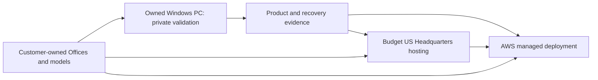
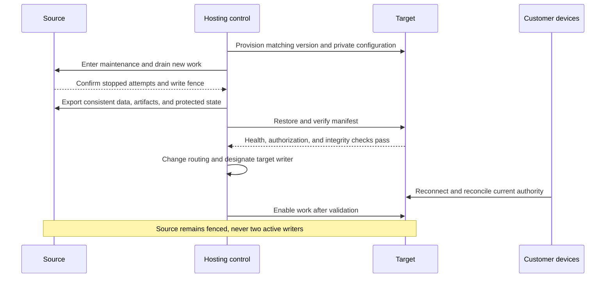

# Hosting choices and migration

[Overview](README.md) · [Economics](06-pricing-and-economics.md) · [Owned server](07-owned-server-validation.md)

**Status: Staged hosting strategy; no hosting purchase or cloud certification.**

## Start with what needs hosting

The customer-owned Office configuration materially changes infrastructure needs.
Headquarters needs ordinary trusted application/database hosting. Office requires
hardware virtualization only on the computer executing agent workloads.

Therefore, a budget VPS without nested virtualization can still host Headquarters
for customers who bring their own Offices. It cannot also host a Linux Office
requiring `/dev/kvm`. Do not reject inexpensive Headquarters hosting based on an
execution requirement that is satisfied on the customer's machine.

The intermediate budget host is optional. Migrate because capacity, operations,
availability, or customer requirements justify it, rather than on a fixed date.

## Candidate platforms

| Option | Headquarters | Hosted Office | Tradeoff / current decision |
|---|---|---|---|
| Owned Windows PC | Native packaged services and PostgreSQL | Native Hyper-V | First validation target; one failure domain |
| Budget US VPS | Suitable if measured app/database resources fit | Only if required virtualization is explicitly supported and certified | Low-cost candidate for BYO-first pilot |
| OVHcloud US bare metal | Self-managed Linux/Windows stack | Candidate hardware host, subject to certification | Research candidate; current deals are not guaranteed availability |
| Hetzner Cloud | Candidate trusted app hosting | Cloud FAQ says nested virtualization is unavailable | Do not confuse dedicated vCPU with bare metal |
| Hetzner dedicated | Candidate self-managed stack | Candidate KVM host | EU dedicated offers change residency assumptions |
| AWS | ECS application services, RDS, protected storage/secrets | Supported nested-virtualization EC2 or bare metal, subject to certification | Preferred managed-cloud candidate after validation |
| Azure / Google Cloud | Credible managed alternatives | Selected virtualization-capable families, subject to certification | Keep application portable; defer deployment adapters |

Sources: [OVH US offers](https://us.ovhcloud.com/deals/), [Hetzner Cloud restriction](https://docs.hetzner.com/cloud/servers/faq/),
[AWS nested virtualization](https://docs.aws.amazon.com/AWSEC2/latest/UserGuide/amazon-ec2-nested-virtualization.html),
[Azure Dsv6](https://learn.microsoft.com/en-us/azure/virtual-machines/sizes/general-purpose/dsv6-series),
[Google nested virtualization](https://docs.cloud.google.com/compute/docs/instances/nested-virtualization/overview).

## What to compare before purchase

Use a dated bill of materials rather than headline server price. Include actual
region and stock; CPU/memory/storage; setup fees and renewal terms; bandwidth and
egress; public IPv4; backups; database operations; monitoring; certificate/signing
requirements; OS and hypervisor support; and operator time.

The initial preference is US hosting. European dedicated pricing is an alternative
only after explicitly revisiting geography. No cloud credit, promotional allowance,
or unverified discount is required to make the base cost model work.

A self-managed host shifts database patching, disk alerts, replacement, restore,
and security updates onto C-Sweet. Low rental cost is not low operating labor.
Measure that labor in the pilot, particularly for private-device support.

## AWS destination shape

Proposed destination components:

- ECS/Fargate for trusted per-customer Headquarters deployments and shared account services.
- RDS PostgreSQL with isolated customer databases/roles and a separately sized control database.
- S3-compatible artifact storage, protected mutable repository storage, and tested backups.
- Managed secret/key services, restricted service identities, monitoring, and audited operations.
- A gateway deployment that preserves Office/connector identity and long-lived streams.
- EC2 execution instances only for customers who rent hosted Offices.

AWS supports KVM/Hyper-V nested virtualization on selected instance families, but
that establishes only a platform prerequisite. Certify the actual Office image,
kernel, host type, networking controls, and supported workload profiles. Do not
assume Windows/Hyper-V evidence certifies Linux/Firecracker or public egress there.

## Portability boundaries

| Keep stable | Allow adapter-specific implementation |
|---|---|
| Customer, Headquarters, Office, connector, and employee identities | Host instance, VM, task, service, and disk identifiers |
| Work and capability authorization | OS service manager and cloud resource API |
| Model routing and billing semantics | Secret-store and ingress integration |
| PostgreSQL schema and migration history | Database deployment/backup mechanics |
| Artifact metadata, digests, ownership | Object/file storage provider |
| Deployment operation lifecycle and idempotency | Infrastructure-as-code resources and commands |

Do not start by building a generic multi-cloud orchestration platform. Implement
the owned-server adapter and a portable desired-state description; add the next
provider only when a real deployment needs it. Product code should not know EC2
resource IDs, Windows drive letters, or a hosting vendor's billing SKU.

## Migration contents

An export/restore operation includes more than the main database:

- Tenant data, user mappings, schema version, durable work, subscriptions/usage attribution.
- Repository refs and objects, mutable source state, immutable artifacts, and metadata.
- Application data-protection keys and Headquarters signing/trust material, protected appropriately.
- Model configuration with secret references remapped through a protected secret transfer.
- Deployment settings, endpoint mapping, gateway compatibility, and data-integrity manifest.

Device private keys normally stay on customer devices. Preserve the same logical
Headquarters identity and supported trust material when moving that Headquarters.
If trust must change, use an explicit supported transition/re-enrollment; never
silently accept a new signer. Replacement hosted Offices get their own enrollments.

## Migration sequence

Use a versioned, checksummed export with an explicit consistency boundary. If the
database snapshot and repository snapshot are taken at different logical points,
references can disagree. Drain/fence and validate artifact/repository digests.

DNS alone is not a write fence: stale clients and long-lived streams can continue
to reach the old service. Explicitly invalidate old execution authority and disable
old writers as part of cutover.

## Rollback rules

Before the target accepts writes, rollback can restore routing to the verified
source after resolving device/session state. After target writes begin, moving
back requires reconciliation or transfer of those writes; a DNS reversal can lose
work or duplicate charges. Preserve both backups and the exact cutover ledger.

The pilot can use a planned maintenance window. Zero-downtime migration, active-active
Headquarters, and automatic cross-cloud failover are outside the first proposal.

## Triggers to leave the owned PC or budget host

- Public testers need availability that the home network/power cannot provide.
- Measured capacity repeatedly approaches safe memory, CPU, or storage limits.
- Customer requirements need managed recovery, region controls, or stronger operational assurance.
- Operator time and incident risk outweigh the rental savings.
- Revenue supports the full target cost, including support and contingency.

Before a paid launch, set explicit recovery objectives, verify an actual restore,
and state the service's real availability commitments. A cloud logo does not
establish C-Sweet security, compliance, or an application SLA.
