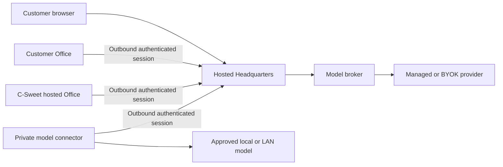

# C-Sweet hosted platform and hybrid Offices

**Status: Draft for review.** Last updated: **2026-10-15**.

This is a product and architecture proposal, not a claim of production readiness.
The current repository has useful foundations, particularly Office enrollment,
outbound connections, hardware isolation, and inference telemetry. Hosted account
management, commercial billing, and private-model connectivity still need work.

## The idea

A customer pays C-Sweet to keep Headquarters available, then chooses where the
work and inference happen. They can connect their own computers as Offices,
rent hosted Offices, bring provider API keys, connect a private model server, or
buy managed inference. These choices are independent.

The likely entry configuration is **hosted Headquarters + a customer-owned Office
+ customer API keys**. Customers should not have to expose ports or operate a VPN
to connect their machines to hosted Headquarters.

Arrows labeled **outbound session** show which side opens the network connection.
Once established, the session carries authorized requests and responses in both
directions. Headquarters does not need to dial into the customer's home network.

## What has been agreed

- `www.c-sweet.com` is the public entry point for the eventual hosted service.
- Customers receive separate Headquarters instances and can connect multiple Offices.
- Shared physical hosting is acceptable with appropriate customer isolation.
- Offer customer-owned and hosted Offices, managed inference, BYOK, and private models.
- The private-model connector must also work without installing an Office runtime.
- Charge a Headquarters subscription, an Office fee, active-agent fees, and managed
  inference usage. Customer-owned Offices carry a smaller connection/management fee.
- Charge an agent's full monthly fee if it works during that billing period.
- Hosted Office plans may include hours and opt-in overage; an entry Office may sleep.
- Start development on an owned Windows 11 Pro PC with 32 GB RAM, approximately 2 TB
  SSD, and Tailscale connectivity. Avoid recurring cloud rental during early work.
- Keep a migration path to affordable hosting and later US managed cloud, with AWS
  the current candidate rather than an already purchased or certified deployment.

Exact prices, included quotas, recovery targets, and detailed billing policies
remain proposals. See the [decision register](09-decisions-and-questions.md).

## Read by question

| Your question | Document |
|---|---|
| What would a customer buy and experience? | [01 — Product and customer journeys](01-product-and-journeys.md) |
| What runs where, and what separates customers? | [02 — Architecture and tenancy](02-architecture-and-tenancy.md) |
| How can an Office connect without opening ports? | [03 — Office connectivity](03-office-connectivity.md) |
| How do local models, BYOK, and managed models coexist? | [04 — Model connectivity](04-model-connectivity.md) |
| Who can access data, keys, and customer computers? | [05 — Security and data boundaries](05-security-and-data.md) |
| What do we charge, and what does it cost us? | [06 — Pricing and unit economics](06-pricing-and-economics.md) |
| What can we build and validate on the owned PC? | [07 — Owned-server validation](07-owned-server-validation.md) |
| How do we choose hosting and move later? | [08 — Hosting and migration](08-hosting-and-migration.md) |
| Which choices are settled, proposed, or unresolved? | [09 — Decisions and questions](09-decisions-and-questions.md) |
| What evidence would make the feature ready? | [10 — Acceptance scenarios](10-acceptance-scenarios.md) |
| Which statements come from code or external sources? | [11 — Evidence and source map](11-evidence-and-sources.md) |

For a product review, read **01 → 06 → 09**. For a technical review, read
**02 → 03 → 04 → 05 → 10**. For development and operating cost, read **07 → 08 → 06**.

## Illustrative customer bill

A proposed Standard Headquarters is $99/month. A linked customer-owned Office is
$9/month and three active agents are $30/month: **$138 to C-Sweet**, before any
managed inference. With BYOK, the customer pays the model provider separately.
These are pricing hypotheses, not an approved price list or guaranteed margin.

The original all-hosted example remains possible: $99 Headquarters + $69 hosted
Office + $30 agents = **$198**, before inference and approved overages.

## Important distinctions

| Distinction | Why it matters |
|---|---|
| Hired agents versus concurrent workloads | Ten hired agents do not require ten continuously running VMs. |
| Customer-owned Office versus hosted Office | Only the latter consumes C-Sweet-funded execution capacity. |
| Local inference versus local-only data | Hosted Headquarters still handles prompts, results, history, and policy. |
| Existing Office tunnel versus proposed model connector | The first exists; the second is a new bounded capability. |
| Tailscale development access versus customer connectivity | Customer Office connections must work without joining our tailnet. |
| Product validation versus production certification | Local success does not prove cloud isolation, availability, or capacity. |

## How to review and revise

Each topic owns its details. Update prices and formulas in document 06, record the
decision in document 09, then update dependent examples. Use decision IDs in review
comments, such as **Q-03** for first-use agent billing or **Q-07** for private endpoint
scope. Keep unvalidated assumptions visible instead of turning them into promises.

This document set intentionally precedes a delivery backlog. Once reviewed, its
accepted decisions and acceptance scenarios can drive implementation work without
moving this feature specification into the implementation folder.
