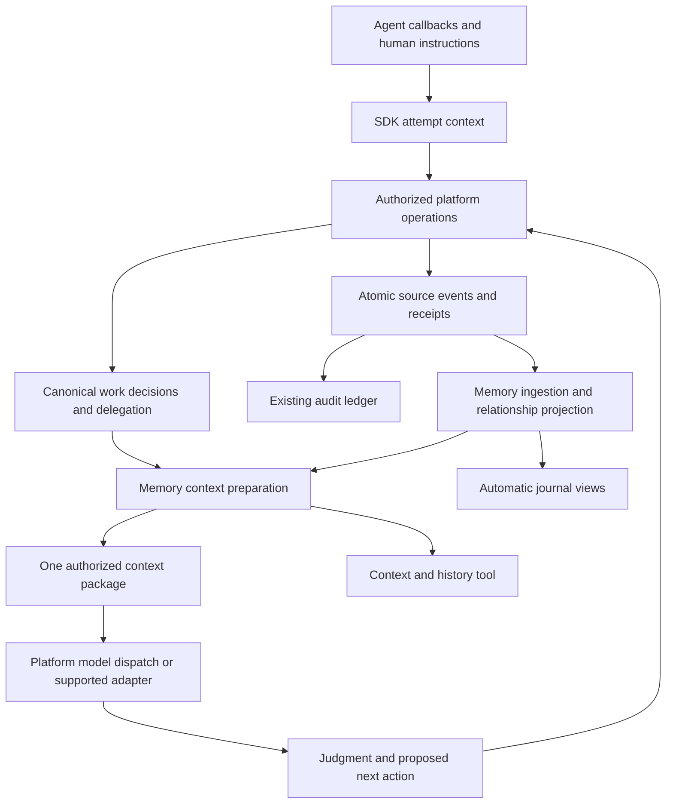
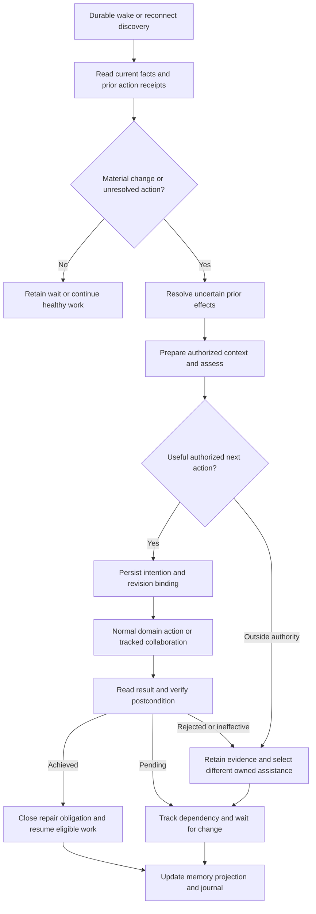

# Automatic agent memory and work recovery plan

Status: proposed for review. November 15, 2026. This change contains documentation only.

## Purpose and recommended design

Make continuity and recovery standard behavior for agents using the SDK. An agent should receive the relevant goal, connected work history, current responsibilities, previous attempts and unresolved questions without its creator implementing journal maintenance. After interruption or an update, it should be able to assess the situation, perform an authorized repair or collaboration, verify the result and continue useful work.

Use the existing Memory system to assemble context and maintain automatic journals. Connect it to canonical work, delegation and event records. Keep assignments, approvals, execution grants and completion authoritative in their existing platform services. A journal explains those records; it does not become another assignment database or an execution grant.

Provide both an automatically maintained journal and an on-demand context tool through the same memory pipeline. Journal views follow an employee's responsibilities or a particular goal and its related work. Agents can contribute concise reflections through normal responses and optional annotations, but useful continuity must work with no journal-specific agent code.

This plan standardizes interactions and evidence. Game scope, staffing choices, planning depth, sprint contents and repair strategies remain judgments made by the responsible agents within current authority. It adds no required specialist, universal QA gate, fixed planning sequence or mandatory model call before every callback.

## Outcomes for review

The implementation is accepted when all of the following hold:

- A new SDK agent using normal callbacks and the platform model client receives relevant context and produces an automatic journal without implementing memory writes or a new base-class override.
- Work remains connected across planning, staffing revisions, delegation, execution, review, repair, reassignment and final reporting. Creating a replacement preserves the original goal and any outstanding obligations.
- A restarting agent can distinguish an unattempted action, a failed action, an accepted action whose response was lost and a human-paused action.
- A blocked execution item can receive an authorized diagnostic assessment without silently reopening execution. A repair uses the normal domain action and proves its actual result.
- Automatic injection, explicit recall, tool retrieval and journals share authorization, source deduplication and prompt assembly. Equivalent supported requests receive equivalent eligible evidence.
- Memory enrichment, summary generation or journal presentation can be unavailable while independently authorized work continues from current operational records. Missing mandatory scope, authority or approval still prevents the affected operation.
- A third-party agent can participate using public contracts without inheriting a first-party agent class or knowing first-party names and roles.
- Fresh startup through Sprint 1, interrupted-work recovery, subsequent sprints and final completion pass the journey tests below. A second, non-game workflow proves that the interaction pattern is reusable.

## Existing foundations and gaps

The source map below describes the inspected implementation. Historical version and completion statements in linked documents remain historical; implementation must verify the current package graph before selecting release versions.

| Foundation | Existing symbols and location | Extension required |
|---|---|---|
| Memory evidence and operational references | `CSweet.Memory`: `MemoryEpisode`, `MemoryOperationalReference`, `MemoryWorkContext`, `MemoryClaimKind`, `MemoryEdge` in `MemoryModels.cs` | Reuse source identity, trust, temporal and audience support for connected work and journal derivatives. Operational relationships need explicit authoritative provenance. |
| Automatic conversation recall | Platform `AgentMemoryService.PrepareTurnRecallAsync`, `PreparedMemoryRecall`, `MemoryRecallDispatchEvidence` | Generalize shared context preparation to all supported work/model paths while retaining dispatch-time checks. |
| Agent framework memory integration | Memory `AgentMemoryContextProvider.ProvideAIContextAsync` and `StoreAIContextAsync` | Reuse shared preparation; prevent duplicate capture/injection. Failed invocations and non-model actions require platform lifecycle capture as well. |
| SDK memory access and model client | `PlatformCapabilityClient.Memory`, `PlatformMemoryClient.ExecuteAsync`, `AgentRuntimeContext.CreateChatClient`, `PlatformChatClient` | Add typed context/history/journal reads and automatic integration. The inspected chat client forwards messages and counts memory tags; that alone does not supply universal automatic recall. |
| Durable work execution | SDK `AgentRuntimeWorker.ProcessLeaseAsync`, `DrainPersonalTodoAsync`, `InferenceExecutionScope`; platform `AgentWorkInbox` | Capture and propagate exact work/attempt context across nested claims and all callback paths. Dispose transient context after the attempt. |
| Work and event context | `AgentEventEnvelope.WorkContext`, `CausationId`; platform `AgentWorkItem`; personal work context | Verify propagation end to end. A field in a contract is insufficient if a dispatch path omits it. Correlation is not proof of causation. |
| Recorded history | `CSweetDbContext.CaptureAgentAuditEvents`, `QueueAudit`, `AuditOutboxDispatcher`, `AuditEventWriter`, `SecurityAuditService` | Derive authorized connected history from existing evidence and canonical links. Keep the existing ledger; add a rebuildable relationship index where required. |
| Current memory workspace | `AgentMemory.Journal.cs`, `AgentMemory.razor`, `EmployeeTimeline` | The present Journal combines memory records with activity for the loaded-record window. Add working-context views and complete cursor-based connected history without presenting that window as a full timeline. |
| Operating checkpoints | SDK `AgentOperatingState`, `DurableAgentState`, `DurableWorkHandoff` | Retain concurrency-safe recovery assessments and action intentions. These operational receipts remain separate from explanatory memory summaries. |
| Attention and recovery | `AgentAttentionScheduler`, `AgentAttentionInvalidationService`, `ManagerWorkRecovery`, `WorkRecoveryService`, `IWorkRecoveryAuthorizationPolicy` | Schedule meaningful reassessment and turn investigation into owned actions/collaborations. Reuse current authority evaluators and allow trusted extension policies. |
| Tracked collaboration and reporting | `ITrackedDelegationService`, `TrackedDelegationService`, `DelegationRuntime`, `WorkTrackingWorker`; coordination service | Reuse acceptance, current ownership, reporting obligations and durable wake recovery. A diagnostic request must not end as an unassigned promise. |

Two inspected recovery behaviors must be covered explicitly. `PersonalTodoService`'s `WorkItemMutationEngine.RequeueAsync` can retain a repeated-failure stop for an owner's routine retry and return the unchanged blocked item. A transport-success response therefore does not prove work resumed. `ManagerWorkRecovery.HandleAsync` currently turns `Investigate` or `Escalate` into a blocked recovery result; the assessment alone does not create an investigation or deliver a request to another owner.

Related specifications:

- [Memory implementation register](memory-system-implementation.md).
- [Employee memory workspace](employee-memory-workspace.md) and [employee audit timeline](employee-audit-timeline.md).
- [Delegation with tracking](delegation-with-tracking.md) and [collaboration recovery](work-management/collaboration-recovery.md).
- [Planning recovery and scoped progress](../planning-recovery-and-scoped-progress.md).
- [Model output contracts](../agent-model-output-contracts.md), [durable events](../durable-events-and-recovery.md) and [model capacity](../agent-token-budgets.md).
- [Run comparisons](../run-reviews/README.md) for observed startup timelines and future comparison records.

## Ownership and architecture

Memory owns eligibility, history selection, source-linked summaries, retrieval, deduplication and rendering. Platform adapters supply live operational facts and apply their own authorization. The SDK binds callbacks and model invocations to the server-established attempt and requests prepared context. Agents choose their next domain action through currently granted tools.

Do not move domain mutation services or workflow orchestration into the Memory library. The library should accept generic source references and authorized source-reader adapters; it must not depend on C-Sweet database entities, game roles or sprint types. Shared operational contracts belong in the existing WorkManagement contracts where appropriate. Memory context/evidence types belong in Memory abstractions, and SDK convenience types remain thin wrappers. Inventory existing types before adding a new one; do not duplicate `MemoryWorkContext` or established execution identity.

## Connected work and event history

### Stable references and relationships

Use canonical organization-scoped resource references with resource type, stable ID and optional exact revision. Resolve employee identity separately from installation/runtime identity so an installed package update preserves continuity. Preserve the actual executing installation and version on each attempt.

Every observed interaction should retain the relationships known at its boundary: originating work, parent delegation or coordination, source decision/instruction, current actor, accepted result and direct causation when recorded. Several goals may legitimately share a ticket or artifact. Do not force everything beneath a single root or infer a goal from the agent's current project when an older action belongs elsewhere.

Initial relationship meanings include `supports`, `depends_on`, `responds_to`, `delegated_from`, `supersedes`, `produced` and `verified_by`. Reuse existing domain links for these meanings. Current assignment and reporting responsibility are temporal operational references, not a second mutable owner field in Memory. Relationships retain source ID, revision, author/provenance, effective time and lifecycle eligibility.

Descriptive relationships may be extensible with namespaced types. Only a validated domain operation may create an execution dependency, transfer responsibility, supersede an approval or change completion requirements. A model-proposed link remains an attributed proposal until the appropriate operation accepts it. Code binds selected existing references; the model never fabricates identities or authority.

Keep correlation, causation, operation identity and attempt identity distinct. A correlation groups a conversation or workflow; a causation link identifies an actual originating event or operation. A retry is another attempt of the same intended operation when its input and authority are unchanged. A revised command receives a new operation identity linked to its predecessor.

### Proposed contract shapes

These are proposed logical fields to bind to existing types during C01. Server-owned values are derived or validated against current authenticated state; clients cannot select another principal by submitting a field.

| Record | Required information |
|---|---|
| Resource reference | Organization, resource type and stable ID; exact revision when evidence or an action requires one. Preserve external provider identity through an authorized adapter. |
| History association | Source event/reference, relationship meaning, target reference, recorded actor, source/effective time and provenance. Separate proposed associations from accepted domain relationships. |
| Context read request | Optional visible focus reference, purpose/query, requested evidence kinds, continuation and known watermark/generation. Employee/installation, active attempt, grants and model capacity come from the platform binding. |
| Context read response | Schema version, context generation, live focus/source revisions, direction and obligation references, evidence units, supported prior actions, conflicts, coverage/freshness and continuation. Each unit carries source lineage, trust/applicability and a retrievable reference. |
| Supplied-context receipt | Authenticated attempt and invocation, exact package/unit/source fingerprints, final rendered contribution and size accounting, preparation/dispatch generation and current eligibility evidence. It cannot be authored by the model. |
| Journal revision | Stable artifact/employee identity, affected focus sections, contributor set and revisions, source watermark, summary generation, current/stale status and derivative lifecycle metadata. |
| Recovery intention | Target work/operation, assessed source basis, actor/owner binding, chosen currently supported action, expected postcondition, command identity and concurrency revision; references to pending collaboration/reporting. |
| Recovery verification | Accepted/uncertain operation receipt, observed current state/revision, whether the postcondition holds, unresolved obligations and next dependency or accountable actor. |

The context response may expose only a permitted subset of a journal or history. Opaque references must still be reauthorized when opened. Serialization must be versioned and compatible with unknown optional fields; unknown mutation semantics require negotiation rather than a best-effort guess.

### Capture and ordering

Capture accepted business transitions, failures, handoffs, verified outcomes and consequential decisions at the existing platform mutation boundary. Record an action intention before dispatch where the operation crosses a process/provider boundary. Keep start, accepted result, verification and uncertain outcome distinguishable.

Persist the domain change and its event/outbox records in one local transaction. Downstream ledger and memory projections consume those records idempotently; do not attempt a distributed transaction across all stores. Existing source/capture mechanisms should share stable event IDs and checkpoints so audit and memory consumers do not independently invent the same event.

Retain both occurrence time and recorded time. Present a stable stream order with a cursor/watermark and explicit causal links. A later-arriving event may describe an earlier occurrence; do not rewrite original evidence or treat wall-clock order as a total causal order. Where no durable order is known, label the relationship as unknown.

Background projection uses fenced leases, per-source revision/checkpoint recovery and fair batches. One invalid source must not stall other employees or projects. Late events cannot resurrect a revoked, superseded, forgotten or cancelled instruction. Source invalidation must be checked synchronously at reads/dispatch, even when the derived projection has not caught up.

### Discovery and visibility

Provide authorized discovery by work, goal, collaboration and employee responsibility, with cursor-based related-history expansion. A single correlation string or the newest page of messages must not be the only route to older obligations. Traverse incrementally, deduplicate visited references and tolerate cycles in descriptive relationships. Domain dependency services retain responsibility for validating executable dependency cycles.

Expose snapshot watermark, coverage, projection freshness and continuation cursor. Distinguish a genuinely empty history from unavailable or incomplete history. Return identifiers and records only where the caller may discover them; omit restricted relationships without exposing private titles, participant identities or counts. Organizational membership or participation in one ticket does not grant the full employee audit timeline.

## Automatic journals

### Journal contents and views

Maintain a stable journal artifact identity per employee, with goal/work views assembled from its authorized sources. Use the existing employee Memory workspace and lifecycle controls. Exported text is a snapshot with its source watermark; agents use current service reads for action.

The journal should explain:

| Section | Contents and source |
|---|---|
| Direction | Assigned responsibilities, approved long-term outcomes, constraints and non-goals, with current source references. |
| Current focus | Active work, immediate intended outcomes and the last verified checkpoint. |
| Connected history | Consequential decisions, handoffs, failed attempts, accepted replacements and supported results. |
| Open obligations | Outstanding execution, review, reporting and collaboration obligations, resolved from canonical records. |
| Blockers and uncertainty | Current dependencies, missing information, hypotheses and evidence that could change the assessment. |
| Next possibilities | Suggested actions and collaborators, clearly distinguished from accepted assignments or scheduled work. |
| Lessons | Source-linked findings with applicability to the relevant technology, task type or version. |

An agent's motivations mean the purpose of its assigned work and authorized goals. The journal must not invent personal objectives, commitments or organizational direction. Record concise decision summaries and observations, rather than hidden model reasoning or private chain-of-thought.

### Automatic maintenance

Construct a useful structural journal deterministically from work and event references before model enrichment is available. Generate narrative summaries asynchronously when meaningful evidence changes: an approved direction changes, an action succeeds/fails, a collaboration responds, an owner changes or an obligation closes. Coalesce high-volume progress and token events; do not summarize every heartbeat, tool chunk or idle cycle.

Summary jobs use an immutable contributor set and source revisions, summary schema/model identity, idempotency key and fenced generation. Before publishing, recheck contributor eligibility and the projection generation. A late summary must not overwrite newer evidence. Preserve revision history while publishing a current view; simultaneous updates from different tasks must not replace the entire employee journal with one task's state.

Summaries remain derivatives. Store their source fingerprints and applicability; do not ingest the generated journal as independent evidence for its own claims or let repeated summarization increase trust. Use source events or verified earlier summary lineage for hierarchical compaction, preserving corrections and unresolved contradictions. Mixed-audience summaries inherit all contributor restrictions; create separate authorized views instead of broadly publishing a private journal.

An agent may add a concise reflection through a normal result or an optional typed annotation. Code associates it with the authenticated work and author. Treat it as agent inference until supported; it cannot amend approved direction or mark work complete. No manual journal writes, text-file editing or end-of-cycle callback are required for baseline correctness.

## One memory context and prompt pipeline

### Context preparation

Generalize the existing `PreparedMemoryRecall` and dispatch-evidence flow into one shared policy used by conversation recall, work execution, explicit tools and supported framework adapters. Proposed API names below are illustrative, not implemented symbols.

The prepared package should include current work/attempt binding, eligible evidence units, relevant operational facts with revisions, summary lineage, coverage/freshness, unresolved contradictions and source references. Its receipt records what was actually supplied to a particular model invocation. A read receipt records access; it is not proof of prompt inclusion.

For each invocation:

1. Resolve employee, organization, current work/attempt, model capacity and grants from authenticated platform state.
2. Read current obligations and applicable direction through authorized operational adapters. Select related history, personal/relationship memory and journal derivatives relevant to this task.
3. Check source lifecycle, sensitivity, audience, applicability and revisions before ranking and packing. Preserve independent namespaces; retrieval across them does not declassify their contents.
4. Deduplicate transcript, recall, tool results and journal contributors by source/revision and rendered evidence unit. A summary and its source may both be useful, but repeated facts must not consume context accidentally or appear as independent corroboration.
5. Pack complete meaningful units within the configured model input capacity, including actual instruction/tool/schema overhead and reserved generation capacity. Return retrieval references for omitted material. Preserve prerequisites, exceptions, conflicting evidence and qualifiers.
6. At provider dispatch and retry, recheck live attempt ownership and current evidence eligibility. If relevant state changed, invalidate/rebuild the prepared package rather than silently sending a stale approval or cancelled instruction.
7. Record exact supplied units, source fingerprints, package generation and measured/estimated size. Dispose transient task context at attempt end; historical read receipts do not authorize reuse by another task.

Keep governing platform instructions, current authorized task instructions, operational evidence and recalled untrusted material distinguishable in the rendered request. Trust comes from source and policy, never from a journal heading or a model-written tag. Supersession and instruction precedence follow the domain's explicit decision rules; recency alone cannot override an approval. Unresolved conflicts become visible questions for the responsible actor.

### Automatic and explicit retrieval

The platform Memory context assembler owns the final context package for platform-mediated model dispatch. The SDK default model client and platform chat path call that shared service; the SDK does not run a competing injector. A registered framework adapter submits context contributions or references to that owner rather than independently appending another memory block. Repeated tool follow-ups and provider retries reuse source accounting while revalidating eligibility. New evidence changes the context generation explicitly.

Recognize supported structured context contributions through server-issued receipts and source identities. A caller-written `<memory_context>` tag is neither trusted attribution nor proof that the platform should omit or replace context. Legacy manually injected material requires an explicit compatibility path: preserve its untrusted status, deduplicate only what can be identified and report reduced attribution where necessary. Do not silently enable two independent injectors during rollout.

Expose typed SDK conveniences and model-visible named tools for these operations:

| Proposed operation | Purpose |
|---|---|
| Read working context | Obtain current direction, obligations, linked work, meaningful changes and prior attempts for the authenticated work. |
| Read related history | Expand causally/operationally related events at a stable watermark, with filters and continuation. |
| Read journal | View the current authorized employee or goal journal, with stale/partial indicators. |
| Read source evidence | Inspect a permitted exact source/revision and refresh its current applicability. |
| Propose an association or reflection | Submit an attributed judgment bound to visible resources; domain-changing effects require their normal operation. |

Reuse existing memory query capabilities for compatible reads after security review; retain source-specific work/delegation authorization. If a new capability is necessary, add a reviewed additive contract. No universal tool may bypass source permissions or execute arbitrary platform operations.

No arbitrary character ceiling should truncate journal content, decisions, reflections or evidence in storage. Audit existing memory render cutoffs, capability payload limits and validation rules in the affected paths. Replace fixed prose cutoffs with model-capacity-aware packing, complete-unit pagination or existing chunked transport. Respect explicit configured transport/security limits with a continuation or actionable error; do not silently raise limits or claim unlimited model capacity. Preserve complete source records and make omitted material retrievable.

### Unavailable and restricted context

When optional recall or summarization is unavailable, return typed degradation and use currently authorized operational facts. Policy denial, cancellation, invalid source evidence and missing mandatory approvals cannot use an availability fallback. Avoid replaying an old cached packet because current authorization is unavailable. Optional journal infrastructure failure must not turn a successfully accepted domain command into a second execution attempt.

## Automatic SDK lifecycle integration

Wrap the existing attempt boundary in `AgentRuntimeWorker.ProcessLeaseAsync` and matching test runtime. Establish the context before role handlers and record platform-observable outcomes through existing completion/failure paths. Cover capability, event, chat, coordination, delegation, attention and personal-task execution. Nested personal claims must switch the exact canonical work focus and restore it correctly; concurrent callbacks require isolated async scopes rather than a process-global current journal.

The platform records the lease and accepted domain effects even if the process dies before a callback returns. Startup reconciliation uses those durable records; a `finally` block or agent-written summary is never the only evidence of an attempted action. `OnActivatedAsync` should remain lightweight and should not perform unleased business repairs.

SDK users obtain automatic capture and standard model context through the normal runtime/client path. Existing role callbacks may supply optional judgment or domain-specific action providers, but skipping `base` or overriding a callback must not disable core recording and context isolation. Preserve custom tools, provider capabilities and role profiles. Extend `AgentTestRuntime` so default behavior can be exercised without bespoke agent internals.

When no model is configured, granted or available, deterministic capture and reconciliation still work. A repair requiring judgment remains an explicit pending responsibility with its existing wake/review route; do not invent a judgment, silently acquire a provider or prevent unrelated deterministic callbacks from running.

## Self recovery through ordinary actions and collaborations

### Triggers and assessment

Reuse durable attention/invalidation and work-tracking events. Trigger reconciliation for first activation, reconnect/update, lost/expired lease, failed operation, changed dependency or decision, accepted collaboration result, ownership change and scheduled review of a genuine wait. Persist durable demand before relying on a running process. No per-agent polling loop is needed.

First compare current source versions and existing open recovery work. Unchanged, healthy work takes a cheap no-op path without inference or another recovery ticket. Build a meaningful assessment basis from relevant operation/failure, approved scope, owner, capabilities/grants, dependency/decision revisions and applicable package/schema versions. Do not use timestamps, journal refreshes or model-run IDs to create a new repair opportunity. A package change is a reason to reassess relevant work, not proof that every failed operation is safe to repeat.

Include outstanding nonterminal work in discovery. An apparent Running item may have an expired lease, an unclaimed delivery or a missing dependency subscription. Reconcile against the actual lease/operation state and repair the supported delivery/wait mechanism. A long inference or unchanged journal alone is not proof of a stalled operation; avoid an arbitrary elapsed-time rule that cancels healthy work.

Assessment is a separately authorized read/judgment activity. It may inspect blocked work while the original execution stop remains in force. A human pause, cancellation, revoked source or revoked authority fences execution and any delegated workaround. Permit assessment only within the actor's current visibility and policy; do not repeatedly contact a human who intentionally paused work.

### Judgment and action selection

Offer named, currently available actions grounded in platform contracts: continue eligible work, inspect evidence, retry an eligible operation, amend owned planning/draft work, request clarification, delegate an investigation, request a reviewed resource/staffing change, propose replacement/cleanup or escalate to the accountable owner. These describe options, not a mandatory state sequence or exhaustive domain taxonomy.

Use current capability discovery and trusted action descriptors to determine what can actually execute. A custom provider may supply a versioned operation contract, idempotency/lookup support, validation and verifiable outcome references through its reviewed platform integration. A declaration in an agent manifest cannot grant authority. Unknown operations remain diagnosable but are not automatically replayed on the strength of a textual error or a model assertion.

Models return only judgment, rationale, authored repair content and selections from supplied named references. Code supplies identities, exact resource/version bindings, dates, policy facts and command keys. Validate using the same contract the platform enforces. For a rejected model-authored proposal, return the actual rejection for the existing single corrective generation; then retain a concrete owned blocker. Avoid arbitrary global counts of reasoning steps or universal game-specific repair rules. Repeated side effects are controlled by unchanged-basis detection, durable command receipts, current authorization, applicable execution policy and evidence of progress.

### Intention, execution and verification

Persist the assessed source basis, selected operation, expected outcome, current revision bindings and stable command identity before dispatch. Reuse existing operating-state/command receipts where suitable; the Memory narrative references them rather than duplicating their execution state. Fence concurrent attempts so only one accepted intention owns a particular repair effect.

For accepted effects whose response is lost, query the normal operation receipt/current state before replaying. Persisting a receipt locally cannot atomically commit a third-party external effect; require the provider's idempotency key and lookup/reconciliation contract. If neither exists, mark the effect uncertain and obtain the appropriate assistance before repeating a consequential action.

Treat `Accepted`, `AlreadyApplied`, `Pending`, `Rejected`, `NoChange` and `Uncertain` as distinct proposed result meanings. Reuse existing domain results or extend them compatibly. Success at the transport layer is not a verified postcondition. An unchanged blocked item after `RequeueAsync` must produce a truthful retained-stop result, not a claim that planning resumed. Verify a resumed claim separately from delivered work and final acceptance.

`Investigate` must create or reuse an owned investigation, execute an authorized evidence read or issue a tracked collaboration with a concrete question and intended result. `Escalate` must deliver or durably queue the request to a currently accountable actor and retain the reporting obligation. Reuse `TrackedDelegationService`, coordination and work tracking; do not introduce a parallel conversation protocol or another recovery ticket for every wake.

When recovery requires the blocked owner to amend its proposal, route that assessment to the actual owner through an authorized assessment path. Give it current approved direction, rejection evidence and available amend/replace actions. A required manager review remains owned by that manager. Resolve the existing silent self-requeue behavior with an explicit result and supported assessed continuation, not by broadly removing repeated-failure protection.

### Cleanup and responsibility changes

An agent may identify an obsolete or duplicate attempt. Before a permitted cancel/supersede action, resolve the surviving canonical work, outstanding criteria, dependencies, artifacts, pending reports and interested recipients. Transfer or explicitly dispose of each obligation using the normal domain service. Preserve source evidence and the replacement link. Cancellation alone does not satisfy acceptance criteria or mark delivery complete.

Responsibility changes require authorized reassignment, recipient acceptance where required, old-owner fencing and reporting/subscription recovery. Resolve current employee, capabilities and availability from operational records. Do not choose a successor from historical mentions, numerical role positions or journal prose. If a qualified owner is absent or ambiguous, create one tracked actionable decision for the accountable manager. Shared work continuity does not transfer a predecessor's private memory; any private debrief or post-deactivation transfer needs an explicitly supported, authorized workflow under existing memory policy.

Apply existing policy for consequential choices. Independent judgment is required where the applicable approved policy calls for it, including spending/hiring commitments, dismissal or override of QA findings, and decisions that hold work for the CEO. Do not add a second reviewer to ordinary reads, draft corrections, dependency checks or verified continuations. Use existing approval/decision mechanisms and current named reviewers; an agent cannot manufacture its own independent approval. Clarify whether already approved spending authority covers a specific action through those mechanisms.

Recovery closes only its verified repair obligation. Unaffected work can continue when its own dependencies and grants are satisfied. An employee's global journal status must never block every task because one unrelated item needs attention.

## Third party compatibility

| Integration | Automatic support and boundary |
|---|---|
| Agent using the standard SDK runtime and model client | Automatic attempt capture, context preparation, journal maintenance and recovery discovery; no journal API calls or required recovery override. Actual actions still require current grants. |
| SDK agent using another supported model framework | Use the shared context adapter/composition contract. Framework hooks must not double-inject or independently persist the same interaction. |
| Protocol-compatible agent without SDK inheritance | Platform operations still capture canonical effects. Public context/history tools and durable events expose the same authorized evidence. The agent or its framework adapter consumes the context contract. |
| Agent with an external model path | Supply an explicit governed adapter, current source authorization and delivered-context receipts. The platform cannot automatically insert context into an unobserved model call or claim its private actions were captured. Existing egress/provider policies continue to apply. |
| Third-party service/action provider | Register reviewed public operations and evidence/receipt adapters. Recovery uses their normal permissions and declared reconciliation behavior; unsupported outcomes remain uncertain. |

Use additive versioned contracts, named choices and capability negotiation. Older clients may ignore optional context fields and use existing workflows. Never silently claim full automatic support for an older runtime; show the supported mode and installed versions. Required new grants use the normal review/update flow. Baseline journaling must not require broad memory write/manage privileges for an agent because the trusted platform owns capture.

## Implementation work packages

These packages sequence technical dependencies, not business workflow gates. Every package includes its affected contract, failure and integration tests. Do not postpone all end-to-end integration until the final package.

| Package | Deliverable and main code boundaries | Depends on | Exit evidence |
|---|---|---|---|
| C01 Contract and source inventory | Inventory canonical IDs, existing relation/receipt types, grants, callback paths, current package pins and capture gaps. Define shared context, history and outcome additions with compatibility fixtures. | Review of this plan | Contract examples and threat/failure cases reviewed; one minimal SDK and one protocol-only fixture identified. |
| C02 Connected evidence capture | Extend accepted transition/outbox producers and source adapters; add indexed relationship projection and resumable checkpoints. Start in `CSweetDbContext.Audit`, existing memory ingestion, work/delegation services and `AgentWorkInbox`. | C01 | Real transaction rollback, duplicate/out-of-order consumption, crash replay and association isolation pass. |
| C03 Shared context preparation | Reuse/refactor `AgentMemoryService`, `MemoryEngine`, `PreparedMemoryRecall`, `MemoryRecallDispatchEvidence` and rendering. Add per-attempt/invocation selection, attribution, deduplication and capacity-aware units. | C01; C02 for work-history inputs | Conversation, SDK and framework requests follow the same policy; dispatch-time revocation and overlap tests pass. |
| C04 Public context and history access | Add typed SDK wrappers and authorized model tools over shared preparation and source-specific reads. Include cursor/watermark/coverage contracts and named relationship proposals. | C02, C03 | Protocol-only agent can read/expand the same permitted evidence; restricted graph traversal and legacy clients pass. |
| C05 Automatic runtime integration | Integrate `AgentRuntimeWorker`, `AgentRuntimeContext`, `PlatformChatClient`, `AgentTestRuntime` and platform dispatch. Cover nested claims, retries and cancellation without requiring agent overrides. | C03, C04 | An agent with no journal code obtains context; concurrent callbacks never share task context; no double injection. |
| C06 Journal projection and presentation | Add deterministic working journal, asynchronous source-linked summaries, per-employee/work views and current artifact revisions. Extend the existing Memory workspace and retention/review paths. | C02, C03; C05 for invocation attribution | Journal survives interrupted callbacks, stale summary jobs and concurrent task updates; source correction/erasure and browser tests pass. |
| C07 Recovery assessment and durable actions | Connect attention, `ManagerWorkRecovery`, `WorkRecoveryService`, operation policies and tracked delegation to generic assessment/intention/verification. Replace silent ineffective retry reporting with explicit outcome handling. | C02–C05 | Assessment while execution remains stopped; owned investigation; response-loss replay; current authority and actual postconditions pass. |
| C08 Cleanup and handoff reconciliation | Implement obligation-preserving amend/supersede/reassign adapters using existing domain services. Reconcile subscriptions and pending reporting. Avoid a universal mutation gateway. | C07 | Old-owner fencing, recipient acceptance and dependency/report preservation pass; unaffected work remains runnable. |
| C09 Integrated journeys and evaluation | Run the journeys and failure matrix below against the combined platform/SDK/Memory boundary, including non-game and protocol-only agents. Compare observed timelines. | First vertical slice at C05; full acceptance after C06–C08 | Reproducible automated results plus separately recorded configured-model/live acceptance. |
| C10 Upgrade and release | Ship additive migrations, resumable discovery, compatibility modes, package-consumer verification, observability and rollback controls. | Each shipped slice; final rollout after C09 | Existing records converge without business recreation; exact published package versions and Installed Agents behavior verified. |

Deliver the first vertical slice through an accepted work transition, connected history, automatic context and journal, and one verified recovery action. Then expand adapter coverage. Do not certify broad production readiness from an in-memory happy-path demo.

## Relationship to the existing Memory register

Keep [Memory System Implementation](memory-system-implementation.md) as the authoritative wider backlog. Record cross-references and evidence for the relevant milestones rather than creating competing completion claims:

| Existing milestone | Work advanced here |
|---|---|
| M02–M06 | Existing audience/dispatch protection, ingestion recovery, lifecycle and retained evidence requirements apply to every new source, summary and tool. |
| M07–M10 | Event/effective-time semantics, fairness, evaluated quality and migration/release acceptance must include the new paths. |
| M11–M14 | Shared preparation, invocation accounting/deduplication, complete context units and accurate supplied evidence underpin C03–C05. |
| M15–M16 | Reconcile derivatives against current facts; use canonical operational references and reviewed identity resolution. |
| M17–M18 | Journal inspection, correction/recovery controls and attributable feedback. |
| M19 and M21 | Typed operational outcomes and compact source-linked journals/summaries. |

Semantic/vector retrieval in M20 is optional for this feature. Canonical link traversal, exact references and lexical retrieval must support the baseline. Complete the affected authorization/lifecycle acceptance slices before enabling their new consumers; this plan neither requires closing all unrelated Memory work nor waives existing protections.

## Tests and evaluation

### Test layers and repository ownership

| Layer | Extend existing suites and add focused fixtures |
|---|---|
| Memory library and stores | `EmployeeMemoryTests`, `AgentFrameworkIntegrationTests`, `TemporalTraversalTests`, `GraphPathEvidenceTests`, source integrity, correction, suppression, erasure, transfer and search/selection tests. Exercise both supported SQLite and PostgreSQL semantics where the library exposes the feature. |
| Platform memory and model dispatch | `AgentMemoryDispatchTests`, `AgentMemoryOverlappingDispatchTests`, `AgentMemoryDurabilityTests`, instruction dispatch, broker evidence, scoped audiences and journal tests. Verify platform-supplied and agent-created requests. |
| Operational authority and durability | `AgentOperatingStateReceiptTests`, `AgentAttentionSchedulerTests`, `TrackedDelegationTests`, `TrackedDelegationPostgresTests`, employee audit tests, personal work and recovery service tests. Use real relational transactions and the actual mutation service for recovery effects. |
| SDK | `ManagerWorkRecoveryTests`, `WorkContextLifetimeTests`, `AgentTestRuntime` coverage and runtime/model-client tests. Ensure default authoring and external adapter fixtures work without role-specific overrides. |
| Public APIs and UI | Authenticated API tests, component tests, and browser acceptance for employee journal, related-work navigation, source inspection and recovery state. |
| Combined journeys | Actual SDK runtime plus platform services and durable stores, with deterministic model/provider fixtures for reproducibility; configured-model pilots measure judgment quality separately. |

Do not make every dependency return successful mock data. In particular, the repeated-failure retry test must execute the real `RequeueAsync` authorization/stop branch and assert the returned state, not mock it as Ready. No individual suite proves cross-repository integration or live model behavior.

### Required fault and invariant matrix

| Scenario | Required result |
|---|---|
| Minimal agent with no memory/journal implementation | Normal task and model call produce linked evidence, useful context and journal without author-maintained text. A non-model task still records operational outcomes. |
| Same action through event, attention and manager discovery | One intended effect and one open recovery obligation; repeated reads and duplicate hints do not grow tickets or summaries. |
| Missed events and offline/update reconnect | Current-state discovery catches older outstanding work across all pages and converges without depending on event arrival order. |
| Process termination before dispatch, after dispatch and after accepted effect | Intention/receipt/current-state lookup distinguishes each case; no accepted ticket, hire, report or external effect is duplicated. |
| Forced failure between state/outbox writes | Transaction rolls back the local mutation and wake records together; retry converges. Test memory projection lag separately from authoritative transaction failure. |
| Provider accepts effect but acknowledgement is lost | Replay uses the same idempotency key or verified lookup. Unsupported lookup leaves explicit uncertainty rather than a guessed retry. |
| Simultaneous callbacks and concurrent journal writers | Work and audience context stay isolated; stale expected revisions fail/reconcile; no unrelated journal section or obligation is lost. |
| Lease lost during model wait or before action | Late callback cannot dispatch or apply the old intention. New owner/attempt reconciles accepted effects before continuing. |
| Queued inference followed by approval amendment, revocation or source erasure | Old package fails revalidation; no withdrawn content reaches the provider and queued summary/replay cannot restore it. |
| Reworded finding or reordered named catalog | Stable operational identity retains the same issue/role relationship; wording/order does not create another owner, issue or hire. |
| Same text from two independent sources | Preserve both provenance paths and any disagreement; deduplication does not incorrectly merge different people, decisions or tasks. |
| Journal, transcript and explicit recall repeat a source | Final prompt has one deliberate representation per selected unit and truthful supplied-source accounting; follow-ups/retries do not accumulate duplicate memory. |
| Long decision with decisive qualification at the end | Complete source survives; packing preserves meaning or provides an explicit omission/reference. No fixed prose cutoff changes the decision. |
| Malicious journal/reflection/tool text | Cannot become a system instruction, grant, approval, canonical owner or accepted outcome. Forged source/attempt references are rejected. |
| Private conversation linked to shared work | Only independently authorized evidence is exposed; topology, summaries and exported artifacts do not leak private metadata or content. |
| Stale or poisoned summary generation | Old generation cannot publish as current; summaries cannot cite themselves as independent proof or inflate trust. |
| Human pause, cancellation or denied operation | Read/assessment follows its own policy; execution and delegated workarounds remain fenced. No inferred grant or automatic approval. |
| Retry returns unchanged Blocked | Result remains a verified retained stop; an owned supported repair/collaboration follows. No success narrative or identical unbounded retry. |
| Investigation or escalation is chosen | Real owned work/request and reporting commitment exist or the failure to create them is explicit. No unassigned promise or claim of delivery. |
| Replacement proposal and cleanup | Surviving work retains criteria, source direction, dependencies, approvals that remain applicable and pending reports; old attempt is visibly superseded. |
| Manager/owner changes while repair is queued | Current authorization and assignment win; stale actor is fenced, valid responsibility/reporting is transferred or an actionable vacancy remains. |
| One task blocked while another is eligible | Eligible work continues; no journal-wide, project-wide or organization-wide gate is inferred. |
| Memory/summary worker unavailable or poison event | Current authorized work continues where required facts are available; degradation is visible; other sources advance; later recovery does not duplicate effects. |
| Legacy SDK, unknown capability or external model path | Advertise actual support; preserve supported old behavior; require governed adapter for unobserved context/effects. No hidden authority or false completeness. |
| Large and cyclic descriptive graph | Stable pagination, incremental expansion, no duplicate visits, explicit partial coverage and preserved service fairness. No full-business prompt expansion. |
| No meaningful state change | No extra model call, recovery ticket or journal summary; existing wait has an accountable dependency and wake/review route. |

### Journey one Fresh business through Sprint 1

Start a new business with an approved Breakout-like desktop-web goal using normal onboarding. Exercise staffing proposal, a requested correction, exact approval and hiring, proportional technical feasibility work, incremental roadmap, first-sprint drafting/estimation and staffing/resource reconciliation. Specialists are justified by the work; the test does not mandate a Game Designer or early QA hire.

Verify that the revised staffing request is linked to and supersedes the earlier attempt, approved direction reaches the responsible agents, and the technical hire is discoverable as a verified result. Tickets keep their source obligations and are created once. Independent planning/feasibility work can proceed while unrelated future scope is unresolved. Sprint execution starts only through the existing actual readiness/authority rules, without this feature adding another gate.

Run with default SDK behavior and zero journal maintenance in the fixture agents. Compare the final provider requests with delivered-context receipts. The human and agent journal views must explain why Sprint 1 is runnable and who owns each open obligation.

### Journey two Interrupted and blocked work recovery

Pause the journey after a staffing correction or planning action is submitted. Inject response loss, an offline recipient, duplicate/missed wakes and a process update. Include a failed planning operation for which the ordinary owner's requeue returns the same blocked revision. Reconciliation must observe accepted effects, preserve the correction and assess the current failure without repeating the original request.

Have the responsible actor choose an owned investigation or tracked collaboration, produce a supported repair, verify the postcondition and continue the original goal. Also run variants with current denial, a human pause, changed owner and an external effect with no lookup. Those variants must preserve the correct stop and expose a concrete next owner/action. Another independent item must continue throughout. Repeat reconciliation until quiescent and assert that it creates no extra tickets, requests, hires or reports.

### Journey three Subsequent sprints and final completion

Complete Sprint 1 and have the existing accountable agents evaluate its actual results and management input before selecting subsequent work. Include a high-speed collision defect while scoring is being drafted, then a scope variant with interacting power-ups. The agents should judge impact, preserve useful draft work, revise affected priorities and justify any staffing change from actual complexity.

Verify associations across corrective tickets, review/QA evidence, accepted outcomes, sprint review decisions and successor work. Sprint completion and increment acceptance remain separate. The memory layer supplies evidence; existing domain services determine readiness and completion. A sprint review can conclude that the current plan remains suitable without manufacturing changes or consultations.

At the final sprint, verify the approved outcomes, remaining obligations, acceptance evidence and final reporting through existing project completion rules. Do not automatically create an empty successor sprint. Open defects, explicitly deferred scope, cancelled scope and accepted delivery retain distinct dispositions. Reporting closes after the final report is durably delivered, and the journal becomes a source-linked completion account without fabricating project acceptance.

### Generality and third party journeys

Repeat the core lifecycle for a non-game workflow, such as a report-producing service: approved objective, delegated analysis, amended input, artifact review, correction and final report. No Epic, sprint, game role, engine or first-party identity may be required by the continuity/recovery contracts.

Use a protocol-only third-party agent with custom named capabilities and no SDK base inheritance for at least one handoff and repair. Test accepted, declined, clarification, offline and revoked-grant responses. Verify that the first-party agent waits for actual acceptance/outcome and that the third-party agent can retrieve the authorized history through the public tool.

### Model and run evaluation

Use deterministic model fixtures for contract/failure coverage, including malformed JSON, invented references, unsupported claims, repeated wording and valid novel repair proposals. Reuse actual incident replies where available under existing model-output fixture policy. Test smaller and more verbose model responses; grammar validity alone does not establish correct judgment.

Run a configured-model pilot separately, retaining installed versions, approved scope, source watermarks and reproducible failure injection. Record time to first useful ticket and first running sprint, model generation time, coordination wait, publication delay, recovery latency, unnecessary consultations, repeated ineffective attempts, unresolved ownership, duplicate effects, context relevance and token overhead. Compare with the existing startup timeline tooling using the same milestones and label changed inputs.

Correctness acceptance requires zero unauthorized context releases, lost accepted effects, duplicate consequential effects and false completion claims in the prescribed scenarios. Performance/relevance targets should be agreed from the measured baseline before broad rollout; do not invent a speedup or hide slower but correct runs. Autonomous repair quality requires observed verified outcomes, not model statements that the issue is fixed.

## Upgrade and release plan

Use additive schemas and versioned context/relationship/result contracts. Deploy compatible platform readers and migrations before enabling new writers and SDK automatic context. Keep durable generation/checkpoint data across application restarts. Index source references, work/goal relationships, sequence cursors and open recovery lookups; apply existing fair scheduling and configurable transport/resource controls.

Backfill relationships only from exact canonical links and retained evidence. Existing records with ambiguous or missing provenance remain explicitly partial; do not invent historical transitions, approvals or causation from prose. Stable import receipts make repeated upgrade discovery safe. Rebuild projections from eligible sources without rebuilding erased content. Reuse existing tickets and obligations; do not recreate businesses or duplicate work to gain continuity.

Enable passive capture/history first, then context/journals, then verified recovery actions. Use rollout configuration to separate projection, context composition and autonomous action execution, so an action defect can be disabled without losing history. These controls are operational rollout tools, not extra user approval steps on every task. Rollback preserves accepted domain effects and readable older contracts; legacy clients must not unknowingly execute intentions created under incompatible semantics.

Inventory exact current package versions at implementation time. Additive public SDK/Memory/WorkManagement APIs normally require minor versions; breaking wire/storage changes require the appropriate compatibility design and version. Synchronize package pins, templates, samples, authoring docs and tests. If Office contracts are actually changed, follow their dual-consumer verification rules; avoid unrelated contract churn.

Build/test and pack every changed package, inspect `.nupkg` metadata, then verify affected consumers with sibling references disabled. For changed agents, bump and synchronize the version before creating final-version release notes. If either developer core is edited, update both Engineer and SoftwareDeveloper and run `scripts/Test-DeveloperAgentCoreParity.ps1`. Publish dependencies before consumers and deploy agent updates through Installed Agents. Do not patch stored manifests, package digests or installed payloads.

Run fresh-database and retained-record upgrades in disposable relational test environments. Live rollout acceptance uses normal product APIs and reviewed installed packages. The deleted test business is not a prerequisite; the next fresh business is the primary live pilot, with synthetic retained-record fixtures proving upgrade recovery.

## Operator experience and diagnostics

Extend the existing employee Memory workspace with readable direction/current-focus panels, a connected chronological history and linked obligations. Preserve existing source inspection, privacy, correction, hold and forgetting controls. Give human viewers current portraits/names where permitted, concise summaries, meaningful status labels and expandable evidence. Show freshness and partial coverage without exposing internal implementation details in normal task guidance.

Realtime events are invalidation hints; re-read authorized current state on updates and reconnect. Keep navigation/scroll stable, cancel stale requests and prevent a response for one employee from rendering under another. Verify responsive layout, keyboard navigation, empty/loading/error states, accessible relationship navigation and long-content expansion in the browser.

Keep Overview attention focused on an actual human action. Agent-owned repair and ordinary journal updates belong in activity/work history. Reuse existing issue identity, supersession and attention retirement rather than creating duplicate cards from journal language. A human card should name the decision, current owner and available action, and retire when its canonical condition resolves.

Diagnostics should connect work, attempt, source event, context generation, supplied receipt, recovery intention and verification outcome using content-free identifiers. Record projection lag, failed jobs, incomplete coverage, denied/stale dispatch, no-op retry, outstanding repair/reporting age and no-change suppression. Protect source content and do not log a second ungoverned copy of private journal material.

## Review decisions and implementation completion

Recommended decisions are to use platform-owned automatic capture, a rebuildable linked-history projection, Memory-owned journal/context composition, typed public reads and ordinary authorized actions for repair. Baseline behavior should require no author-maintained journal. Agent reflections remain optional. Semantic embeddings and autonomous policy changes are outside this feature's required scope.

During contract design, settle the exact reuse/additions for operational references and context receipts, adapter capability negotiation, invocation capacity accounting, current source invalidation and assessed continuation for repeated-failure stops. Review the execution and privacy examples before enabling autonomous mutations. These are implementation contract decisions; they should not require agent creators to understand storage or lifecycle internals.

Completion requires source changes and package evidence for the selected work packages, passing integration/fault/journey suites, documented unresolved adapter coverage and separate configured-model/browser/live acceptance results. A unit-test pass, a journal screenshot or a model's recovery explanation alone is insufficient. This review draft authorizes no implementation or live changes.
