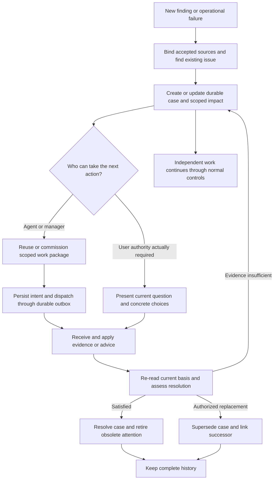

# Proposal: durable issues, coordinated resolution, and a concise Overview

Status: implemented in source; coordinated release verification and rollout notes follow. No live business records or installed agents were changed.
Prepared: 2026-11-14.

## Intended result

Overview should tell the user what actually needs their action and what the team is already handling.
An issue should keep its identity as agents discuss it, receive advice, revise a plan, or replace a
failed attempt. Related work belongs to that issue rather than becoming a new apparent problem on
each review. Its current cards should disappear when authoritative evidence confirms resolution or
supersession; its history should remain available.

Implement this as a shared platform and SDK interaction pattern. Agents retain judgment about
meaningful ownership, work sequencing, consultation, and escalation. The pattern must support game
production, software delivery, hiring, and other business work without a fixed team or planning script.

## Findings behind this proposal

The current Brickwave run in Qwen Games provides the recovery pilot. These are observations from the
review, not claims that every outstanding decision is obsolete:

- Overview showed three attention cards concerning toolchain feasibility: a blocked Marcus commitment,
  a pending Babylon/2D scope decision, and a recovery incident. A manager status report also appeared
  elsewhere on the page. The old collaboration was still Failed when inspected.
- Current Activity showed over 50 entries, many named `Reconcile planning responsibility` or
  `Receive planning reconciliation`. Gabriel's board had 43 completed items, including multiple
  consultations about similar review-package, audio-feasibility, and presentation obligations.
- The project had five open board items and reported ready build capacity. That progress does not
  prove that the old feasibility requirement is satisfied or that its pending decision can be discarded.
- `BlockedWorkAttentionReader.ReadAsync` promotes every authorized visible blocked personal item.
  `CanRetry` expresses permission to retry, not a requirement for the human to act.
- `OverviewAttentionItems.StandaloneBlockedWork` and `StandaloneQuestions` primarily deduplicate by
  exact decision/incident IDs. Records about one cause can remain separate without those links.
- `ProjectHealthService.IncidentRequiresOwnerInputAsync` already distinguishes manager recovery from
  genuine owner input. The blocked-personal-work path does not share that eligibility rule.
- Producer `ReconcileOwnershipFindingsAsync` starts a consultation and tracking card per gap.
  `OwnershipFinding` includes generated statement text and the outline digest in its identity.
  Rephrased findings or revised outlines can therefore create fresh work for an existing concern.
- A completed consultation is currently enough to complete its tracking card. That does not mean
  Gabriel accepted its advice or that the underlying ownership gap is resolved.
- The Director's feasibility decision prompt concatenates `feasibility.Findings`. `DecisionPrompt`
  clips the displayed preview, but clipping does not create a useful executive explanation.

An additional persistence risk is confirmed by source inspection, but its contribution to this live
run has not been measured. `PersistPlanningCycleAsync` derives mutation keys from the planning
fingerprint and `UpdatedAt`. The caller saves a cycle, then adds reconciliation references and saves
again without necessarily changing that timestamp. `PluginOperationsCapabilityHandler` returns the
previous state when that key matches, without comparing the changed content. A later write may retain
the references, but interruption before it leaves a recovery window. This requires a regression test.

## Recommended design

### 1. Give each issue a durable identity and explicit relationships

Add a small shared `WorkIssueCase` registry and typed source links. This is an additive coordination
record, not another task engine. Existing tasks, incidents, decisions, reviews, and execution receipts
remain authoritative for their own state. A case owns identity, accountability, resolution evidence,
and their relationships; Overview projects their current authorized state.

Do not force ordinary planning gaps into execution-failure incidents. A `ProjectIncident` remains
evidence of a detected operational problem and may link to a case alongside a planning finding,
task, consultation, or decision. An existing incident may anchor a failure case; no second incident is
created merely to present it. Ordinary tasks and approvals need no case unless an issue actually exists.

Proposed record responsibilities:

| Part | Required information |
| --- | --- |
| Identity | Platform-assigned issue ID, organization, optional project/board/team scope, stable obligation or source identity, revision |
| Accountability | Responsible employee, next actor, delegated manager, current next action |
| Meaning | Kind of concern, concise title and explanation, full retained detail, affected scope |
| Basis | Accepted source revisions/digests, current planning or candidate revision, typed supporting evidence |
| Relationships | Tasks, coordination sessions, decisions, incidents, predecessor/successor cases, and replacement attempts |
| Resolution | Open, Resolved, or Superseded; exact resolution basis and authorized receipt |

Track handling phase separately from resolution: for example, working, waiting for evidence, waiting
for an authorized decision, or awaiting verification. A consultation can be complete while the case
remains open. A failed historical attempt can remain Failed after the case is resolved by its verified
replacement. These distinctions must be visible in detail views.

Keep decision audience and action availability separate from severity and lifecycle. A severe failure
can be manager-owned. A human's permission to retry does not make retry their responsibility.

### 2. Preserve obligation identity across wording and planning revisions

After the first grounded assessment, persist the distinct approved obligations and their assigned IDs.
Their source references identify real outcomes and binding constraints; they do not require an Epic
for each paragraph. Subsequent reviews compare against this retained obligation catalog and current
ownership evidence rather than inventing a fresh set of identities from prose.

The model judges whether a finding is the same concern, a changed obligation, or a genuinely new
concern and selects supplied evidence/candidate references. Code assigns and validates IDs, source
bindings, actors, revisions, and authority. Similarity can suggest candidates; it cannot authorize a
merge or erase a distinct acceptance requirement. Ambiguous matches stay explicit and are reconciled
by the responsible agents without automatically asking the user.

Preserve an obligation ID when its meaning survives an approved source revision. When meaning changes,
record an explicit replacement relationship and revalidate affected ownership. Do not carry advice
across changed scope, constraints, candidate, or environment merely because wording looks similar.

Rewording, receiving a duplicate event, or adding an unrelated finding must not create another active
case or commission for an unchanged obligation. A recurrence after verified resolution is a linked
episode with its new evidence, rather than an edit that erases the earlier resolution.

Separate substantive evidence changes from presentation/activity changes. Brief wording, progress
timestamps, queued callbacks, and a case's own notifications must not invalidate its advice or trigger
another full ownership review. Freshness hashes cover the case's relevant accepted inputs, requirements,
authority and evidence; unrelated project updates do not make every manager report obsolete. New
relevant evidence must still wake reassessment promptly.

### 3. Consolidate agent reconciliation without delaying independent work

Let the responsible manager group compatible findings into one scoped consultation using their
shared accepted sources, specialist capability, dependencies, and approaching work. One work package
may resolve several cases; one complex case may legitimately need several different contributions.
Do not impose one call per finding, one mandatory reviewer for every gap, or a numerical batch size.

Persist a commission with its member case IDs, exact sources, intended advice, accountable recipient,
and stable idempotency identity before dispatch. Use a durable outbox to initiate it. The dispatcher
and restart discovery reuse the same commission and coordination receipt. Track the package once;
its member cases retain individual scope, ownership, and resolution status.

When a related finding arrives during active work, the manager decides whether it fits the current
package or needs a subsequent package. Preserve the immutable request already sent; record amendments
or a successor explicitly. Do not restart or enlarge an in-flight request silently.

After advice arrives, wake the accountable agent to apply and assess it. Completed advice alone does
not close a case or prove product acceptance. Reuse valid evidence, retain useful drafts, and hold
only affected work and dependency consumers. Existing staffing, readiness, QA, and final-completion
checks remain in force. Planning reconciliation does not acquire a mandatory independent QA gate.

### 4. Reconcile related records to a truthful current state

Resolution must identify what satisfied the obligation or replaced its applicability. Suitable bases
include reviewed ownership against the exact accepted sources, verified execution/review receipts, or
an authorized decision incorporated into the affected plan. A new status message, elapsed time,
unrelated completed task, resource readiness, or receipt of advice is insufficient by itself.

On each relevant source transition:

1. Re-read authorized current state and verify the source revision.
2. Update the case and its exact relationships with optimistic concurrency.
3. Resolve or supersede only the records whose purpose is satisfied or replaced. Keep failed attempts
   as historical evidence. Retire obsolete tracking tasks through an audited terminal transition;
   do not invent a successful result or cancel a running claim without the existing execution rules.
4. Withdraw obsolete notification presentations. Supersede/cancel a pending decision only through its
   authorized governance path and recorded replacement basis. Preserve every still-required decision.
5. Persist state changes, mutation receipts, and notification/wake outbox entries atomically.

An owner answer may move a case to “Applying your decision.” It does not imply that dependent work
was updated or that a sprint started. Conversely, completed corrective work should not leave an
obsolete retry card active while waiting for an unrelated reporting callback.

### 5. Make Overview an action queue and a compact status view

Build a shared server-side attention projection consumed by Overview, the navigation badge, and
relevant mobile views. The client must not independently infer actionability from task status or prose.
Aggregate authorized sources by issue identity and current episode, with adapters for legacy records.

| View | What belongs there | What removes it from that view |
| --- | --- | --- |
| Your action needed | Current decisions or operations that actually require this user's authority, with an actionable request | Answer accepted, authority/basis changed, authorized withdrawal, or verified resolution/supersession |
| Being handled by the team | Open manager/agent-owned cases, grouped by project or work package | Resolution/supersession, or a real action becomes necessary from this user |
| History | Resolved/superseded cases, completed consultations, failed replaced attempts, and prior decisions | Remains available as audit history |

One issue should not appear as three unrelated cards because it has a blocked task, incident, and
decision. A grouped case may expose multiple distinct required decisions; grouping must not hide one
or turn one answer into authorization for another. Define the badge as the number of issue cards
requiring the user, plus unrelated actionable approvals/requests, and use the same projection everywhere.

Retain an explicit unclassified state for legacy blockers whose next actor is uncertain. Show the
uncertainty and accountable manager for reconciliation; do not quietly hide them or invent an owner
decision. If no qualified manager is available, route a real assignment/administration request under
the existing policy rather than leaving the issue ownerless.

Current Activity should distinguish logical work from its inbox events and model calls. Group a work
package's consultation, tracking callback, and queued wakes under its current project activity, with
expandable source details. Preserve distinct independent work. Present running, queued, and waiting
states truthfully; grouping cannot manufacture progress or imply simultaneous execution.

### 6. Present concise explanations and concrete actions

A current card needs a short title, what happened, scoped impact, accountable actor, and next action.
For user decisions, show the actual question, recommendation and its reason, available options with
consequences, and what remains held. Pending future milestones are not present-day attention items.

Keep full authored text, evidence, transcripts, and diagnostic codes. Use a separate brief projection
and expandable Details. Do not reintroduce database or authored-text character ceilings to make cards
shorter. Layout can collapse a preview; the brief itself should answer the user's question. Raw failure
envelopes, capability names, criterion indexes, and internal identifiers belong in technical details.

An optional model can summarize supplied evidence; code computes current state, actor, authority,
actions, and execution status. Reject summaries that claim unsupported resolution or progress. Provide
a factual brief without a model so reporting failure never prevents recovery or action presentation.

Example team status:

> **Planning responsibilities under review**  
> Gabriel and Victor are reconciling the review-package requirements.  
> No action needed from you. **View progress**

Example user decision, only when an actual scope exception is reserved for the owner:

> **Approve a change to the rendering constraint?**  
> Marcus recommends keeping the approved 2D scope. A 3D tooling exception changes that constraint.  
> **Keep 2D scope** · **Review the exception**

These examples specify presentation, not a predetermined answer for the current project. The current
Babylon/2D decision must first be checked against accepted sources and any replacement feasibility evidence.

“Retry after review” should appear only when the current cause permits that specific authorized retry.
If an agent update or missing resource is needed first, state it and link to the appropriate operation.
If the manager can perform the next step, show their ownership rather than requiring a user click.
Reading or acknowledging a notification never resolves work, grants approval, or satisfies a gate.

### 7. Correct shared persistence and recovery semantics

Fix the planning-state write risk as a reusable operation contract, not a timestamp adjustment alone:

- Bind each mutation identity to its intended scope and content. Same identity with different content
  returns a typed conflict; an exact replay returns the recorded receipt without another effect.
- Retain receipts across intervening writes so an older duplicated command cannot be reapplied as new.
  Keep revision concurrency checks distinct from idempotent replay checks.
- In `PersistPlanningCycleAsync`, give logically different mutations different content-bound identities
  even when their timestamps match. Verify that the accepted response contains the intended references.
- Persist commission intent before external dispatch; retain the returned session binding durably.
  Recover interruption before dispatch and after successful dispatch without another commission.
- Reconcile child updates by revision and explicit changes, preserving concurrent work on unrelated
  cases. An old full-cycle snapshot cannot erase newer advice or resolution relationships.

Use durable events as wake hints, then read current state before acting. Duplicate or out-of-order
events cannot resurrect a closed episode. Authorized paged discovery on reconnect repairs missed
events; agents do not need a new polling loop for each issue. Operational paging/transport budgets
are independent from game complexity, team shape, and authored-text storage.

## Interaction flow

The “evidence insufficient” path updates the same case. It creates new work only for a distinct
unanswered need, changed evidence, or an explicit recovery operation, not for a rewritten sentence.

## Authority and compatibility boundaries

- Platform code validates organization, current employee identity, source visibility, work scope,
  revision, source digests, and action grants for every mutation. Grouping never broadens authority
  or exposes linked evidence the viewer cannot read.
- Managers choose consultation, sequencing, and in-scope reconciliation. Keep existing approval and
  second-judgment policy for spending/hiring/expensive experiments, QA overrides, and proposed CEO
  holds; a case cannot grant any of these powers itself. Only user-reserved decisions escalate to the
  user, apart from genuine operations only that user can perform.
- Case resolution is not QA acceptance, completion of all affected work, or permission to bypass a
  workflow. Final delivery still checks approved obligations and accepted evidence.
- Changes are additive. Unupdated agents retain their current work and permissions. Legacy records
  remain visible through conservative adapters until linked or explicitly reconciled.
- Add optional typed issue/work-package references to relevant task, coordination, and decision
  contracts. Do not identify issue kinds through card titles or free-text parsing in new code.

## Implementation sequence and code map

The following is one coordinated change delivered through reviewable increments, not independent UI
patches. New names in this table are proposed symbols, not existing APIs.

| Increment | Work and primary source locations | Exit condition |
| --- | --- | --- |
| 1. Mutation correctness | `PluginOperationsCapabilityHandler` operating-state writes; shared receipts/CAS helpers; Producer `PersistPlanningCycleAsync` | Changed content cannot be silently replayed as an earlier mutation; interruption tests pass |
| 2. Durable identity and links | Proposed `WorkIssueCase`, `WorkIssueSourceLink`, registry service and persistence; existing `ProjectHealth.cs`, `WorkTask`, workstream decisions and coordination associations | Source-bound cases support atomic transitions, exact links, authorized reads, outbox and reconnect discovery |
| 3. Shared agent interaction | SDK `PlanningFinding`, `WorkContributions`, `TrackedCollaboration`, manager incident helpers; optional public issue/commission DTOs | Register/update/read/commission/apply/resolve interactions work without role-specific engine logic |
| 4. Planning integration | Producer `RoadmapOwnership.cs`, `OwnershipReconciliation.cs`, `ProducerModels.cs`, `SpecialistAgent`; Director feasibility and handoff recovery | Paraphrased findings reuse cases; compatible gaps share work; advice and issue resolution are separate |
| 5. Attention and activity projection | `BlockedWorkAttentionReader`, `ProjectHealthService.Actionability`, `.Coalescing`, `.Presentation`, `ExecutiveDecisionService.Inbox`, `CurrentActivityService` | All source types share current eligibility and causal grouping; real user decisions remain visible |
| 6. UI | `OverviewAttentionItems`, `OverviewAttentionState`, `PendingAgentQuestions`, `BlockedWorkAttentionCard`, `AgentQuestionCard`, `ProjectIncidentAttentionCard`, `DecisionPrompt`, Current Activity components | Concise briefs, explicit next actors/actions, expandable detail and identical badge/list eligibility |
| 7. Legacy reconciliation and rollout | Versioned recovery operation, existing incident/decision governance, Installed Agents releases and operator instructions | Existing Brickwave/Prism Break records recover without resetting a business or rewriting history |

Keep generic lifecycle, evidence binding, command receipts and collaboration mechanics in the platform
and SDK. Role-specific semantic judgment remains in each agent. Use shared helpers and authoring
templates for future agents rather than copying another game-specific workflow into each repository.
Avoid changing the bundled video-game extension merely to introduce another independent lifecycle.

## Recovery of existing businesses

Provide an audited, versioned reconciliation operation that managers can discover on upgrade or
reconnect. It must be resumable, idempotent, authorized, and previewable through ordinary issue details.

1. Discover the existing project's blocked tasks, incidents, active questions, reconciliation cards,
   coordination sessions, accepted sources, and current planning state using exact relationships.
2. Link known causal records into cases. Use existing IDs, accepted source references, correlation
   receipts, and explicitly reviewed relationships. Similar titles alone do not justify merging.
3. Reuse completed advice whose source bindings remain valid. Reconcile duplicate/paraphrased
   findings into the retained obligation catalog. Preserve completed board items and all transcripts.
4. Determine whether old feasibility work is still required, resolved by exact evidence, or replaced
   under approved direction. Ready build capacity alone cannot establish technical feasibility.
5. Retire obsolete tracking/presentation records through normal commands. Preserve genuine pending
   decisions; do not answer, approve, or cancel them just to make the queue empty.
6. Wake the current responsible manager for unresolved work. Re-check actual roster, scope, and
   dependencies before normal sprint readiness. Resume only eligible work.

Unknown legacy cases stay explicitly under management review. Do not use an age cutoff, string
blacklist, blanket completed status, automatic “approve,” direct SQL patch, or installed-runtime edit.
No manual message from the user should be necessary to restart an already authorized recovery.

## Required tests and acceptance evidence

| Scenario | Required result |
| --- | --- |
| Repeated finding with paraphrased text | Same obligation/case; valid advice retained; no new active commission solely for wording |
| Distinct obligations with similar text | Separate meaning and criteria preserved; no automatic semantic over-merge |
| Changed accepted brief, constraint, candidate or environment | Revalidate affected advice; record replacement explicitly; do not reuse stale authority |
| Unrelated project update or presentation-only revision | Existing valid evidence stays valid; no self-triggering review loop or misleading stale-report alert |
| Several compatible gaps | Shared consultation/package with individual case outcomes; no per-finding callback explosion |
| Additional gap during consultation | Existing immutable request survives; compatible follow-up is explicit and deduplicated |
| Advice received but not applied | Case remains open with next actor; no claim of resolution or product acceptance |
| Advice applied and ownership accepted | Current case resolves; obsolete cards disappear; receipts and transcript remain |
| Task, incident and decision share a cause | One grouped issue presentation, retaining every distinct required decision/action |
| Blocked work is manager-owned | Team status, not human attention solely because the human could retry |
| Human action actually required | Accurate request with evidence, consequences and authorized current options; remains visible until acted on or validly withdrawn |
| Replacement succeeds while an earlier attempt failed | Old attempt stays Failed in history; satisfied recovery task/case stops demanding another retry |
| Unrelated work completes | Genuine pending decision and affected hold survive |
| Same mutation key, different payload | Typed content-mismatch rejection; no silent loss of new reconciliation references |
| Exact replay after intervening state writes | Original receipt reused; no duplicate or rollback of newer state |
| Crash before/after commission dispatch or notification | Reconnect discovers the same intent/session; no duplicate consultation or lost ownership |
| Duplicate/out-of-order events and concurrent managers | Idempotent effects; no resurrection of superseded work or overwritten unrelated changes |
| Revoked permission, changed manager, stale action revision | Re-read/route to authorized actor; no stale action or cross-business evidence leakage |
| Model/report generation fails | Factual status and actionable recovery still available; full diagnostics retained |
| Long Unicode reports and evidence | Complete storage and detail access; concise accessible brief without authored-text caps |
| One unresolved finding during sprint planning/execution | Affected scope/consumers held; independent work still passes ordinary staffing/readiness/QA controls |
| Final sprint/project closure with an open obligation | Closure refused; resolved notification is never treated as acceptance evidence |

Cover three end-to-end journeys: fresh business through its first sprint; recovery of an existing
noisy Brickwave/Prism Break project; and a mid-sprint QA or material-management finding through
correction, successor planning, and final completion. Include a non-game fixture using the same
case/commission contracts to demonstrate that the pattern is not tied to game roles or Epic layouts.

Extend existing `BlockedWorkAttentionTests`, `OverviewAttentionStateTests`, `PendingAgentQuestionsTests`,
`CurrentActivityTests`, incident/decision presentation tests, Producer `OwnershipProgressTests` and
`OwnershipReconciliationTests`. Add durable-store/transaction tests and actual incident response
fixtures; in-memory replay of the exact same judgment is insufficient. Verify rendered desktop/mobile
and accessibility text so collapsed details do not leave an unreadable full diagnostic wall for
assistive technology. Read the original question and evidence without relying on a visual-only clamp.

Measure unique open cases, active consultations, queued tracking callbacks, owner-required actions,
model calls and time to verified progress before and after the pilot. New prose and repeated status
reads do not count as progress. For unchanged obligations, identity and commission counts must remain
stable across replay, paraphrasing, restart and reconnect. Do not invent performance improvements
before measurement or set a universal game-size threshold.

## Release and rollout

Implementation versions are Contracts 5.8.0, SDK 5.31.0, Producer 6.14.0 and Director 0.9.0. Deploy the host migration and capabilities before updating installed agents.

Expect coordinated changes in C-Sweet, SDK, Producer and Director. Public wire additions may require
`CSweet.WorkManagement.Contracts`; keep generic references there and SDK convenience helpers in the
SDK. Increment changed packages using semantic versioning, synchronize consumer pins/templates/tests,
and verify package-only consumers with sibling references disabled. Bump each changed agent before
writing its exact-version release notes. Any developer-core edits must follow Engineer/SoftwareDeveloper
parity rules; no such core edit is currently required by this design.

Deploy additive host migrations/capabilities before agents use them, publish dependencies before
consumers, and update agents through Installed Agents. New grants follow normal reviewed manifest
approval; missing grants produce an actionable compatibility state, not a hidden fallback loop.
Run authorized legacy reconciliation after updates. Verify new-business, existing-business and
non-game journeys, case/card convergence, and an actual admitted sprint separately from report success.

Keep current actionable records visible during rollout until current-state classification or exact
reconciliation establishes their new presentation. Turning off grouping should restore detailed
visibility without reopening resolved work. No rollback or compatibility mode may discard newly
recorded relationships, decisions or resolution receipts.

## Decisions recommended for implementation

Adopt the additive case registry and shared current-state projection; retain existing execution and
decision sources as authoritative. Persist obligation identity, consolidate related consultations,
and separate advice completion from verified issue resolution. Deliver persistence correctness and
legacy reconciliation with the UI changes so the pilot addresses work creation and retirement as
well as card appearance.

Detailed API names and storage layout can be finalized during implementation against existing receipt
and outbox helpers. Any design that introduces a second execution engine, infers authority from prose,
or hides an unclassified blocker does not meet this proposal. No additional product permission or
game-specific rule is required to prepare these changes for normal review.

## Implementation and recovery map

- `WorkIssueService.ReconcileAsync` owns source-bound cases, episode history, typed relationships, CAS, content-bound mutation receipts and atomic wake/UI outboxes. `WorkIssueValidation` is shared with SDK callers. `WorkIssueCapabilityHandler` verifies the reviewed manifest and current actor; scoped board and source authorization are checked on use. Initial registry scope is a project board; unrelated organization workflows retain their existing sources and shared Overview classification.
- `WorkIssueCommissionDispatcher.DispatchOneAsync` locks durable intent and commits session, tracking, case binding and outboxes together. Board locking serializes overlapping commission admission. Retirement intents are persisted with terminal cases and rediscovered after restart. A linked open issue or active lease prevents retirement. Permanent source/authority failures move once to the current responsible manager instead of creating a retry loop. Session history and completed deliverables are retained.
- SDK `DurableAgentState.UpdateAsync` / `UpdateVersionedAsync` derive mutation identities from content and observed revisions. Exact receipt replay cannot replace newer state. `PlanningObligationCatalog.Bind` lets models judge equivalence while code preserves identity and checks supplied references. New observed evidence may explicitly reopen a case; changed wording alone cannot.
- Producer `ReviewOwnershipAsync`, `ReconcileOwnershipFindingsAsync` and `ReadOwnershipContributionsAsync` retain identities, exact-source advice and reviewed ownership. Compatible gaps share a durable commission. A versioned contract stamp reconsiders matching blocked planning once on upgrade. Legacy references transfer explicitly; already-owned scope receives a terminal reconciliation receipt without another consultation. Holds propagate to descendants/consumers while prerequisites and independent work remain eligible.
- Director `ReconcileProductionIssuesAsync` links current feasibility, retained sessions and required decisions. `SupersededRecipeBlocker` requires exact current positive evidence to replace a pending blocker; it cannot override a decided pause or target change. `SaveStateAsync` and `UpsertPortfolioIndexAsync` use shared persistence and domain merges.
- `OverviewIssueReader.ReadAsync` groups exact typed source links and legacy correlations. Shared `OverviewIssueDirectory` drives both cards and the badge. Actual user decisions remain in attention; agent-owned recovery appears under team work. `IssueAttentionCard` uses a concise brief and native collapsed details with full evidence and authorized actions. `CurrentActivityService.ReadAsync` groups linked commissions/tracking after authorization and execution ranking, so a waiting tracker cannot hide a live attempt.
- Migration `DurableWorkIssues` (`20261115052034`) adds cases, commissions and durable receipts. It does not delete or rewrite existing work, transcripts, decisions or artifacts. Authored explanations and evidence use PostgreSQL `text`; identifier sizes and paging remain protocol controls rather than game/team limits.

### Brickwave rollout

1. Publish Contracts 5.8.0, then SDK 5.31.0, then the Producer/Director releases. Deploy the C-Sweet host/API/UI and normal EF migrations before the new capabilities are used.
2. Update Producer and Director through Installed Agents, including normal reviewed grants for the three issue capabilities and issue-change subscription. Restart/reconnect through ordinary host operations; no database or installed-package patch is part of recovery.
3. Normal manager review discovers retained planning state and exact source relationships. The Producer's contract-change receipt permits one matching reassessment; commission/retirement intents survive interruption and are rediscovered by the host. Accepted artifacts, completed work and usable advice carry forward.
4. Verify the owner-required count, grouped team status, active commissions and eligible board progression separately. A real pending feasibility decision stays actionable until answered or validly superseded. Ready infrastructure or unrelated completed work is not proof that the decision is obsolete. An old failed attempt may stay Failed after its issue is resolved by a verified replacement.

No live Brickwave recovery or sprint start was executed during implementation. Publication and live observation are still needed to verify actual roster/readiness and sprint admission; unit or report success does not establish that outcome.

### Verification completed

- 165 selected platform/UI regressions passed against packages with sibling SDK, Contracts and Memory references disabled. This includes native collapsed card rendering, exact legacy source grouping, reworded findings, content-mismatch rejection, maximum-length state keys, unaffected-work holds, current-authority routing and actual PostgreSQL migration/rollback/retirement tests. The PostgreSQL test uses an isolated disposable database; unrelated organization/install foreign keys are disabled in its fixture, while issue uniqueness, concurrency checks and transactions remain active.
- 887 SDK tests and two sample tests passed. A fresh generated package-only agent passed seven tests and its self-test.
- Contracts: 81 tests and NuGet pack passed. Producer: 567 tests passed. Director: 436 tests passed. Both agent suites ran with sibling package references disabled; their self-tests, NuGet packs, release-source checks, extension provenance checks and Linux release-bundle pack/verification passed.
- The host built against SDK 5.31.0 and Contracts 5.8.0 packages. NuGet metadata was inspected for all four packages, including synchronized dependency pins and agent manifest/release-note versions. EF model/snapshot parity and legacy row retention were checked by the PostgreSQL tests.
- Validation artifacts are local under the repositories' `.artifacts` directories. They are verification builds, not installed-runtime changes. The live Brickwave pilot remains a post-publication check; no speed improvement or admitted sprint is claimed from these tests.
