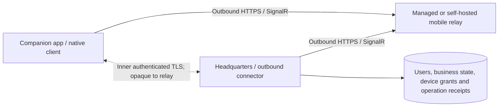

# Mobile relay architecture and protocol

Date: 2026-11-11. **Proposed v1 design; no runtime implementation asserted.**
See the [delivery plan](README.md) and [acceptance register](acceptance-and-operations.md).

## Baseline and implementation owners

Headquarters pins `CSweet.ConnectionService.Protocol` 0.7.0. The cached NuGet package's nuspec records commit `a9fcb6c5df887435b74056683fcd764ccc303c24`. The `D:\Repositories\CSweet.ConnectionService` checkout matches that commit and declares 0.7.0. The older sibling checkout declaring 0.3.0 is unsuitable for this baseline. Package provenance is established; the physical-device transport proof remains open.

| Boundary | Existing starting point | Proposed deliverable and authority |
| --- | --- | --- |
| C-Sweet / MAUI and shared UI | `MainPage` mounts `CSweet.UI.Routes`; `MauiProgram` installs a cookie HTTP handler; `BusinessContext` and `AppRealtimeState` carry web state | Mobile root, native transport, per-enterprise service scope, protected profile store, native files/browser callbacks. Only validated Headquarters results populate business screens. |
| C-Sweet / Headquarters | `AuthenticationService`, `ApplicationUser`, existing organization access and domain services, realtime outbox | Local identities, external identity links, member invitations, enterprise privileges and business grants, device policy, command execution and receipts. Web and mobile adapters use the same actor-aware services. |
| `CSweet.Market` repository | ASP.NET Core Identity with registration, confirmation, recovery, two-factor and passkey pages; cookie sign-in only; Identity email currently goes to a no-op sender | Becomes the OpenID Connect issuer on a dedicated account hostname. A C-Sweet account is a Market account, so user IDs, roles, purchases and entitlements are unchanged and no linking step exists. Adds device authorization for Headquarters, code + PKCE for the phone, installation registration and real Identity email. See [identity and installation linking](identity-and-installation-linking.md). |
| Enterprise directory (proposed module in Market, used only by linked installations) | New service surface | Authenticated lookup of one's invitations and enterprises. Contact descriptors contain enterprise ID, display name, relay binding and Headquarters public-key pin. Keep issuer and directory deployable independently of the relay. |
| ConnectionService repository | `IConnectionModule` and existing BCL-only protocol package | Mobile relay module, checkpointed usage and bounded routing. Protocol DTOs describe the transport. Business DTOs stay in C-Sweet. |

### From identity to membership

Headquarters has a single human account today. The member model, business access levels, enforcement on every endpoint, invitation data model and state table are specified in [multi-user Headquarters](multi-user-headquarters.md); this section describes how identities attach to it. The hosting choice made at first run (linked or private) and the linked registration flow are in [identity and installation linking](identity-and-installation-linking.md).

A verified account may have zero enterprises. An authorized Headquarters administrator creates a membership invitation for a recipient and selected access. Persist its hash, expiry, issuer restriction, intended grants and audit record at Headquarters. Deliver an official invitation through the directory/email, or a private one through an internal administrator handoff. On redemption, prove control of the invited identity, check that the inviter's grants are still assignable, and atomically consume the invitation, link or create the member, and publish an outbox change. A resend supersedes the old secret. Retries for the same accepted recipient recover the result. Member invitations and the five-minute phone pairing invitations below have separate purposes and lifetimes.

External identity links are unique by trusted issuer and subject. Use a verified email to address an invitation only. Bind native sign-in to the configured issuer, audience, transaction state, nonce and PKCE verifier. Use the platform browser for OIDC. Give Headquarters an assertion scoped to its enrollment flow, with validated subject binding; a directory session or Market cookie has no business authority. An existing Market customer signs in with the same account; there is nothing to link. Pairwise OIDC subjects can differ by client; use an explicit server-side account link when an issuer issues pairwise identifiers.

Local user activation uses the private Headquarters invitation inside the pinned enrollment channel. Headquarters provisions credentials and supports administrator-mediated recovery within the deployment. For company OIDC the administrator registers redirect URIs and issuer trust at the private IdP. Internal DNS, certificate trust, IdP and relay must be reachable from the phone. Private mode must start with discovery, public email, public telemetry and managed entitlement endpoints unavailable.

### Directory discovery and first contact

1. The operator opts the installation into discovery and verifies control of its installation identity. Pin issuance and rotation use the registered installation binding. Participating Headquarters publishes only the recipient binding, invitation/active/removed state, descriptor and revision. Commit changes with an outbox; the directory deduplicates by enterprise and update identity and rejects older revisions. Use bounded reconciliation after outages.
2. After shared sign-in, list memberships and invitations for the authenticated account only. Do not expose a lookup by arbitrary email. Once a member selects an enterprise, obtain a short-lived enrollment-only relay ticket bound to that route and the phone's public key. A private invitation supplies its own pin and limited ticket.
3. Verify the Headquarters pin and prove key possession inside the encrypted connection. Authenticate the person and check current membership or redeem the member invitation at Headquarters. Evaluate the device policy below. No business operation is accepted until enrollment completes.
4. Directory outages allow already enrolled profiles to reconnect using saved descriptors and their valid device grants. New shared sign-in or discovery can require a retry. Stale directory entries cannot restore removed membership. An ordinary reconnect never updates a saved pin from the directory.

## Connections and trust

The SignalR hub lives at the selected relay, proposed route `/hubs/mobile/v1`, reachable publicly or only inside the company network/VPN.
Headquarters is a SignalR client for this transport even though it remains the business
authority. Registering the existing local `AppEventsHub` URL is insufficient and is
not part of this design. Both endpoints initiate outbound TCP/443 connections; use
WebSockets for v1 and report an explicit unsupported-network state if upgrades are
blocked. No UPnP, router changes, reverse proxy to all Headquarters endpoints or public
Headquarters URL is required. Outer TLS uses normal hostname/certificate validation.

Relay routing identity, Headquarters business identity and phone enrollment are separate:

| Authority | Source of truth | What it permits |
| --- | --- | --- |
| Relay operator | Local service bootstrap/operator store | Operate that relay and allocate routes; cannot grant business access. |
| Managed entitlement | Service-side account/installation binding | Connect a paid or beta-entitled Headquarters route within its limits. |
| Headquarters connector | Relay-scoped enrollment key and active binding generation | Attach only its assigned Headquarters route. |
| Phone admission | Relay-scoped phone public key and active route grant | Open a channel to one Headquarters; no business permission. |
| Business session | Headquarters device record bound to an application user | Execute allowed catalog operations subject to current user/resource authorization. |

Identifiers in messages never establish authority. Relay groups and routing IDs are
delivery aids. Derive sender, route, role and generation from authenticated connection
state. Authenticate connector/device key possession using short-lived nonce-bound
proofs; persist nonce consumption to reject replay. Use separate key purposes and
audiences from OAuth deployment proofs and service-owner keys. A compromised relay
can deny/delay service and observe metadata; it must not impersonate Headquarters,
decrypt business content or authorize a command. A compromised Headquarters or unlocked
paired phone remains inside the content trust boundary.

## Inner encrypted channel

Use platform `SslStream` over a bounded, ordered duplex byte-stream adapter carried
by SignalR binary messages (MessagePack). Phone acts as TLS client; Headquarters as
TLS server over its outbound connection. This does not open a server network socket.
Require TLS 1.2 or newer and prefer TLS 1.3; reject obsolete protocols and anonymous
authentication. Do not invent a message cipher/key exchange or treat outer HTTPS as
end-to-end encryption. M0 must prove this arrangement on supported native platforms.

Each Headquarters has a protected persistent certificate key. The invitation pins
its SHA-256 SPKI fingerprint. Inner certificate validation checks that pin, certificate
validity, intended key use and supported algorithms; its trust model is explicit
enrollment rather than the public web PKI. Do not install a general trust override.
An ordinary reconnect cannot replace the pin. Headquarters key loss/identity rotation
requires fresh local authentication and phone re-pairing in v1.

Phone generates its own certificate key; enrollment records its SPKI fingerprint.
Unpaired channels permit only pairing against a pinned Headquarters certificate.
Paired channels require mutual TLS with exact device-key matching plus current
Headquarters device/user checks. Enrollment proves possession of the phone key before
activation. No payload-supplied application user or role is accepted as identity.
Store phone secrets through platform protected storage/key facilities and Headquarters
keys using protected host storage. Never serialize private keys into QR codes, browser
storage, logs, diagnostics or ordinary app preferences. Test backup/restore and reinstall
behavior explicitly; secure storage is not a guarantee of hardware-backed keys.

## Pairing and revocation

Steps 1–4 describe an existing user's **Pair my phone** flow. Account discovery supplies the restricted channel as described above. For a first-time private member, the administrator hands off a recipient-bound membership invitation plus a connection descriptor with the pin and a separately expiring enrollment ticket. Inside pinned TLS, redeem the invitation using the configured local activation procedure or company IdP proof, then join step 5. If only the transport ticket expires, a trusted HQ session can issue a fresh admission without broadening the member invitation. Administrative issuance never grants the administrator the member's identity.

1. A current authenticated, enabled user requests **Pair my phone** at Headquarters.
   A system administrator first enables the mobile module and enrolls the relay binding.
   Revalidate the web user's security stamp and require antiforgery on every local write.
   Users enroll only their own phones; there is no arbitrary target-user parameter.
2. Headquarters creates an invitation with a cryptographically random 256-bit secret,
   stores its hash, and sets a five-minute server-enforced expiry. Its record binds user,
   Headquarters identity, relay origin/binding generation and invitation ID. Obtain a
   matching short-lived relay admission ticket; that ticket cannot grant business access.
3. QR/manual invitation encodes version, exact HTTPS relay origin, opaque route ID,
   Headquarters ID/SPKI pin, invitation ID, expiry, admission ticket and pairing secret.
   Manual entry is the same high-entropy invitation, not a permanent master key or
   short enumerable PIN. The app previews the address and requires confirmation before
   contacting it; request size, scheme and version are validated before networking.
4. The phone generates a key, opens the restricted relay channel, verifies the inner
   Headquarters pin and submits the invitation secret, device label and proof of key
   possession inside TLS. The ticket never contains the pairing secret. Admission is
   atomically bound to the first phone key; reconnects prove that same key until expiry.
5. Identify the member and evaluate the current enterprise policy. **Phone-first** admits an invited/linked member after successful authentication. **Confirm privileged roles** additionally requires a trusted session for privileged users and is the enabling default. **Confirm every phone** holds each request for confirmation. Privileged includes installation or membership/device administration. Recheck effective privileges, policy revision, identity, expiry and revocation at activation; a promotion or tighter policy can move an unactivated request into waiting.
6. When confirmation is required, the member in an already trusted session or a Headquarters-authorized device approver reviews the exact member, device label and fingerprint. Bind the approval to the request and key. The pending phone cannot approve itself. A QR scan alone never activates a device. Atomically consume the pairing invitation where used, persist the member/device grant, audit record and relay-registration outbox.
7. Relay registration is idempotent. After a lost acknowledgement the same phone uses its recoverable enrollment receipt. The app shows **Approved, connecting** until the relay grant and Headquarters grant are usable. Denied, cancelled and expired requests are terminal.

A device request moves from authenticated request to optional awaiting confirmation, then consumed or a terminal denial/cancellation/expiry. A device grant moves from pending relay to active or revoked. At every transition reject a late completion for a revoked grant or superseded relay binding. User self-service is limited to one's own devices. Administrative approval and revocation require distinct authorized actions and audit records.

Device revocation commits at Headquarters immediately with audit/outbox, closes local
channels, and rejects further requests/event delivery. Relay revocation follows durably;
relay unavailability cannot delay the Headquarters denial. Disabled/locked/deleted users,
security-stamp changes and removed resource membership are checked on every operation
and outbound event; role information from initial connection is not sufficient.
Cancellation, expiry and revocation cannot be undone by a late completion/restart.

## Protocol and application integration

> **Decision D2 (2026-11-11).** The catalog operations, `MobileOperationDispatcher` adapters and `IMobileHeadquartersClient` described below are superseded by the [request tunnel and thin shell](tunnel-and-thin-shell.md). Where this section says "compiled, allowlisted adapters", read "routes marked `AllowFromMobile`". Transport, limits, idempotency keys, receipts, event and reconnect rules still apply. Do not build catalog adapters.

The mobile module advertises its own wire version `1.0`. Keep it independent of the
existing OAuth wire version. Reject unknown mobile major versions and unsupported
required features before enrollment. An old service lacking the module is unsupported,
not a successful mobile connection. The endpoint/protocol names here are proposed APIs.

| Surface | Required contract |
| --- | --- |
| Local `/api/mobile/settings` | Administrator-only read/update of enabled mode, exact relay origin, expected revision and safe connection state; separate from OAuth selection. |
| Headquarters membership | Admin invite/resend/cancel, change privileges or business access, remove member; recipient accepts for their authenticated identity. Persist grant revisions and directory outbox together. |
| Local `/api/mobile/invitations` | Short-lived own-device pairing, create/list/cancel. Return the secret once. Separate approval/deny command checks trusted actor, pending device key, expiry and policy. |
| Local `/api/mobile/devices` | List/rename/revoke own devices. An authorized administrator can review requests and revoke a grant within this Headquarters. Audit both actions. |
| Relay module | Operator/managed enrollment, nonce proof admission, invitation admission, device grant/revoke and status reconciliation; all typed, route-scoped and bounded. |
| Hub methods | `OpenChannel`, `SendFrame`, `CloseChannel`; server callbacks deliver open/frame/close notices. Channel IDs are service-assigned and bound to both authenticated endpoints and binding generation. |
| Inner messages | Versioned, length-prefixed UTF-8 JSON request/response, subscription, invalidation and operation-status messages. User authority is derived from the TLS session. |

Frame metadata contains only channel ID, direction/sequence and encrypted bytes.
Use a single ordered sender per channel; reject repeats, gaps, stale generations and
cross-route IDs by closing the channel. A reconnect starts a fresh channel/TLS session;
never splice old frames into a new encrypted stream. Acknowledged hub forwarding is
not business-command acceptance. A slow receiver triggers bounded backpressure, then
channel closure and resynchronization rather than unbounded buffering.

Inner requests carry request ID, catalog operation/version, bounded resource parameters,
deadline, and mutation idempotency key/expected resource revision where applicable.
Responses carry correlation ID, success DTO or fixed error code, and durable operation
ID for async work. Only compiled, allowlisted adapters are dispatchable. Do not accept
arbitrary URLs, HTTP headers, methods, SQL, file paths or local ports. Limit initial
reads to the screen families and writes named in the [plan](README.md).

`MobileOperationDispatcher` creates a scoped authenticated actor from the device record
and calls the same canonical application services and access checks as native APIs.
Extract shared authorization where an endpoint currently owns it; do not replace it
with a weaker mobile-only check. Server code derives actor/organization relationships.
Reuse business DTOs and expose `IMobileHeadquartersClient` to the companion screens.
Use a native `IAppRealtimeConnection` implementation for those screens; retain browser
cookie/antiforgery behavior for the existing web host. Do not register the browser-only
credentials handler as the MAUI relay transport or emulate an administrator cookie.

Mutation keys are unique by user, operation and Headquarters; bind the canonical
request digest, target and expected revision. Same key/different input is a conflict.
Persist admission/receipt and the domain effect or durable work creation in one
Headquarters database transaction. Existing domain idempotency remains authoritative;
if an operation cannot provide this boundary, keep it disabled until adapted. An
uncertain client queries by original key before any resend. Reauthorize status/result
reads; no cached successful reply may reveal content to a now-revoked user. No automatic
execution queue at the relay; Headquarters offline returns a clear unavailable state.

Retain recoverable result receipts for at least 30 days. After response content is pruned,
retain the operation key/digest and durable domain-result reference as a deduplication
fence for the lifetime of that effect. A pruned result returns an explicit expired-result
state; it never causes the same operation key to execute again. Bound unresolved receipts
per device and reject new submissions under storage pressure rather than evicting a fence.

Events are wake hints, not snapshots or execution grants. Add a mobile recipient lane
beside the current publisher without letting an offline relay stall LAN delivery or
retain unbounded event history. Reuse committed outbox changes and current recipient
resolution, then recheck current access before mobile delivery. Send a minimal
`AppRealtimeEventEnvelope` projection containing event ID/type and authorized resource
references/revision; never blindly forward `Data`, private message bodies or all agents'
traces. The phone deduplicates event IDs and refreshes authorized canonical reads.

V1 reconnect performs bounded paginated current-state reloads for the active business,
visible conversations/boards and attention items, plus unresolved operation receipts.
Subscribe before reading and coalesce invalidations during the reads; repeat dirty
resources until stable. Do not use the global outbox sequence as a complete per-user
replay cursor: authorization filtering creates gaps and publication is not a phone ack.
No offline event replay promise. Pagination expiry forces a new read, never a mixed
permission snapshot. Queries remain bounded and cancellable; background app suspension
tears down transport and foreground resume performs this same recovery. While the app is suspended or closed, a content-free [push notification](push-notifications.md) tells the person something is waiting; it never replaces the reads above.

## Enterprise sessions and parity capabilities

Identify each saved profile by Headquarters identity and member identity. Relay origin can change. Use separate protected key references and credential namespaces for each profile. The account-level chooser retains minimal display metadata. The active service scope owns navigation, business focus, reads, subscriptions, badges, transient documents and drafts. Give every activation a fresh generation even when returning to the same profile. On confirmed switch, invalidate the old generation before cancellation/disposal, empty navigation history and present the new Enterprise root. Apply asynchronous results only while their generation matches. Keep unresolved operation IDs partitioned by their originating profile across process death.

The initial catalog supports read-only screens, then chat/read markers and approval decisions. Expand it by workflow and advertised capability until the [parity matrix](workflow-parity.md) is covered. A visible action also requires current resource authorization. For files negotiate maximum sizes, bounded chunk sizes and backpressure. Use a transfer ID bound to the user, device, enterprise and resource. Verify length and digest before committing an upload; cancel or expire partial content. Reauthorize downloads/resume, clean temporary files on exit, and count bytes against relay limits. Do not embed entire files in the JSON command lane.

A provider browser return carries an opaque one-time transaction tied to the initiating profile, actor, operation and expected callback. Preserve the existing provider service's redirect/consent checks. On app resume, query that transaction at its originating Headquarters, even if the user switched enterprises. Display a completion only in the matching authorized session. Duplicate or expired returns cannot bind another provider account.

## Hosting changes and recovery

`MobileConnectivityOptions` is separate from provider `PluginConnectionOptions`.
Disabled is the migration default and the default for a private installation; a new linked installation starts as Managed. Managed origin is application-owned configuration;
custom origins require operator approval through exact origin network policy. Preserve
TLS/DNS destination validation, redirect denial and explicit private-network opt-in.
QR scanning never expands Headquarters' allowed-origin policy.

Switching mobile relays increments its binding generation, disconnects the old lane,
enrolls a new relay key and registers current phone public keys through a durable
reconciliation job. It does not change Headquarters identity or provider OAuth bindings.
An authenticated current phone receives an encrypted migration descriptor before cutover
when possible; an offline phone can scan a non-secret connection descriptor from the
local Headquarters UI. It accepts the new relay only after user confirmation and the
same pinned Headquarters identity plus device-key authentication. Old admissions cannot
grant new-generation access. Old-relay cleanup may remain pending, visibly, but cannot
restore Headquarters access. Do not promise transparent migration for offline phones.

On loss of Headquarters identity/protected key storage, require local recovery and
re-pairing. On database restore, keep mobile connectivity disabled until an operator
rotates relay admissions and revokes all restored device grants before re-enrollment;
do not allow restore to silently resurrect revoked devices. A relay restore requires
fresh connector/device grant reconciliation and new connection generations. Treat
backup handling as a release prerequisite, not as solved by SignalR reconnect.

The restore procedure must start with the connector disabled before loading a snapshot,
invalidate restored device grants and rotate route admissions before reenabling it.
Ship this as an explicit maintenance command/runbook with crash-recovery tests. Arbitrary
manual rollback of both database and protected storage outside that procedure cannot
be detected reliably from the restored snapshot alone; do not claim otherwise.

References for implementation (the proposed combination still requires M0 validation):
[SignalR .NET client](https://learn.microsoft.com/en-us/aspnet/core/signalr/dotnet-client?view=aspnetcore-10.0),
[SignalR security](https://learn.microsoft.com/en-us/aspnet/core/signalr/security?view=aspnetcore-10.0),
[SslStream](https://learn.microsoft.com/en-us/dotnet/api/system.net.security.sslstream?view=net-10.0),
[MAUI secure storage](https://learn.microsoft.com/en-us/dotnet/maui/platform-integration/storage/secure-storage?view=net-maui-10.0).
