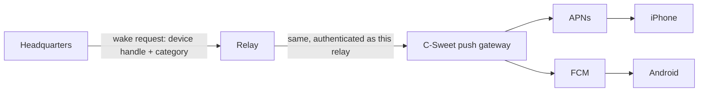

# Push notifications

Updated 2026-11-12 after independent review (gateway no longer trusts the relay, acceptance split by app state). **Proposed design; nothing here is implemented.** Decision D5 in the [decision log](decisions.md): push is part of the first release. No push code exists in any repository today.

## What push is for

Telling a person that something at one of their enterprises needs them while the app is closed. It never carries business content, and it is never the source of truth: tapping a notification opens the app, which connects to Headquarters and reads the current state as usual.

| Category | Sent when | Default |
| --- | --- | --- |
| `approval` | A decision is assigned to the person | On |
| `message` | A direct message or a mention | On |
| `device` | A phone is waiting for this person's approval | On |
| `attention` | An item enters the person's attention list (blocked work, failed stage they own) | On |
| `security` | A new phone was enrolled for their account, or their access changed | On, cannot be turned off. Lock-screen text is always the generic line; detail only after unlock. |

## Path

- **Headquarters** decides that a person should be notified, from the same committed outbox changes that feed realtime, after rechecking the person's current access. It sends one wake request per enrolled device over its existing relay connection.
- **Relay** forwards the wake. It is a carrier only: it never sees a platform token and its limits are a courtesy, not the control.
- **Push gateway** holds the Apple and Google credentials for the published app, and is where trust is enforced. The relay is the party the encrypted channel is designed to distrust, so it must not be the one the gateway believes. The gateway owns: the phone's consent, the binding between a gateway handle, a device and a route, quotas, expiry, replay rejection and revocation of a sender.

**Registration.** The phone registers its platform token **directly with the gateway** over HTTPS and receives an opaque gateway handle bound to that phone and to one Headquarters route. The phone gives the handle (never the token) to Headquarters inside the encrypted channel. Headquarters asks the gateway, through the relay, to wake a handle; each request carries a short-lived, single-use authorization that the gateway can verify came from the Headquarters bound to that handle. A compromised relay can drop or delay wakes but cannot forge one for a handle, raise limits or learn tokens.

**What each party learns**

| Party | Learns | Never learns |
| --- | --- | --- |
| Relay | That some handle at route R was woken at time T |
| Gateway | That handle H (bound to a device and a Headquarters) was woken at time T with category C | Who sent what, any text, any business or resource ID |
| Apple / Google | That the app on this device was woken, and the category key | Enterprise, sender, content |

**Payload.** The category, a collapse key that is random per handle and category (not derived from the route, so the provider cannot correlate enterprises), and the opaque profile reference the phone supplied when it registered with the gateway. Nothing else. The visible text is a localized template chosen on the phone by category, for example "Northstar: an approval is waiting", where the enterprise name comes from the phone's own saved profile. If the profile cannot be found the text is "C-Sweet: something needs your attention".

- iOS: alert push with `mutable-content`; a notification service extension reads the enterprise label from the app group and rewrites the title. No network call in the extension.
- Android: high-priority data message; the app's messaging service builds the local notification the same way.
- No badge counts in v1. A count is business data and would need its own design.

## Private and self-hosted installations

| Deployment | Push |
| --- | --- |
| Linked, official relay | Works. |
| Self-hosted relay with internet egress | Works if the operator enables **Use C-Sweet push gateway** and the phone can reach the gateway to register. The gateway learns device tokens and wake times. Off by default. |
| Isolated network (no egress) | Not available. Apple and Google delivery needs the internet. The app says so in Settings → Notifications and keeps foreground realtime. |

A custom build of the app with the operator's own Apple and Google credentials is possible because the app is open source; document it, do not build tooling for it in v1.

## Lifecycle

1. After enrollment the phone asks the OS for notification permission, at a moment the person understands (after the first successful connection, not on first launch).
2. The phone obtains its platform token, registers it with the gateway, and sends the returned handle to Headquarters inside the encrypted channel.
3. Token rotation: the phone re-sends on every launch if the token changed.
4. Revocation, sign-out, removed membership or profile removal: Headquarters stops sending and asks the gateway to delete the handle; the phone also deletes it directly when it can. Revoking one enterprise's handle leaves the same phone's other enterprises working.
5. Headquarters submitting no further wakes after a revoke is the guarantee. A notification already accepted by Apple or Google before the revoke may still be shown; it carries no content.

**Per-person settings.** Settings → Notifications on the phone, stored at Headquarters per device: each category on or off (except `security`), and quiet hours in the person's time zone. Headquarters applies them before sending, so muted categories generate no traffic at all.

**Limits (initial defaults), enforced at the gateway.** 30 wakes per handle per hour and 300 per Headquarters per hour; identical collapse keys within 30 seconds are merged at Headquarters; over the limit Headquarters stops sending for that device until the next hour and records it. Wake requests do not count against the 10 GiB traffic allowance but are counted and reported.

**Failure rules.** Push is best effort. A failed or delayed wake never blocks the outbox, LAN realtime or any business transaction. Headquarters offline means no push; the relay never queues wakes on behalf of Headquarters.

## Data and contracts

| Where | Addition |
| --- | --- |
| Headquarters | `MobileDevicePushRegistrations`: `DeviceGrantId`, `GatewayHandle`, `CategoriesJson`, `QuietHoursJson`, `UpdatedAt`. Headquarters never holds the platform token. |
| Relay | Nothing stored. Forwards `Wake` and enforces a coarse per-route rate. |
| Mobile protocol | `Wake(gatewayHandle, category, authorization)`; capability flag `push` so an older relay is reported as "push not supported", not as an error. |
| Gateway | `POST /register` (phone: platform token, profile reference, route binding proof) returns a handle; `DELETE /register/{handle}`; `POST /wake` verified against the handle's bound Headquarters, with quota, expiry and replay checks; rejected tokens delete the handle. |

## Issues

**PN-01 · Spike: receive a push on both platforms — M · Senior-led.** A throwaway MAUI app receives an alert push on a physical iPhone and a data message on a physical Android phone, in Release builds, with the app closed. Choose and record the Android Firebase binding package. Confirm the iOS notification service extension builds with the MAUI project. This runs alongside the M0 transport spike and has the same stop rule.

**PN-02 · Push gateway — L · Senior-led.** Phone registration and handle binding, `POST /wake` with verification, quotas, expiry and replay control, Apple token-based auth, Google service-account auth, feedback collection, secrets from protected configuration, no payload logging. Tests with fake providers; one manual send to each real platform recorded as device evidence.

**PN-03 · Relay forwarding and wake authorization — M · Senior-led.** `Wake` message, coarse rate, and the Headquarters-signed authorization the gateway verifies. Tests: a relay-forged wake is rejected by the gateway; a replayed authorization is rejected; a wake for a handle bound to another Headquarters is rejected.

**PN-04 · Headquarters notification decisions — L · Senior-led.** Map outbox event types to categories, resolve recipients, recheck access, apply settings and quiet hours, merge duplicates, send. Tests: a person removed from the business gets no wake; muted category sends nothing; relay unavailable does not delay the outbox.

**PN-05 · Phone registration and permission prompt — M · Junior + review.** Permission prompt after first connection, token registration and rotation, deletion on sign-out and profile removal. Platform code in `CSweet.Maui/Platforms`; the decision logic in `src/CSweet.UI/Mobile/` with unit tests.

**PN-06 · Notification display and tap handling — M · Senior contract, junior implements display.** A senior first specifies and proves on hardware: profile selection after process death, behaviour when the profile was revoked, the unsent-edit path, and the iOS extension timing out (the original generic text is shown). Then: Localized templates per category in all supported languages, enterprise label lookup, tap opens the right enterprise (switching profile if needed, through the normal switch path with its unsent-edit guard) and lands on the category's list (approvals, conversations, device requests, attention).

**PN-07 · Notification settings screen — M · Junior.** Settings → Notifications: categories, quiet hours, and the "not available on this network" state for isolated deployments.

**PN-08 · Self-hosted relay gateway option — S · Senior-led.** Operator setting to forward wakes to the C-Sweet gateway, and documentation of what the gateway learns. The relay needs no gateway credentials of its own.

## Acceptance

- The guaranteed behaviour is that opening the app shows current state. Delivery is tested per app state, recording provider submission time and observed arrival separately: foreground, background, ordinary termination (swiped away), permission denied, and delayed delivery. Android **Force stop** from system settings blocks delivery until the app is reopened; record that as expected, not as a failure. Tapping a delivered notification opens that enterprise's approvals.
- The captured push payload contains no enterprise name, person, business or resource identifier.
- Revoke the phone at Harbor: Headquarters submits no further wake for it, and Northstar notifications on the same phone still arrive.
- A relay that fabricates a `security` wake, or replays a captured one, is rejected by the gateway.
- Two enterprises on one phone: a wake for Harbor while Northstar is active shows "Harbor", and tapping asks before discarding an unsent Northstar edit.
- Isolated network: no outbound connection attempts to Apple, Google or the gateway from relay or Headquarters.
