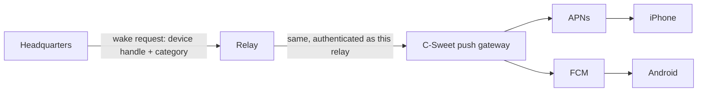

# Push notifications

Date: 2026-11-11. **Proposed design; nothing here is implemented.** Decision D5 in the [decision log](decisions.md): push is part of the first release. No push code exists in any repository today.

## What push is for

Telling a person that something at one of their enterprises needs them while the app is closed. It never carries business content, and it is never the source of truth: tapping a notification opens the app, which connects to Headquarters and reads the current state as usual.

| Category | Sent when | Default |
| --- | --- | --- |
| `approval` | A decision is assigned to the person | On |
| `message` | A direct message or a mention | On |
| `device` | A phone is waiting for this person's approval | On |
| `attention` | An item enters the person's attention list (blocked work, failed stage they own) | On |
| `security` | A new phone was enrolled for their account, or their access changed | On, cannot be turned off |

## Path

- **Headquarters** decides that a person should be notified, from the same committed outbox changes that feed realtime, after rechecking the person's current access. It sends one wake request per enrolled device over its existing relay connection.
- **Relay** maps the Headquarters-scoped device handle to the stored platform token and forwards. It applies per-device and per-route rate limits.
- **Push gateway** holds the Apple and Google credentials for the published app. Those credentials belong to the app's publisher and cannot be handed to self-hosted relays, so the gateway is a small separate C-Sweet service (it can ship in the same process as the official relay).

**What each party learns**

| Party | Learns | Never learns |
| --- | --- | --- |
| Relay and gateway | That device D at route R was woken at time T with category C | Who sent what, any text, any business or resource ID |
| Apple / Google | That the app on this device was woken, and the category key | Enterprise, sender, content |

**Payload.** Platform token, a collapse key (`route + category`), the category, and an opaque profile reference the phone itself created at enrollment. Nothing else. The visible text is a localized template chosen on the phone by category, for example "Northstar: an approval is waiting", where the enterprise name comes from the phone's own saved profile. If the profile cannot be found the text is "C-Sweet: something needs your attention".

- iOS: alert push with `mutable-content`; a notification service extension reads the enterprise label from the app group and rewrites the title. No network call in the extension.
- Android: high-priority data message; the app's messaging service builds the local notification the same way.
- No badge counts in v1. A count is business data and would need its own design.

## Private and self-hosted installations

| Deployment | Push |
| --- | --- |
| Linked, official relay | Works. |
| Self-hosted relay with internet egress | Works if the operator enables **Use C-Sweet push gateway**. The relay registers with the gateway using its own key; the gateway learns only device tokens and wake times. Off by default. |
| Isolated network (no egress) | Not available. Apple and Google delivery needs the internet. The app says so in Settings → Notifications and keeps foreground realtime. |

A custom build of the app with the operator's own Apple and Google credentials is possible because the app is open source; document it, do not build tooling for it in v1.

## Lifecycle

1. After enrollment the phone asks the OS for notification permission, at a moment the person understands (after the first successful connection, not on first launch).
2. The phone obtains its platform token and sends it to Headquarters inside the encrypted channel, with a random profile reference. Headquarters stores a device handle and sends handle + token to the relay with the device grant.
3. Token rotation: the phone re-sends on every launch if the token changed.
4. Revocation, sign-out, removed membership or profile removal: Headquarters deletes the handle and tells the relay to delete the token. A wake for a deleted handle is dropped.
5. The gateway reports tokens that Apple or Google reject as unregistered; the relay deletes them and tells Headquarters.

**Per-person settings.** Settings → Notifications on the phone, stored at Headquarters per device: each category on or off (except `security`), and quiet hours in the person's time zone. Headquarters applies them before sending, so muted categories generate no traffic at all.

**Limits (initial defaults).** 30 wakes per device per hour and 300 per route per hour at the relay; identical collapse keys within 30 seconds are merged at Headquarters; over the limit Headquarters stops sending for that device until the next hour and records it. Wake requests do not count against the 10 GiB traffic allowance but are counted and reported.

**Failure rules.** Push is best effort. A failed or delayed wake never blocks the outbox, LAN realtime or any business transaction. Headquarters offline means no push; the relay never queues wakes on behalf of Headquarters.

## Data and contracts

| Where | Addition |
| --- | --- |
| Headquarters | `MobileDevicePushRegistrations`: `DeviceGrantId`, `Handle`, `Platform` (Apns, Fcm), `ProfileReference`, `CategoriesJson`, `QuietHoursJson`, `UpdatedAt`. The platform token is forwarded to the relay and not stored here. |
| Relay | `DevicePushTokens`: `RouteId`, `Handle`, `Platform`, `TokenProtected`, `UpdatedAt`. Deleted with the device grant. |
| Mobile protocol | `RegisterPushToken(handle, platform, token)`, `DeletePushToken(handle)`, `Wake(handle, category, collapseKey)`; capability flag `push` so an older relay is reported as "push not supported", not as an error. |
| Gateway | `POST /wake` authenticated by relay key; `GET /feedback` for rejected tokens. |

## Issues

**PN-01 · Spike: receive a push on both platforms — M · Senior-led.** A throwaway MAUI app receives an alert push on a physical iPhone and a data message on a physical Android phone, in Release builds, with the app closed. Choose and record the Android Firebase binding package. Confirm the iOS notification service extension builds with the MAUI project. This runs alongside the M0 transport spike and has the same stop rule.

**PN-02 · Push gateway — M · Senior-led.** `POST /wake`, Apple token-based auth, Google service-account auth, feedback collection, secrets from protected configuration, no payload logging. Tests with fake providers; one manual send to each real platform recorded as device evidence.

**PN-03 · Relay token store and forwarding — M · Senior-led.** Table, three protocol messages, rate limits, deletion on revoke. Tests: wake for another route's handle is rejected; revoked device receives nothing; limit reached.

**PN-04 · Headquarters notification decisions — L · Senior-led.** Map outbox event types to categories, resolve recipients, recheck access, apply settings and quiet hours, merge duplicates, send. Tests: a person removed from the business gets no wake; muted category sends nothing; relay unavailable does not delay the outbox.

**PN-05 · Phone registration and permission prompt — M · Junior + review.** Permission prompt after first connection, token registration and rotation, deletion on sign-out and profile removal. Platform code in `CSweet.Maui/Platforms`; the decision logic in `src/CSweet.UI/Mobile/` with unit tests.

**PN-06 · Notification display and tap handling — M · Junior + review.** Localized templates per category in all supported languages, enterprise label lookup, tap opens the right enterprise (switching profile if needed, through the normal switch path with its unsent-edit guard) and lands on the category's list (approvals, conversations, device requests, attention).

**PN-07 · Notification settings screen — M · Junior.** Settings → Notifications: categories, quiet hours, and the "not available on this network" state for isolated deployments.

**PN-08 · Self-hosted relay gateway option — S · Senior-led.** Operator setting, relay registration with the gateway, documentation of what the gateway learns.

## Acceptance

- With the app force-closed on both platforms, assigning an approval produces a notification within ten seconds on a normal connection; tapping it opens that enterprise's approvals.
- The captured push payload contains no enterprise name, person, business or resource identifier.
- Revoke the phone: a subsequent approval produces no notification.
- Two enterprises on one phone: a wake for Harbor while Northstar is active shows "Harbor", and tapping asks before discarding an unsent Northstar edit.
- Isolated network: no outbound connection attempts to Apple, Google or the gateway from relay or Headquarters.
