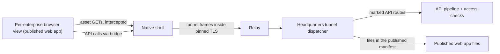

# Request tunnel and thin shell

Updated 2026-11-12 (second revision that day). **Proposed design; nothing here is implemented.** See decision D2 in the [decision log](decisions.md).

**Target: thin shell.** The app ships a native shell. Each enterprise's pages come from that enterprise's own Headquarters, so pages always match the Headquarters they talk to. The reason is version skew: with pages bundled in the app, every one of about 660 routes and every page would have to stay compatible across app and Headquarters versions that drift constantly (store updates versus Headquarters auto-update, several enterprises per phone). The thin shell reduces the version contract to the tunnel protocol and a small bridge.

**Gate.** A prototype (TS-13) runs alongside H1–H3 and must pass before H4 is built. If it fails on something that cannot be fixed, H4 and later work use **bundled screens** over the same tunnel; the tunnel, dispatcher, route marking, access checks and phone-width layout work carry over unchanged.

This revision replaces the earlier loopback-proxy design, which independent review showed could not load the published web app (`<base href="/">`, root-relative assets) and did not contain a hostile Headquarters. There is no local listener on the phone. The realtime hub is not forwarded; the phone receives minimal hints. Writes use one recovery contract. Transport, pairing, revocation, event and restore rules in [architecture.md](architecture.md) still apply; this guide replaces its catalog-operation parts.

## What the person sees

- **Native shell (in the app).** Launch, sign-in, private pairing, enterprise chooser, waiting for approval, unreachable and revoked screens, the top bar with the enterprise selector, notifications, camera and file pickers. Built in [Phase 1](phase-1-shell.md).
- **Enterprise content (from that Headquarters).** Below the top bar, a browser view runs the published web app (`CSweet.App`) fetched from the active enterprise's Headquarters through the encrypted channel.

## Shape

### Loading the web app

- **One origin per enterprise, stable across launches**, that never resolves on the network (for example a reserved host name the shell intercepts, or a custom scheme). The web app runs at the root of that origin, so `<base href="/">` and root-relative assets work unchanged. The mechanism per platform is chosen in TS-13.
- The shell answers the browser view's **GET** requests for that origin itself. Both platforms let an app intercept GET loads. No POST or WebSocket interception is needed, because API calls do not use the view's network stack.
- Files come from Headquarters through the tunnel and only if listed in the **published-file manifest** (TS-14): path, content hash, size. Headquarters serves them from its published web directory, never by proxying to the web frontend (which also proxies other routes).
- The shell caches files per enterprise by content hash. A cold start against an unchanged Headquarters downloads only the manifest; a Headquarters update downloads only changed files.
- **Every other request from the view is blocked**: other origins, frames, any URL not in the manifest. Outside links open in the system browser after a native confirmation.
- **Separate browser data store per enterprise** (cookies, local storage, caches, service workers). Both platforms offer this only on recent OS and WebView versions; TS-13 records the minimums, and the app's minimum OS (iOS 15 and Android API 24 today) may rise.

### API calls

In shell mode the web app does not use `fetch` for the API. `CSweet.App/Program.cs` already builds its `HttpClient` at startup (today with `CookieAndAntiforgeryHandler`). When it detects the shell bridge it uses a `ShellBridgeHttpHandler` *(proposed)* instead, which hands each request to the shell. The shell sends it through the tunnel and returns the response. No cookies or antiforgery tokens exist on this path; identity comes from the device's TLS session at Headquarters.

### Bridge

The bridge is the only way page code reaches native code, and it is where a hostile Headquarters is contained.

- Accept messages only from the main frame of the active enterprise's view, and only while it is active.
- Each view's bridge is bound to one enterprise. It can never name, list or reach another profile, tokens or keys.
- `request` goes only to that enterprise's tunnel and only to paths the dispatcher accepts; the shell rejects anything else before sending.
- Camera, file pick, file save, outside links and anything that would switch enterprise need a **native confirmation** naming the enterprise.
- Validate every argument, cap sizes, rate-limit.

| Call (web → shell) | Purpose |
| --- | --- |
| `hello(contractVersion)` → `{shellVersion, profileLabel}` | Version check; outside the window the shell shows "update needed" |
| `request(method, path, headers, body, operationKey)` | API call through the tunnel. With an operation key, the shell stores it in the protected per-profile store before sending. |
| `subscribeHints(resourceTypes)` | Realtime hints for this enterprise |
| `setUnsavedWork(bool)` | Unsent-edit warning before a switch or notification tap |
| `scanCode()`, `pickFile(accept)`, `saveFile(name, transferId)` | Native features with confirmation; bytes move through the file-transfer lane |
| `openExternal(url)` | System browser after confirmation; provider returns matched to the originating enterprise |

| Event (shell → web) | Purpose |
| --- | --- |
| `hint(event)` | A resource changed; the page re-reads it |
| `navigate(path)` | After a notification tap |
| `resumed()` | Foreground resume; refresh and re-check pending operation keys |

## Request tunnel

The shell (or, in the fallback, bundled pages) sends API requests as tunnel messages inside the encrypted channel. There is no local listener and no loopback port.

### Messages

One request per stream ID; at most eight streams per phone.

| Message | Fields |
| --- | --- |
| `RequestHead` | stream ID, method, path and query, permitted headers, operation key, deadline |
| `RequestBody` / `ResponseBody` | stream ID, bytes (at most one frame), end flag |
| `ResponseHead` | stream ID, status, permitted headers |
| `Reset` | stream ID, fixed reason code |

Bodies stream with backpressure. The 256 KiB limit in the operations register applies to JSON bodies; files use the separate transfer lane.

**Permitted request headers:** `Accept`, `Accept-Language`, `Content-Type`, `Content-Length`, `If-None-Match`, `X-CSweet-Operation-Key`. `Cookie`, `Authorization`, `Origin`, `Host` and forwarding headers never cross. **Permitted response headers:** `Content-Type`, `Content-Length`, `Content-Encoding`, `ETag`. `Set-Cookie` and `Location` are removed.

### Dispatcher at Headquarters

The dispatcher's entry into the API is **not yet proven** and TS-02 must prove it on a packaged build before the dispatcher (TS-03) is built. The TS-13 prototype does not depend on it. Facts it has to respect:

| Fact in the source | Consequence |
| --- | --- |
| `ApiAntiforgeryMiddleware` validates an antiforgery token on every authenticated non-GET `/api` request (skipped only in the `Testing` environment). | A device-authenticated request has no token. The exemption must apply only to requests that entered through the dispatcher and were authenticated by the device scheme, and must be impossible to claim from ordinary HTTP. Cookie requests must still fail without a token; test both. |
| Some endpoints select the Identity cookie scheme explicitly, validate the security stamp, check the administrator role and validate antiforgery themselves (example: `ConnectionServiceAdministrationEndpoints`). | These are unreachable from a phone until each one is deliberately adapted. Do not weaken them generically. |
| The API and the web app are deployed separately (separate web directory on Windows; nginx container in Docker, which proxies `/api/` and `/git/` and has no `/hubs/` location). | The dispatcher targets the API process only. It never forwards to the web frontend, which itself proxies other routes. |
| Authorization outside named policies exists: explicit `.RequireAuthorization()`, scheme-specific policies, handler checks and broker middleware. | The dispatcher must resolve the final endpoint once and run its actual policy, not re-implement policy lookup. |

Rules:

1. Identity is the person bound to the device's TLS session, rebuilt per request from the device record with enabled state and security stamp rechecked. It is carried by a dedicated authentication scheme that only the in-process dispatcher can issue.
2. Only routes with the `AllowFromMobile` marker are dispatched; everything else is 404. The marker states read or write. Administrator-policy routes need a second explicit marker.
3. A route is marked "read" only after checking it has no side effects. Example to fix first: the approvals dashboard read performs expiration reconciliation.
4. Marking a route requires that its handler or service checks **ownership of the target record**, not only the business in the URL (see the [multi-user guide](multi-user-headquarters.md), "Resource ownership").
5. Static files only from the published-file manifest, GET only, exact path and hash. No hub socket, no arbitrary hosts, ports or paths.

### Realtime

The phone does not connect to `AppEventsHub`. The live publisher sends the full envelope including arbitrary `Data`, and hub groups are joined once at connection time, so forwarding it would leak content and survive a downgrade. Instead, implement the mobile recipient lane from the architecture guide: after rechecking the person's current access, Headquarters sends `{event id, type, resource reference, revision}` over the encrypted channel, and the shell delivers each hint to the active enterprise's view (`hint`), where the page re-reads the resource. (Fallback: a native `IAppRealtimeConnection` does the same for bundled pages.) First deliverable: one hint type, proven with removal of access during an open connection and during an in-flight read.

### Writes: one recovery contract

There is one answer to "did this action happen", and it lives in the domain service.

- A mobile write that changes business state must carry an operation key; the dispatcher rejects it otherwise.
- The key is bound to the person, the route, a digest of the request and the expected revision. Same key with different input is a conflict.
- Use the idempotency the domain already has. Message send (`CommunicationHubService`) and decision answer (`ExecutiveDecisionService`) already deduplicate; pass the key into them. Do not add a second ledger beside them that could disagree.
- A write whose service has no idempotency is **not marked for mobile** until it does. There is no generic "in doubt" receipt.
- The shell stores the pending key, target Headquarters and person in the protected per-profile store **before** sending (not in browser storage), and asks for the result by key after any uncertain outcome. Result reads are reauthorized.
- Proof workflow: chat send. Drop the response after commit, restart both sides, recover exactly one message, reject changed input under the same key, and deny the result read after membership removal.

### Versions

Pages always match their Headquarters. What still needs a supported window is the tunnel protocol and the bridge contract. Headquarters advertises both at connect; outside the window the shell shows which side needs updating. Test one older and one newer supported counterpart and one refused combination.

## Prototype (TS-13), alongside H1–H3

One mid-range Android phone about three years old, one iPhone of similar age, and one device at the app's minimum OS, over cellular, against two real Headquarters on different versions.

| Check | Pass |
| --- | --- |
| Real published `CSweet.App` loads, changed only by shell-mode detection | Yes, both platforms |
| First open of an enterprise (nothing cached) to usable business list | 30 s or less |
| Cold start, Headquarters unchanged | 5 s or less, only the manifest downloaded |
| Navigation between visited pages | 1 s or less for 95 % of taps |
| Ten minutes with two enterprise switches | No reload, no OS kill of the view |
| Data written by enterprise A's pages | Not readable from B's view |
| Test page calling the bridge from a frame, from an inactive view, with another profile's ID, or for the camera without confirmation | All rejected |
| Requests from the view to non-manifest URLs or other origins | Blocked |
| Minimum OS and WebView versions for per-enterprise data stores | Recorded |
| Apple review risk | A senior reads the current guidelines on downloaded code and native bridges and records a view; submit a TestFlight build with a review note if possible |

The owner also uses the build for a day. Thresholds may change before the prototype runs, not after.

**Outcomes.** Pass: H4 is built on the thin shell. Fail on speed only: try the optimisations once (trimmed build, load only the active language's data, compressed files), then decide. Fail on isolation, bridge containment or store review with no fix: switch to bundled screens. Record the outcome in the decision log.

## Issues

**TS-13 · Thin-shell prototype — L · Senior-led. Start now, alongside H1–H3.** Per-enterprise origin and data store, GET interception, manifest-based asset fetch over a desktop stand-in for the tunnel, `ShellBridgeHttpHandler`, bridge v0, request blocking. Run the table above. Throwaway; findings feed TS-15 and TS-16.

**TS-01 · Tunnel message codec — M · Senior-led.** Encode and decode with size and field limits. Property tests for malformed input, oversize, unknown stream IDs, interleaving.

**TS-02 · Dispatcher entry proof — M · Senior-led. Do with the spikes.** Packaged build, API and web frontend as separate processes: one authorized read, one write, one denied administrator operation. Prove the device scheme cannot be claimed from HTTP ingress, cookie writes still need antiforgery, and the endpoint's real policy ran. Record the mechanism in the decision log. If no safe mechanism exists, stop and revise.

**TS-03 · Dispatcher — L · Senior-led.** Rules 1 to 5 including the manifest file target, header filtering, streaming, deadlines, resets. Tests: unmarked route 404; administrator route without the second marker 404; file not in manifest 404; revoked device cut mid-stream; `Set-Cookie` never leaves.

**TS-04 · `AllowFromMobile` marker and conformance rule — S · Senior-led.** A marked route must also carry an access rule and a recorded ownership review.

**TS-05 · Operation keys on the first two writes — M · Senior-led.** Message send and decision answer, using their existing idempotency. Done check: the chat-send loss-and-recovery proof.

**TS-06 · Shell-mode HTTP handler in the web app — M · Senior-led.** `ShellBridgeHttpHandler` and shell detection in `CSweet.App/Program.cs`; normal browser behaviour unchanged (test both).

**TS-07 · Mobile realtime lane — M · Senior-led.** One hint type end to end through the bridge; access removed during an open connection and during an in-flight read.

**TS-08 · Protected pending-operation store — S · Senior-led.** Per profile, survives process death, cleared on profile removal.

**TS-09 · Version window and update-needed screen — S · Junior + review.** After a senior fixes the window and advertised versions.

**TS-10 · Mark the first routes — M · Senior decides, junior implements.** For H4: auth status and the business list. A senior reviews each route's side effects and ownership check first.

**TS-11 · Phone layout pass, one navigation group per issue — M each · Junior.** In the web app at 360 px: no horizontal scrolling, primary action reachable, dialogs fit, tables have a stacked form, board drag has a menu alternative. Keyboard, text scaling, native Back and touch recorded separately on hardware. Improves the browser too.

**TS-12 · Desktop harness — M · Senior-led.** Headquarters and dispatcher in-process, the published web app served to a desktop browser with a test bridge that forwards `request` to the dispatcher, signed in as a chosen fixture person. Evidence labelled **harness**: page and route behaviour only, nothing about production entry, TLS, the relay or a phone.

**TS-14 · Published-file manifest — S · Junior + review.** Build step writing path, hash and size for every file in the published `web` output (`docs/deployment/windows-build.md`), plus a Headquarters setting for that directory. Tests: a file not in the manifest is never served; a changed file changes its hash.

**TS-15 · Per-enterprise browser view host — L · Senior-led.** Production version of the prototype view: origin, data store, interception, blocking, Back routed into the web app's history first.

**TS-16 · Bridge v1 — M · Senior contract, junior implements calls.** The tables above, every containment rule tested by a hostile test page.

**Fallback only (if TS-13 fails):** TS-F1 tunnel `HttpMessageHandler` for bundled pages, TS-F2 native realtime connection; Phase 1 issues P1-07 and P1-08 then apply in full.
