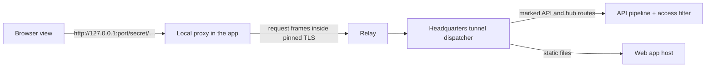

# Request tunnel and thin shell

Date: 2026-11-11. **Proposed design; nothing here is implemented.** Decision D2 in the [decision log](decisions.md): build the allowlisted request tunnel, then trial the thin shell (option C) on real phones. If the trial fails its thresholds, the fallback is bundled pages over the same tunnel (option A). Everything in "Shared foundation" is needed by both, so no work is thrown away.

This guide replaces the catalog-operation and `IMobileHeadquartersClient` parts of [architecture.md](architecture.md) "Protocol and application integration". Transport, pairing, revocation, event and restore rules there still apply.

## What the person sees

The app has a small native part and a web part.

- **Native shell (shipped in the app).** Launch, sign-in, private pairing, enterprise chooser, waiting for approval, unreachable and revoked screens, the top bar with the enterprise selector, notifications, camera and file pickers.
- **Enterprise content (served by that enterprise's Headquarters).** Once a profile is connected, a browser view below the top bar loads the Headquarters web app through the encrypted channel. Each enterprise shows its own version of the pages.

## Shared foundation

### Tunnel messages

Carried as inner messages on the existing encrypted channel. One request may be in flight per stream ID; at most eight streams per phone (existing limit).

| Message | Fields |
| --- | --- |
| `RequestHead` | stream ID, method, path and query, permitted headers, operation key (optional), deadline |
| `RequestBody` / `ResponseBody` | stream ID, bytes (at most one frame), end flag |
| `ResponseHead` | stream ID, status, permitted headers |
| `Reset` | stream ID, fixed reason code |
| `SocketOpen`, `SocketData`, `SocketClose` | For the realtime hub WebSocket only |

Bodies are streamed with backpressure, never buffered whole. The 256 KiB limit in the operations register applies to JSON API bodies; static files and realtime use streaming and count against traffic.

**Permitted request headers:** `Accept`, `Accept-Language`, `Content-Type`, `Content-Length`, `If-None-Match`, `Range`, `X-CSweet-Operation-Key`. Everything else is dropped by the phone and again by the dispatcher. `Cookie`, `Authorization`, `Origin`, `Host` and forwarding headers never cross.

**Permitted response headers:** `Content-Type`, `Content-Length`, `Content-Encoding`, `Cache-Control`, `ETag`, `Content-Range`, `Location` (same-site relative only). `Set-Cookie` is always removed.

### Dispatcher at Headquarters

1. Identity is the person bound to the device's TLS session. Build the request principal from the device record on every request; recheck enabled state and security stamp.
2. Match the path:
   - **API route** carrying the `MobileRoute` marker → run through the normal API pipeline, including the multi-user access filter. No antiforgery (there is no cookie to forge).
   - **Realtime hub** (`/hubs/app-events`) → proxied as a socket with the same identity.
   - **Static web app file** (the published `CSweet.App` output) → served read-only from the web app host. GET only.
   - Anything else → `404`, logged with a fixed code.
3. `MobileRoute` is declared next to the route mapping: `.AllowFromMobile(MobileRouteKind.Read)` or `(MobileRouteKind.Write)` *(proposed)*. The endpoint conformance test from the [multi-user guide](multi-user-headquarters.md) gains a rule: a route with a mobile marker must also have an access rule, and administrator-policy routes need an explicit second marker to be reachable from a phone.
4. Writes: if `X-CSweet-Operation-Key` is present, a filter records a receipt. Tier-1 routes (send message, decide approval, create records, start paid or long-running work) pass the key into their service so a retry returns the first result. Other writes get a generic receipt: a repeat with the same key while the first is unfinished or lost returns "in doubt, check the result" and does not run again.
5. The dispatcher never forwards to arbitrary hosts, ports or file paths. It has exactly three targets, fixed at startup.

How the dispatcher calls the pipeline in-process (loopback listener with an internal-only authentication scheme, or an in-memory server sharing the app's services) is chosen in TS-02 and recorded in the decision log.

### Web app changes (benefit the browser too)

- Attach an operation key to tier-1 writes; keep unfinished keys in local storage and ask for their result on reload.
- Make pages usable at 360 px wide. This is the largest piece of visible work and is needed under either option.

## Thin shell specifics

### Local proxy

- Listens on `127.0.0.1` only. Rejects any request whose first path segment is not the session secret (256 random bits, new on every activation) and any request with an unexpected `Host`.
- **One fixed port per saved profile.** A browser origin includes the port, so local storage, databases and caches for Northstar and Harbor are separate without relying on newer OS features. Cookies are not port-scoped, which is why `Set-Cookie` is stripped. If a profile's port is taken at launch, show a retry state; do not pick another port silently (it would orphan that profile's stored data).
- Stops when the profile is deactivated. Switching enterprise stops the old proxy before the new one starts.

### Browser view

- A plain platform web view for enterprise content, separate from the view used for native-shell screens.
- Navigation is locked to the active profile's local origin. Any other URL opens in the system browser after confirmation.
- No file access, no universal links into the view, developer tools off in Release.

### Bridge between web app and shell

The web app checks for `window.csweetShell` and its `version`. Calls are asynchronous messages; the shell validates every argument.

| Call | Purpose |
| --- | --- |
| `ready(contractVersion)` | Web app loaded; shell hides its loading state. |
| `setUnsavedWork(bool)` | Drives the unsent-edit warning before a switch or notification tap. |
| `scanCode()`, `pickFile(accept)`, `saveFile(name, transferId)` | Camera and files. Bytes move through the file-transfer lane, not the bridge. |
| `openExternal(url)` | Provider consent in the system browser; return is matched to the originating profile. |
| Shell → web: `navigate(path)` | Open a destination after a notification tap. |
| Shell → web: `resumed()` | Foreground resume; web app refreshes and rechecks pending operation keys. |

The bridge exposes nothing about other profiles, no tokens and no keys. If Headquarters is older than the shell's minimum bridge version, the shell shows "This enterprise needs a Headquarters update" with the versions.

### What changes elsewhere

- [Phase 1](phase-1-shell.md) builds the native shell only; Enterprise home and business pages come from Headquarters. See the note at the top of the [Phase 0–1 backlog](junior-backlog-phase-0-1.md).
- [Phases 5 and 6](phase-5-daily-work.md) become: mark routes, add operation keys to tier-1 writes, make each page usable on a phone, and record evidence per matrix row. No per-workflow client or adapter.
- The parity matrix keeps its rows; the "API or transport dependency" column now means "routes to mark".

## Trial

Run after TS-01 to TS-08. Devices: one mid-range Android phone about three years old and one iPhone of similar age, on cellular data, Headquarters behind home NAT, official relay on staging.

| Measure | Pass |
| --- | --- |
| First ever open of an enterprise (nothing cached) to usable Enterprise home | 30 s or less |
| Later cold start of the app to usable Enterprise home | 5 s or less |
| Moving between already-visited destinations | 1 s or less for 95 % of taps |
| Realtime change at Headquarters visible on the phone | 3 s or less |
| Ten minutes of use including two enterprise switches | No reload or OS kill of the browser view |
| Bytes through the relay for first open, and for a cold start with a warm cache | Recorded. Warm start must not re-download the app. |
| Storage isolation | Data written by Northstar's pages is unreadable from Harbor's |
| Another app on the phone calling the local proxy without the secret | Rejected |

Thresholds are starting points; the owner may change them before the trial, not after. The owner also uses the build for a day and records whether it feels acceptable. **Pass:** continue with C. **Fail on speed or memory only:** switch to bundled pages (A); TS-01 to TS-05 and all route marking carry over, TS-06 to TS-08 are dropped. **Fail on isolation or proxy security:** stop and redesign.

Likely first optimisations if speed is close: trimmed and ahead-of-time compiled web app build, loading only the active language's data instead of all of it, and compressed static files.

## Issues

**TS-01 · Tunnel message codec — M · Senior-led.** Encode and decode the messages above with size and field limits. Property tests for malformed input, oversize, unknown stream IDs and interleaving.

**TS-02 · Dispatcher spike — M · Senior-led.** Prove both ways of entering the API pipeline in-process with a device identity; pick one; confirm antiforgery is not required and cannot be bypassed from the web side by claiming to be a phone.

**TS-03 · Dispatcher — L · Senior-led.** The five rules above, header filtering, streaming, deadlines, resets. Tests: unmarked route is 404; administrator route without the second marker is 404; revoked device mid-stream is cut; `Set-Cookie` never leaves; path traversal on static files is rejected.

**TS-04 · `AllowFromMobile` marker and conformance rule — S · Senior-led.** Extension method, metadata, test rule.

**TS-05 · Receipt filter — M · Senior-led.** Receipts table and migration, generic behaviour for ordinary writes, hand-off of the key to tier-1 services (starting with send message and decide approval).

**TS-06 · Local proxy — L · Senior-led.** Loopback listener, secret, per-profile port, request and socket forwarding, stop on deactivate. Tests in `src/CSweet.UI/Mobile` style plain library so they run in `CSweet.UnitTests`.

**TS-07 · Browser view host — M · Junior + review.** Platform web view below the native top bar, origin lock, external links, loading and error states, Android and iOS back gestures routed into the web app's history first.

**TS-08 · Bridge v1 — M · Junior + review.** `ready`, `setUnsavedWork`, `navigate`, `resumed`; version check and the update-needed screen. Camera, files and external browser calls come later with the workflows that need them.

**TS-09 · Trial — M · Senior-led.** Run the table, record results in the acceptance register, record the outcome in the decision log.

**TS-10 · Mark the first routes — M · Junior + review.** Auth status, organizations list, overview, attention, approvals list and detail, conversations list and detail, realtime hub. Enough for the trial to show real pages.

**TS-11 · Phone layout pass, one navigation group per issue — M each · Junior.** Same groups as P0-05. At 360 px: no horizontal scrolling, primary action reachable, dialogs fit, tables have a stacked form, board drag has a menu alternative.

**TS-12 · Desktop tunnel harness — M · Senior-led.** Runs the dispatcher and local proxy on one machine with no relay or phone, so pages can be tested in a desktop browser. Described in [increments](increments.md).
