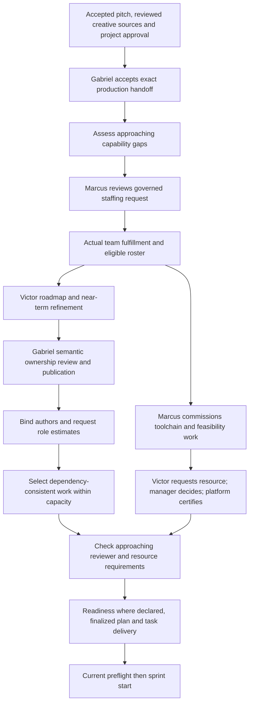
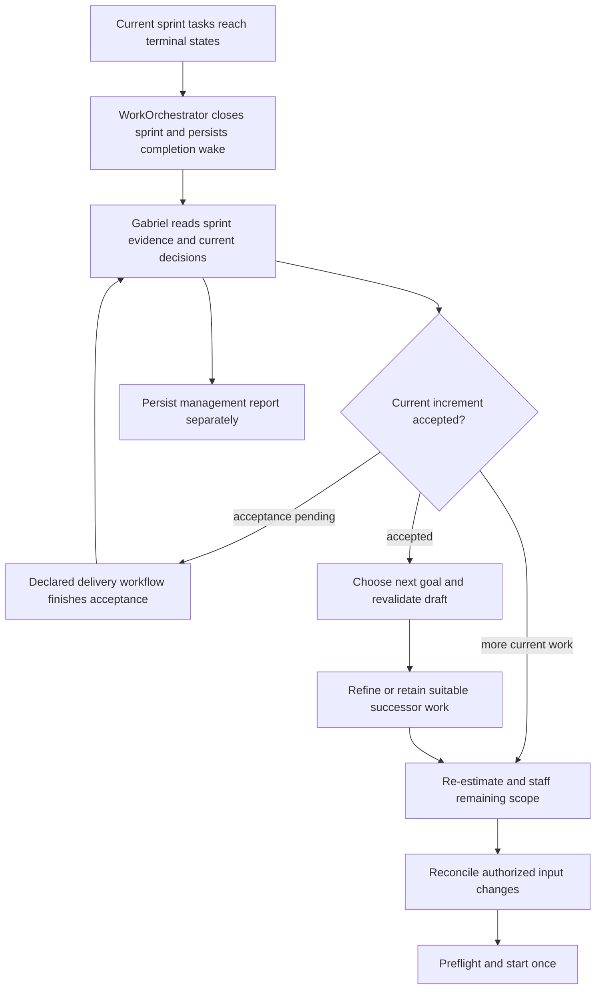
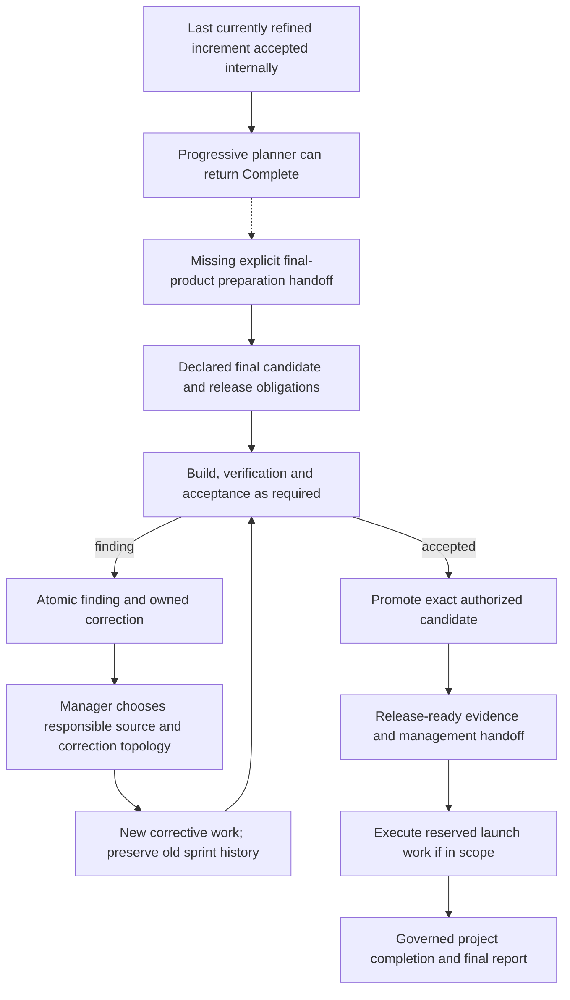

# Planning lifecycle: three code journeys

This trace preserves the pre-implementation source investigation. The implemented symbols, package versions and executed journey checks are recorded in [the lifecycle implementation record](planning-to-project-completion.md#implementation-record-2026-11-14).

Original source investigation, 2026-11-14. Companion to [planning through project completion](planning-to-project-completion.md). At the time of this investigation, no implementation changes, live mutations, new test fixtures or package changes had been made. This investigation follows source and existing test arrangements; it does not claim those tests were executed or that a live run was measured.

## Conclusions

The existing platform is a suitable foundation. The main missing abstraction is a complete, owned handoff from a changed prerequisite to the next authorized action. There are also substantive planning defaults to correct: mechanically generated estimates, capacity inferred from the amount of requested work, structural readiness described as QA assessment, forced next-candidate selection, and a corrective recipe that assumes a particular topology and review order.

Keep deterministic checks for identities, authority, evidence bindings, graph integrity and replay. Let agents reason about decomposition, uncertainty, effort, capacity, staffing, verification purpose and when to stop refining. The new abstractions should standardize these exchanges and their recovery, rather than standardize every game's sequence of roles.

## Journey 1: accepted direction to the first sprint

| Step | Actual source path and handoff | What the next actor can trust |
|---|---|---|
| Accepted sources | Director `ProjectApprovalReview`, `CreativeReviewHandoff`; Producer `SpecialistAgent.AcceptRefinedHandoffAsync` reads exact accepted production sources and persists accepted-handoff state. | Accepted document revisions/digests and project/team context. A chat acknowledgement is not a resource grant or a release approval. |
| Durable planning ownership | Producer `EnsurePlanningCommitmentAsync` and attention recovery; `ReconcilePlanningAsync` discovers the current team and Technical Director. | A persisted commitment survives the initiating chat. Missing technical planning coverage leads to `AssessKickoffCoverageAsync`, not a fabricated technical result. |
| Work-backed staffing | `KickoffCoverage.AssessKickoffCoverageAsync` asks a model for specific approaching work and capability gaps. `ProposeCoverageAsync` submits the governed request. Director staffing recovery tracks its decision and fulfillment. | Proposed slots, approved plans and eligible actual members are distinct. The old mandatory three-role bundle appears only as retained-policy recovery, not the new desired staffing rule. |
| Feasibility/tool readiness | Director `ProductionCommitments.HandleProductionCommitmentAsync` independently advances asset/toolchain choices. `EnsureToolchainDecisionAsync` discovers actual technical leadership, requests supported missing capacity through Victor, and waits for provider/feasibility evidence. Platform `ResourceFulfillmentService` and `ResourceFulfillmentWorker` advance preparation, approval, installation and certification. | Resource approval is not Ready. Documentation and staffing can proceed while toolchain work is pending. Supported resource fulfillment already has durable state, receipts and notifications; reuse it. |
| Roadmap/refinement | Producer `EnsurePlanningSessionAsync` commissions Victor; Technical Director progressive planning constructs proposals; Producer `RoadmapOwnership.ReviewOwnershipAsync` independently compares the accepted sources against concrete Epic criteria. | Proposed coverage is semantically reviewed. Broad “document all requirements” ownership is rejected. Stable proposal keys and exact source references remain code-owned. |
| Publish approaching work | Producer `AdvanceProgressivePlanningAsync`, `PublishCanonicalBacklogAsync` and `BindAvailableWorkAsync` retain the roadmap, detail approaching Stories/tasks and bind available authors. | Future work can remain Epic-level. Speculative drafts do not acquire execution authority. |
| Estimate and commit scope | `ReconcileSprintEstimationAsync` requires accountable author coverage, asks each selected author for estimates, incorporates returned provenance, checks the roster again, filters missing staff and calls `SelectCapacityBoundedScope`. | Current estimates have author/session provenance. That does **not** establish that the estimation method or claimed capacity is meaningful; see findings below. |
| Readiness and plan activation | `MissingSprintStaff`, `PlannedDeliveryReview`, `StaffWorkflowAsync`, SDK `PrepareStoryIncrementAsync` and `TicketWorkflowPlanning.ConfigureAsync` select review defaults and declare real workflow tickets, branch bindings and evidence inputs. Verification-bearing selected work gets a QA readiness coordination. | A declared operation must have eligible participants before activation. Binding a whole Story can demand more capacity than the immediately selected sprint tasks. |
| Start | `ReconcileSprintReadinessAsync` rechecks preparation, current staffing and decisions, calls `FinalizeSprintDeliveriesAsync`, then platform `PreflightSprintAsync` and `StartSprintExecutionAsync`. Broker finalization and orchestration validate current authority, expected revisions, assignments and pinned planning/delivery evidence. | Only authoritative start grants execution. A retained delivery specification or previously passed readiness assessment is not sufficient if its inputs changed. |

### Newly established planning limitations

**Estimation is substantially mechanical in the shared specialist path.** The inspected `extensions/video-game/VideoGameAgentKit.cs` computes points using `Clamp(1 + acceptance-criterion count + dependency count, 1, 13)`, then sets `AvailableSprintCapacity` to the sum of the requested estimates. This is present in the representative Narrative/Level/Playtest kit, Game Designer kit, QA kit, and Producer kit. This manufactures capacity sufficient for the requested batch instead of independently assessing availability. It also makes harmless criterion splitting change estimated difficulty. An overridden role handler may behave differently; do not assume every agent uses this path.

**Selected scope accounts primarily for author points.** `SelectCapacityBoundedScope` groups consumption by author role/installation. It does not consume a separate review/build/service capacity budget. This can produce a staffed but slow sprint with a review bottleneck. Points are not elapsed time; do not add speculative fixed conversions. Ask owners for effort/confidence/assumptions and available commitments separately; use observed throughput and queue conditions to inform Gabriel's judgment.

**Producer-owned estimates can acquire a hidden review dependency.** `OwnEstimates.EstimatePartner` requires another eligible participant with `sprint-estimate-review`, otherwise QA. QA/Technical Director have special estimate-review callbacks. Validate both the advertised specialization and ability to answer that protocol. Do not hire QA solely to witness a routine Producer estimate; use a qualified existing participant when justified, or distinguish provisional forecasts from independent reviews that are actually needed.

**QA readiness is structural in the inspected base handler.** It checks nonempty requirements/criteria, positive estimates/provenance, and package/assignment fingerprints. It does not judge whether a rebound criterion is observable, whether an experiment can answer its question, or whether required tools exist. Keep these useful machine checks in shared validation. If Gabriel requests a semantic testability contribution, ask a qualified reviewer for an actual evidence-grounded judgment; otherwise avoid spending a coordination round trip labeling structural checks independent semantic QA.

**Technical tool readiness is not one universal bootstrap gate.** Current Director source deliberately lets documentation and staffing continue without build certification. Preserve this separation: the task that establishes technical feasibility must not require its own eventual production evidence. A prerequisite experiment needs only the resources necessary for that experiment, not every release resource.

Recommendation: approve this startup structure, but replace the estimation/capacity assumptions and unify declared requirement interpretation before optimizing the number of passes. Source inspection identifies potential latency contributors, not their measured ranking.

## Journey 2: sprint closes, evidence or direction changes, successor starts

1. `WorkOrchestrator` closes a sprint when all execution items are Completed or Cancelled. It persists the completion event/outbox with the changed sprint. This is a terminal execution fact; it does not claim that every cancelled goal was achieved.
2. Producer `HandleManagerEventAsync` responds to sprint, execution, delivery, decision, resource and workforce changes by running current-state attention review. Attention also rediscovers planning commitments, pending reviews, corrections and current roster after reconnect. This existing event-plus-discovery pattern should be extended, not replaced by per-agent polling.
3. `ProgressiveContinuation.ReadProgressiveContinuationAsync` distinguishes completed prerequisite sprints from accepted incremental delivery. Prerequisite completion can wake work remaining in the same Story. Accepted increment continuation additionally reads completed delivery plans and their Story scope IDs.
4. `AdvanceProgressivePlanningAsync` can return the same immutable refinement proposal when a completed sprint leaves unscheduled executable work. For a new increment, it retains the current acceptance boundary. It may commission provisional successor drafting before that acceptance, using assumptions and retained draft/session bases.
5. `ReviewAdaptivePlanAsync` collects accepted brief, board state, findings, QA/builds, decisions, specialist advice and proposals. It persists per-sprint review receipts and a current planning assessment, then applies proposed actions. Hires, spending, finding dispositions and scoped holds use separate governed paths. `PlanningGateScopes.ConfirmedCeoHolds` requires confirmed direction for particular work; a feel report alone is not a CEO hold.
6. After publication and estimates, the same preparation/readiness/start path as Journey 1 runs. Preparation receipts bind scope and roster. Start/preflight remain authoritative and revision checked.

### Failure isolation: two mechanisms with different behavior

An ordinary **product rejection** stops the rejected execution and its dependents. `TicketWorkflowTests.RejectedTicketBlocksOnlyItsDependentsWhileUnrelatedWorkContinues` explicitly exercises this service behavior.

A **planning/assignment validation failure** is broader: `WorkDeliveryService.PulseAsync` first calls `ValidateCurrentScopeAsync` for all plan scopes. Its outer catch stops current nonterminal executions across that plan. It also cancels stale pending/running dispatch and revokes grants. Thus “unaffected work continues” is already true for one rejection path but not a general property of stale inputs.

Recommendation: preserve plan-wide authorization/graph/branch checks where shared authority or promotion makes them necessary. Separate local readiness checks and propagate invalidation through actual evidence/dependency edges. A changed source invalidates every candidate that contains it; a genuinely independent branch need not stop. Implement this against explicit dependency/candidate identities, not ticket titles or Story membership alone. Safe, explicitly selected plan boundaries can also limit the blast radius. Do not enable multiple concurrently writing plans on the same branch as a shortcut.

### Review discretion, caching and reporting

- `ValidateReview` requires a candidate index whenever candidates exist. `AdvanceProgressivePlanningAsync` uses `assessment.Story ?? firstCandidate` as a fallback. A null selection therefore cannot reliably mean “refine first” or “none suitable.” Use an explicit decision disposition with conditional fields; choose-next, refine, wait-on-dependency and conclude are different results. Validate them without forcing a selected candidate for every action.
- The assessment fingerprint includes candidate keys, roster revision, ownership, outline, completed sprint IDs and selected classes of facts. Ordinary nonblocked item revisions and build facts are not all represented. Same-key changed candidate content can therefore leave the assessment basis incomplete. Bind decisions to the material revisions/evidence actually relied upon; revalidate before applying effects.
- `Decide` returns an existing sprint receipt unchanged. When recovering missing reviews, its first generation combines a frozen sprint report with current collected facts. Keep immutable retrospective observations separate from current direction. A newer direction should prompt today's assessment, not be presented as knowledge the team had when the old sprint ended.
- `PublishSprintReviewAsync` is awaited before current effects. A pending coordination returns without blocking normal effects, which is good. A thrown dispatch/read failure can still abort that call before effects run. Persist report delivery as its own recoverable handoff so reporting failure cannot gate production. Do not claim all current reporting is already blocking or already decoupled.

### Exact amendment propagation

Producer `ScopeAmendment.RefreshAmendedDeliveriesAsync` updates canonical planning and re-finalizes delivery; `DeferredScopeAmendment.RecoverAppliedScopePlanningAsync` can restore its continuation. `WorkDeliveryTaskAuthorization.RequireAsync` still checks current child planning revisions and task-delivery digests against the active plan. SDK `PrepareCoreAsync` returns an existing Active/Paused plan without refreshing its bindings. A task can therefore be correctly amended and remain unauthorized by its enclosing plan.

Platform `reconcile-planning` is an explicitly paused manager/owner operation, protected by revision checks and replay receipts. It drains active writers and unpromoted work, preserves graph shape, refreshes snapshots and supersedes aggregate execution history. It is an important reusable starting point, but it broadly reads current scope and may reject plans with successful prior promotions. It is not safe to automatically call it for any arbitrary applied amendment.

Recommendation: carry an exact approved-change basis, assess affected evidence and safe boundaries, then choose unchanged-topology reconciliation or an explicit successor graph. A successful prior promotion must not be undone. Renewal of a still-eligible selected person should use current membership, capabilities, grants, policy and independence; it must not overwrite historical assignments or accept unrelated scope changes. Changed profiles require policy assessment, not digest replacement.

## Journey 3: final increment, late release finding, final closure

### Current stopping point and completion semantics

`SuccessorCandidates` can synthesize a first Story for an Epic without children. After that Story is detailed, it treats an Epic whose existing child Stories are all detailed as an assumed completed basis for drafting. `OutcomeCoverage` separately treats existing Stories under owned Epics with completed delivery plans as verified coverage. Neither is an explicit judgment that the approved Epic has been fully refined and all obligations verified.

`AdvanceProgressivePlanningAsync` returns Complete when the currently detailed work is accepted and no candidate remains. The adaptive branch does not have the legacy branch's retained-Story-count guard. Producer `ReconcilePlanningAsync` completes its planning commitment at that point. Selected increment plans target the internal integration branch. Whole-project SDK setup can return the latest completed plan when executable leaves are done; simply calling it later is not sufficient to create a distinct final product release.

Recommendation: introduce explicit refinement-sufficiency and obligation-disposition judgments supported by evidence. Gabriel owns decomposition sufficiency; the appropriately qualified reviewer judges acceptance of each obligation. Code validates identities, revisions, evidence applicability and the required authority for changed obligations. A global constraint can have a cross-cutting enforcement/verification owner without a made-up Epic for each paragraph. Preserve the distinction between Planned, RefinementComplete and Verified. Final preparation starts from the complete approved obligation set, not empty candidate discovery.

### Existing late-rejection path: useful but specialized

Platform `RecordFindingsAsync`/`EnsureCorrections` retain a blocked candidate's open findings and manager-owned correction in the same transaction as verdict/outbox effects. `CoordinateCorrectionAsync` checks current manager/project membership, candidate and correction revisions, binds a follow-up plan and remediation work, and preserves rejected history. It requires fresh corrective verification before resolving findings. This exists even when original sprint tasks are already complete.

SDK `DeliveryCorrectionCoordinator` rediscovers retained corrections. Its automated recipe currently requires Release scope, one candidate repository, a completed Code source under a Story, a direct Story-to-release branch and mechanical source preparation. Multiple possible source tasks can be selected by a constrained model or governed owner decision; all findings must map to one chosen source. Findings genuinely spanning tasks or unsupported topology become a planning wait. The coordinator reuses original stage assignments and revalidates on finalization; stale staffing can consequently block this path too.

The recipe creates a corrective task, source-preparation ticket and acceptance ticket, binds/activates a follow-up plan, then `EnsureSprintAsync` creates a separate corrective sprint, schedules that task, preflights and starts it. It waits if another sprint is active. It does not traverse the ordinary Producer estimate/capacity/readiness decision path. It also reorders acceptance steps using fixed build/technical/QA categories.

Recommendation: retain this recipe as an eligible optimization, not the universal correction protocol. A correction is a requirement to plan/execute/verify identified findings. Gabriel should decide whether to add work to a suitable sprint, use a new one, or commission specialist work, subject to existing execution rules. All choices should use shared preparation and preflight with explicit needs. Evidence dependencies determine review order. Multi-source, artifact, design and non-Release findings need a real manager-owned refinement handoff, not a permanent string wait. Keep unchanged criteria; changed acceptance uses the existing authorized amendment path.

After accepted correction, platform marks original findings Resolved, original rejected execution Superseded and may mark its old plan Cancelled when all its executions are terminal/superseded. The accepted follow-up plan is the positive evidence. Completion discovery must follow this explicit lineage; old Cancelled status alone cannot mean abandoned scope or fulfilled obligation.

### Existing release and closure mechanics to reuse

- `PromoteDeliveryAsync` checks retained release dependencies and requires a current exact candidate before source-control promotion. Receipts preserve completed repository promotions; partial promotion becomes an explicit blocked state, not a fresh success.
- `ReleaseObligationsCompleteAsync` retains final dependencies across historical/cancelled plans but checks canonical task Completed status. **Nuance:** `WorkDeliveryTaskAuthorization.PreventManualCompletionAsync` already prevents direct Done for workflow/bound/profile execution tasks. This is not proof that users can manually complete every dependency. The remaining weakness is that the release predicate itself does not establish the exact required receipt/candidate applicability, especially for other permitted dependency types. Strengthen it without adding universal QA to administrative obligations.
- SDK `DeliveryBuildReadiness` validates the current stage/assignment, candidate and configured build identity. Build/Release Engineer has its own parallel implementation with narrower fixed stage/scope assumptions and fewer of those shared checks. Stage executions are created as work advances and responses order them by creation time: its use of the last stage is **not** evidence of a failure merely because build-readiness is first in the declared recipe. Consolidate common behavior around the assigned handler/current stage instead of claiming an unobserved ordering defect.
- Certified packaging and test/QA results are separate evidence. Packaging success must not certify gameplay, performance, consent-governed playtests or launch. Build/Release Engineer's current implementation produces packaging/provenance readiness; it is not a public deployment executor.
- `WorkstreamManagedActionExecutor` already applies governed lifecycle changes, checks actor/project/profile/revision authority, validates allowed transitions and prevents Completed while open noncancelled project tickets remain. Reuse `ProposeWorkstreamChangeAsync` and this executor for final closure. The open-ticket guard does not replace approved-outcome or final-release verification: cancellation can close a ticket without satisfying its obligation.
- The alternate Producer `ManagerDelivery` flow proposes lifecycle completion, but only its separate manager-brief project path invokes that recipe. It does not close the adaptive production gap. Public-launch approval remains distinct; identify an actual executor/provider and delivery evidence if launch is part of the approved scope. The inspected agents do not establish a generic store/publication executor.

## Specialist interoperability findings

| Participant | Existing behavior inspected | Generic recommendation |
|---|---|---|
| Game Designer | `VideoGameDesignerAgent.HandleCoordinationTurnAsync` accepts a typed Story consultation, verifies board manager/project and accepted brief revision, then returns attributed assessment, proposed change and evidence needed. Also inherits estimates and canonical artifact execution. | Keep this working domain adapter; define a common contribution request/result envelope so the same scoped lifecycle can carry other disciplines' judgments. |
| Narrative, Level Design, Playtest Researcher | Each inherits `VideoGameSpecialistAgentBase` from its repository's AgentKit. The three inspected kit files are byte-identical. They expose `work.execution.run`, return role estimates and author/substantively validate/submit exact artifact revisions under canonical assignments. Their local classes primarily declare role, prompt and required artifact sections. | These are functioning artifact contributors, not empty role folders. Their inherited coordination fallback expects a typed production planning cycle; it does not supply Game Designer's scoped advice contract. Support a narrow contribution without requiring a whole narrative bible, level document or playtest plan for every question. |
| Playtest Researcher specifically | Prompt and artifact sections concern protocol, participants, consent, measures and interpretation. The inspected local implementation does not demonstrate participant recruitment or actual observed playtest execution. | Ask it to design research and interpret supplied evidence. An attributed design hypothesis is not observed player evidence; unavailable research capacity remains explicit. |
| QA | Specialized artifact/code/candidate execution, retained browser evidence, exact-candidate checks, and Producer estimate-review handling; inherited readiness is structural. | Preserve independent verification. Separate machine readiness checks, optional semantic consultation and actual candidate QA. |
| Build/Release Engineer | Executes certified exact-source packaging and returns durable pending-build IDs; validates resulting build/provenance. | Reuse shared build mechanics; discover supported handlers/resources rather than assuming the role provides deployment or every test operation. |

Game Designer and QA kit hashes differ from the Narrative/Level/Playtest kit, so these are source copies with divergence, not one already centralized implementation. Do not infer that all differences are bugs. Move genuinely common contracts/mechanics into a versioned shared dependency; retain role prompts, domain generators, accepted evidence types and capabilities with their respective agents. Avoid broad source-copy synchronization as the long-term abstraction.

Producer review roles currently come from built-in `VideoGameRoleKeys`; `WorkflowRequirements` also maps known workflow stage keys to roles. Discovery should identify qualified participants and supported contribution/execution contracts from the current authorized catalog/roster. New agents implementing an existing contract should not require a Producer-specific branch; a genuinely new operation may require a platform handler, which should remain an explicit extension point.

## Decisions recommended after the trace

1. Keep the existing declared-workflow platform and event/receipt recovery design. Standardize a handoff contract over those operations, not a second universal workflow engine.
2. Separate local prerequisite invalidation from shared candidate/authorization failures. Preserve the latter's necessary stop boundary and explicit writer/promotion fencing.
3. Use agent judgment for effort, uncertainty, available capacity and scope sufficiency. Code owns arithmetic and bindings; criterion counts are not intelligence or evidence of capacity.
4. Separate structural preflight from a requested semantic readiness contribution. Require independent verification when the chosen operation/obligation calls for it.
5. Represent review decisions explicitly and bind them to material current evidence. Separate retrospective facts, current direction and report delivery.
6. Reconcile only exact authorized scope/assignment changes. Structural edits or already promoted history may require successor work; profile/roster changes never grant authority by themselves.
7. Make ordinary and corrective work share preparation/recovery while allowing multiple domain recipes. Keep source selection/model judgment; remove assumptions that every correction is one Code task in a new sprint.
8. Create a durable final-product preparation/closure handoff and follow correction lineage through to authoritative evidence. Reuse source-control promotion, release-dependency and lifecycle services; keep public launch explicitly scoped.
9. Put common contribution transport/result handling in shared contracts/SDK mechanics; keep domain judgment and unsupported-operation disclosure with agents.

## What source tracing cannot establish

The overall critical path and actual speed savings remain **unmeasured**. No new live telemetry was collected in this task. The relative costs of model work, review queues, staffing fulfillment, certification and board publication require the paired pilot.

The source trace establishes the branches above but does not reproduce every concurrency interleaving. Existing `ProgressiveSprintHandoffTests` substitute platform capabilities, estimates, readiness and preflight; they are valuable agent-callback coverage, not authoritative whole-stack proof. Platform `TicketWorkflowTests` separately cover rejection isolation and ticket execution; correction suites cover transaction/receipt behavior and retained findings. Join these boundaries in future verification before calling the complete lifecycle proven.

Remaining proof work: an amendment affecting one independent path and one shared candidate; changed same-key candidate content; missed sprint reviews with later direction and failed reporting; capacity loss during preparation; multi-source/artifact corrective planning; partial promotion; final-candidate release obligations; governed terminal replay; and retained Prism recovery using published packages. These are acceptance experiments with explicit expected outcomes, not unresolved reasons to replace the whole architecture.
