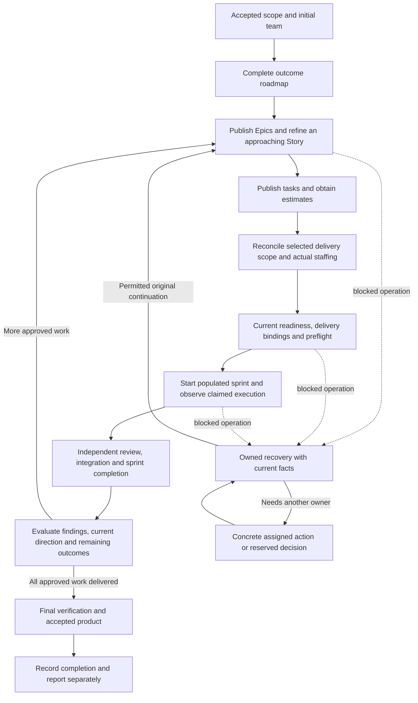

# Planning recovery and scoped progress

> The opening sections retain the previously shipped incident analysis. The
> [resolution design](#next-pass-resolution-proposed-2026-11-15) retains the agreed acceptance criteria;
> [implementation status](#resolution-implementation-2026-11-15) describes the implemented behavior,
> verification boundaries and release order.

## Incident and boundaries

The Qwen Games Prism Break run reached a project-bound board, a draft Production Sprint 1 and a
completed technical outline. `WorkIssueService.RequireBoardAsync` then rejected Gabriel's issue
reconciliation: it checked an OrganizationUser principal while his valid board planning grant belonged
to his current AgentInstallation. Repeating that failure correctly stopped his native planning task.
The manager mention did not produce owned follow-through. Separately, the outline covered the first
increment and omitted later approved outcomes; an ownership gap with no affected Epic indexes held
every Epic, including independent feasibility work.

These are separate permission, recovery and planning-impact problems. No new readiness gate,
mandatory specialist, game-feature inventory or automatic approval is introduced.

## Platform authorization and truthful failures

`WorkActorAuthorization.AuthorizeAsync` resolves an active current organization member to its current
installation principal, or its human principal. `WorkIssueService.RequireBoardAsync` and
`CanReadSourceAsync` use that same resolution. Existing accountable-manager hierarchy, project,
board, source, revocation and expiry checks remain in force. There is no fallback to an old installation
or another employee's grants. A manifest is not authorization.

`AgentTicketFeedback.FailureSentence` describes denied access without prescribing Manage members
as a universal repair. A manager can inspect recorded permissions and platform failure details.

## Shared manager recovery

SDK `ManagerWorkRecovery` is independent of specialist intake. `CSweetManagerAgentBase` uses subscribed
mentions as wake hints and recovers missed notifications on normal attention/reconnect review by
reading currently authorized personal-work boards. It discovers executable blocked work, including plan stages, on
directly reporting boards, including existing records and subordinate recovery escalations.

A durable episode is reserved before Add. The manager commitment references the original native
item, using stable correlation and command keys. Duplicate wakes, interrupted state writes and lost
Add responses converge on the same commitment. `AgentRuntimeWorker` dispatches these commitments
before role-specific claim policies and handlers.

`AssessWorkRecoveryAsync` supplies judgment: retry, continue investigation, or escalate, with evidence.
Code owns identities, scope, source revision and keys. Assessment and retry intent are persisted in
one operating-state write. A current reporting/revision read precedes requeue; the platform still checks
authority. Interrupted dispatch replays the retained command. An unchanged repeated failure does not
trigger another retry or repeated model inference; it requests assistance through reporting ownership.
Unfinished investigation follows the same assistance path rather than waiting for unassigned evidence.
Substantive board evidence or a new reviewer
version permits reassessment; routine timestamps do not. The standard hook is overridable for future
manager types.

Follow-up remains owned until current state shows the source is no longer blocked. A tracker finishing
does not mean the source delivery is complete. A blocked recovery escalates through native work and
reporting ownership; `OverviewIssueReader.ReadAsync` marks that recovery actionable for its reporting
owner. Ordinary unaffected team work is not promoted into a human action requirement.

## Complete outcomes, progressive detail

Technical Director `ReadRoadmapAsync` inventories the complete accepted product independently of the
requested increment. Later outcomes stay at Epic level; Stories and Tasks are refined near execution.
Existing accepted outline identity is retained rather than rewritten during upgrade.

Producer `ReviewOwnershipAsync` includes current staffing/resource facts in the review and cache
fingerprint. Its judgment can identify:

- `Scoped`: concrete affected Epic indexes; only those Epics and their real consumers are held.
- `FutureWork`: an explicitly independent later outcome, with no affected current Epic indexes. It
  stays open, receives an owner/commission, and permits independent current work to advance.
- `Unassessed`: impact remains unknown. Empty affected scope retains the conservative hold until
  judgment establishes actual impact.

`BindOwnership` rejects contradictory future/current impact. `OwnershipReconciliation` retains gap
identity, source evidence and stable commission keys. No missing obligation is discarded. Existing
completion checks in `ProgressivePlanning` and `FinalProductPlanning` still prevent project completion
while ownership gaps remain. Approved constraints and decisions can own obligations without copying
every passage into Epic acceptance criteria.

## Verification and rollout

Regression coverage includes real scoped human/installation permissions, revoked/expired/wrong-board/
wrong-organization/old-installation/inactive/non-accountable rejection, denied-command recovery and
issue dedupe. SDK tests exercise manager discovery, forged mentions, reporting and revision drift,
cached judgments and lost state/Add/retry responses. `PersonalTodoServiceTests` bridges SDK discovery
and handling to the real native task service: repeated failure is resumed by an installed manager,
source identity is retained, duplicate discovery converges, and unrelated ready work remains ready.
Producer tests retain future gaps, preserve genuine prerequisite holds and avoid duplicate roadmap
publication/refinement. Package-based tests and release artifacts are recorded under
`.artifacts/planning-recovery` (local verification, not deployment).

Final package-based verification: SDK 916, sample 2, generated template 7, Producer 581,
Director 449, Technical Director 252, and focused platform 221 tests passed. The optional
`WorkIssuePostgresTests.MigrationPreservesLegacyWorkAndInterruptedDispatchRollsBackSessionCardAndOutboxThenRecoversOnce`
test was skipped because its PostgreSQL fixture was not configured. Published-output self-tests,
NuGet versions/dependency pins, release-note identities, bundle verification and SDK assembly hashes
across the host/test output and all three agent bundles passed. `release-verification.json` records
package/bundle hashes, test counts and `deployed: false`.

Publish SDK **5.33.0**, then Producer **6.16.0**, Director **0.11.0** and Technical Director **6.9.0**.
Deploy the matching C-Sweet API/AgentHost/UI and update those installed agents through the normal
Installed Agents flow, including review of the subscribed mention event. No new contracts package or
database migration is needed for this change. Do not patch installed manifests, package records or
runtime payloads.

For retained Prism Break work, normal attention/reconnect discovery lets Marcus review and requeue
Gabriel's existing blocked planning task. A reasoned diagnostic retry can establish whether the
historical denial persists; the host correction authorizes the actual installation grant. Producer's
new planning-contract fingerprint refreshes ownership impact against current facts while keeping
the accepted brief, outline, draft Sprint 1 and existing work identities. Stable publication and
commission keys reuse existing work rather than recreate it. Fresh businesses use the same path.

After rollout, verify the original planning task advances, issue reconciliation succeeds, Epic tickets
appear, an approaching Story is refined, staffing is resolved for that selected work, and Sprint 1
receives executable tickets. Genuine gaps remain tracked or escalated. Tests prove the recovery
mechanism; live recovery is not confirmed until these records advance on the deployed version.

## Next-pass resolution (proposed, 2026-11-15)

### Primary test and completion standard

The owner will delete Qwen Games and create a fresh business for the next live test. Do not depend
on its live records or request another business reset as a recovery mechanism. Preserve minimized
incident fixtures and test retained-record compatibility in isolated databases.

The next pass must demonstrate an entire continuation: accepted scope and fulfilled initial hiring
lead to published Epics, one approaching Story and its tasks, estimates, selected-work staffing,
an active populated sprint and a claimed execution task. Simulated sprint completion must lead to
evaluation and a justified successor; final accepted delivery must lead to closure without an empty
successor sprint. Permission or provider failures must leave an actionable owner and preserve
unaffected work. A successful callback, large unit-test count or queued retry is not this evidence.

### Design priority: generic interactions that resolve themselves

The owner explicitly prioritizes reusable, self-resolving interactions and third-party agent
compatibility. The journey below describes this game's expected result; it must not become a
mandatory role sequence or planning algorithm for every business.

Use a small set of composable interactions over the existing public capability, contribution,
artifact, issue and native-work contracts. These are interaction patterns, not mandatory new
services or a second workflow engine:

| Interaction | Platform-bound context | Agent judgment/result | Automatic continuation |
| --- | --- | --- | --- |
| Request a contribution | Goal, approved source revisions, scope, requester, eligible recipient and authority | Findings, design/technical advice, evidence or a proposed next action | Receipt wakes the accountable owner to incorporate the result; interruption reuses the request. |
| Propose and apply a change | Current target/revision, preserved obligations and the actual approval boundary | A reasoned refinement, sequencing, staffing or scope proposal | The authorized owner applies it, or routes the exact reserved decision to its owner; unchanged work remains reusable. |
| Await a real dependency | Existing dependency/request identity, accountable supplier and observable resumption condition | Which dependency matters and what can proceed independently | The dependency's durable change wakes rereading/reconciliation; reconnect discovers a missed wake. |
| Recover an original intent | Failed operation, current work/authority facts, retained intent and effect receipt | Diagnosis or a repair choice when judgment is needed | A permitted continuation resumes through its owner; a real missing dependency becomes the preceding interaction rather than another generic escalation. |

Envelope identities, keys, versions and factual permissions come from code. Agents author only
the judgment or deliverable; neither first-party nor third-party models must copy platform-owned
fields into a larger JSON object. Accepted content can use prose, documents or the negotiated
artifact schema. Shared validation checks provenance, applicable obligations and actual authority,
not internal headings, agent personas or a prescribed reasoning style.

SDK base classes are optional implementations of the public interaction contract. A compatible
third-party agent using another language must be able to discover its required capabilities/schema,
receive the same authorized context, submit a result and recover an interrupted interaction without
depending on private correlation-prefix conventions or subclass dispatch. Keep internal receipts
private; expose the supported continuation semantics publicly. Use declared capabilities and current
eligibility to select participants, with named roles as supported metadata rather than positional
selection or fixed first-party agent lists. Unsupported features trigger an explicit compatible
handoff or an owned capability gap, not silent waiting or unreviewed additional permissions.

Self-resolution means the current owner keeps advancing permitted work and reconciling real
dependencies. It does not mean bypassing independence, spending approval or human-reserved choices.
Request human input only for a concrete fact/decision/authority the team cannot supply. Give that
request a concise consequence and actionable choices; resolved causes retire the corresponding
attention item from current state without a manual dismiss/retry ritual.

Do not enforce one Story size, one Epic structure, a standard team or a fixed number of planning
passes. Within the chosen delivery profile, an agent may split/refine work, resequence, acquire a
justified capability, retain a useful draft or wait on a genuine dependency. The platform enforces
the selected scope contract and protects history. Its liveness invariant is simply that every open
interaction has an owner and a concrete next action or observable dependency.

### What the trace establishes

The rollout did activate Director 0.11.0 and Producer 6.16.0. Marcus created a recovery task at
11:21 AM Pacific, but the actual `manager-work-recovery` reply selected `Escalate` from Gabriel's
historical denial. Gabriel's subsequent self-requeue returned the unchanged blocked task. Marcus's
board read succeeded with read-only actions, while `work.issues.read.v1` failed on the same board.
Sprint 1 remained Planned with zero items. Those are observed failures. The additional items below
are source-confirmed paths or risks to prove in the integrated journeys, not claims that they all
occurred in that run.

| Boundary | Finding in current code | Required result in the next pass |
| --- | --- | --- |
| Board and issue access | Broker `WorkManagementCapabilityHandler.RequireAsync` checks board/organization and then the board's team; `WorkActorAuthorization` used by `WorkIssueService` does not resolve that team scope. | One shared board-resource policy, used for authorization, allowed-action discovery and diagnostic facts. |
| Review versus mutation | Director `ReconcileProductionIssuesAsync` reads and can then reconcile a case. Its observed board permissions are read-only; issue mutation currently requires planning-revision authority. | Decide the permitted action before dispatch. A contributor without write authority sends a source-bound request to the authorized owner; it does not acquire ticket-editing rights. |
| Recovery evidence | `ManagerWorkRecovery.HandleAsync` supplies old `BlockReason`, the reviewing manager's allowed actions and version, and all board-item status/revision pairs. It does not establish the blocked owner's current operation eligibility. | Platform-derived facts about the failed operation, current owner/installation and exact relevant dependencies. Unrelated item activity must not authorize another retry. |
| Recovery rediscovery | `DiscoverAsync` reuses an existing recovery correlation and only explicitly wakes running waiting trackers after source unblocking. A blocked escalation is skipped. | Relevant changed facts can requeue the same owned recovery assessment without a new case, lost attempt history or unchanged wake loop. |
| Self-retry | `PersonalTodoService.RequeueAsync` intentionally returns the same blocked task for repeated owner failures. | Read the returned status/revision. Keep the manager's authorized recovery path; do not remove the repeated-failure protection. |
| Owned continuation | `ApplyReviewEffectsAsync` skips `refine` actions; progressive planning can return Waiting for `refine`/`wait`, with a prose `RevisitWhen`. | Refinement dispatches real work; waiting cites a recorded dependency or an owned investigation with a resumption condition. |
| Commission recovery | `WorkIssueCommissionDispatcher` removes `NeedsAuthority`/`NeedsReview` from automatic dispatch; an unchanged terminal commission has no changed-authority resume path there. | Revalidate and resume a retained commission when the relevant cause changes; otherwise retain a specific accountable action. |
| Staffing scope | Sprint estimation checks unfinished sibling tasks; `HierarchicalProjectDelivery.PrepareCoreAsync` prepares assignments for a selected Story's child tasks together. | Keep staffing and delivery-plan scope consistent. Let agents choose refinement into smaller outcomes, resequencing, justified staffing or a genuine dependency wait. |
| Deferred and cancelled work | Shared delivery task selection is broader than the selected sprint and is not itself filtered to unfinished, non-cancelled children. | Test cancelled/deferred work explicitly; it cannot silently demand new current workers or be counted as delivered. Preserve accepted evidence and pinned active plans. |
| Missing future outcomes | FutureWork can name a responsibility without introducing executable delivery work. Final-product assessment can find remaining work, while the frozen-outline refinement contract preserves existing containers. | A missing approved outcome must have an executable path into a versioned future-roadmap amendment. Ownership alone cannot satisfy delivery. |
| Independent projects and duties | Director attention performs production-issue reconciliation before planning-context recovery; a capability exception can abort the remaining work and portfolio iteration. | Persist the affected blocker, continue independent project/duty reconciliation, and expose the failure rather than swallowing it. |
| Verification gap | Previous native-service recovery test supplied a Retry assessment. Producer successor tests also model requeue behavior separately from the platform's repeated-stop guard. | Exercise default manager assessment and the real broker/services together, including the actual Escalate reply and actual no-op self-requeue. |

### Shared patterns to implement

**1. Common authorization with resource-specific boundaries.** Extract the existing effective
board-action policy into shared infrastructure and use it in broker work operations and issue
operations. Resolve the current principal and actual board/team/organization relationships once;
keep read, issue contribution, issue reconciliation, planning edits and execution control distinct.
Do not add blanket role grants or interpret read access as write access. Source-document and exact
revision checks retain their own policy; board access must not make all project documents readable.
Personal boards remain accessible through native personal-work actions only.

Publish effective allowed actions for the authenticated actor. Where a reviewer lacks mutation
authority, reuse `WorkContributions` and current owner discovery for a durable, exact-source handoff.
The authorized owner applies the change through normal revision checks. Test the Director's actual
feasibility write path as well as its initial read. Consolidate the participating finding and owner
action through existing issue/collaboration links, rather than introducing another parallel registry.

**2. Structured current recovery facts.** Extend existing diagnostics/native work evidence with a
typed, authorized recovery read. Bind the failed operation and resource from persisted platform
records, not model-written IDs or parsing display prose. Facts should identify the failure/attempt,
current assignment and owner installation, relevant grant/source/dependency revisions, participating
package versions, the applicable host capability/recovery contract, and any real approval or pause.
Represent unavailable facts as unknown. A package update alone is never proof that access was fixed.

Authorization inspection must reuse the operation's enforcement policy and be limited to the
manager's currently authorized work. It must not become arbitrary agent impersonation, permission
creation, an execution grant or a probe against another business. Missing/legacy evidence leads to
owned investigation; it does not manufacture permission restoration.

**3. Separate mechanical resumption from judgment.** When current authoritative facts establish
that a previously denied in-scope planning operation is permitted, code can resume the original
durable intent once for that relevant recovery basis through the authorized manager. There is no
reason to ask a model to decide whether a grant exists. The owner reruns the normal step, which
rechecks sources, roster and revisions, rather than blindly replaying a stale write payload.
Unknown or still-denied access retains a specific investigation/permission owner. Models decide
semantic repair, sequencing, scope and useful consultations from current facts. They cannot create
permissions, waive QA, grant spending or erase a human hold.

Retain intent-before-dispatch, stable mutation keys and receipts. Read dispatch results; a no-op
requeue is not successful recovery. Preserve the attempt record across Ready, restart and another
failure. Qualifying changed evidence permits reassessment; unchanged wakes do not repeat execution
or inference. A new failure returns to the existing causal case and actual owner. A tracker records
observed step progress separately from verified delivery completion.

**4. Continuations that own the next effect.** Extend the existing native commitments, issue
commissions and SDK durable handoffs with a reusable continuation contract. Every nonterminal
outcome must point to dispatched work, an authoritative pending dependency, or a concrete owner
action. A refine judgment must create/reuse a source-bound refinement/amendment request. A wait
must record who/what supplies the missing evidence and how it will wake work. Investigation must
be assigned before reporting promises it. Keep reporting failures independent of execution.

Discovery must revisit blocked recovery assessments and terminal waiting commissions when their
relevant facts change. Use durable state-change wakes plus current-state reconnect discovery;
duplicates and out-of-order events cannot create a new effect. Do not equate all portfolio failures:
reconcile unaffected work separately while retaining and surfacing the affected failure.

**5. Planning scope consistent with execution scope.** Preserve progressive detail and the full
approved product obligations. The default delivery contract still binds a Story's tasks together;
do not relax Producer staffing checks while leaving that SDK contract unchanged. Let the agents
propose a smaller verifiable Story before commitment when the current Story mixes early experiments
and later work. Apply it as a versioned amendment to unexecuted work, retaining criterion identity,
dependencies, published-item provenance and accepted history. Existing active graphs require the
existing governed amendment/correction path. Test cancelled tasks and already completed source work.

The smaller-Story route is an available judgment-driven refinement, not an automatic rule for every
staffing gap. Missing approved future outcomes follow the same explicit amendment path: add the needed future
Epic/Story responsibility within existing scope, then refine near execution. An amendment adds
delivery work; it cannot simply mark the gap resolved. New product scope still needs its real owner.
Avoid a new partial-Story delivery architecture in this pass unless the existing smaller-Story route
cannot satisfy the fixture; any such API extension needs its own full SDK/host acceptance proof.

### Expected next journey and its checks

The recovery arrow returns to the **recorded blocked step**, not to roadmap regeneration. The
diagram uses C as a compact reference for continuation. No universal QA-before-planning gate is
added. QA/technical review are staffed for the actual deliverable; document outcomes use platform
artifact evidence, while repository/code outcomes need their declared code/build evidence.

At sprint completion, use the existing `ReviewAdaptivePlanAsync` receipt and frozen report, then
incorporate material findings or management direction. A completed sprint can leave unfinished work
in the same increment; preserve that boundary. Keep useful speculative drafts but revalidate their
assumptions before scheduling. A QA defect creates corrective work and fresh independent evidence,
not a rewritten pass. Keep second judgment for spending/expensive experiments, QA disposition
overrides and holding work for the CEO; routine planning does not acquire mandatory consultations.

`ReconcileFinalProductAsync` already separates final acceptance and reporting. Test that final
verification failure creates owned corrective work after an implementation sprint closes, that no
empty successor is created, and that report failure cannot restart production or imply public launch.

### Integrated acceptance, not another collection of isolated successes

Use the existing GameRoleWorkflow/DeliveryWorkflow harnesses, SDK runtime and real platform broker
handlers/services. Script model responses and trusted provider boundaries for reproducibility;
do not replace authorization, native task requeue, issues, commissions, sprint transitions or outbox
handling with always-success fakes. Use an isolated PostgreSQL database for the transaction/restart
journey. Required journey coverage must fail clearly if that fixture is unavailable instead of being
silently counted as completed.

| Journey | Required observable assertions |
| --- | --- |
| Fresh business, classic Breakout | Approved sources and real provisioned team/board grants; Director reads and contributes within its actual rights; Producer publishes one roadmap and selected detail; justified hires become actual roster coverage; Sprint 1 is nonempty and Active; an eligible worker claims real work. No mandatory designer or upfront full-game task expansion. |
| Fresh business, greater complexity | Add interacting power-ups or another game type; verify the agents record their workload/staffing rationale and actual capability coverage, while retaining the same continuation mechanics. Do not assert a fixed team composition. |
| Third-party interoperability | Use a participant implemented without our manager base class or persona/role layout. Discover supported public capabilities, complete contribution/change/dependency interactions, recover a lost reply, and route an unsupported feature to an eligible owner. No private SDK state/prefix knowledge or duplicate work is required. |
| Recovery/restart fixture | Real team-only access, the retained stale-denial/Escalate response, no-op owner requeue, an already-blocked manager task, interrupted state/dispatch replies, revoked access, owner/installation changes and changed source. The appropriate owned continuation advances once, or a real denied dependency remains actionable. No duplicate tickets or reinstated revoked grants. |
| Independent work and sprint transition | An affected branch waits on an actual owner while another progresses; a default refine/wait response produces a concrete continuation. Finish a prerequisite sprint with Story work remaining, evaluate it, then start the justified next populated sprint. Missing later staffing cannot block unrelated current work. |
| Defect and final sprint | High-speed collision rejection while scoring is provisionally drafted; retain unaffected drafting, repair and independently verify the defect; finish remaining approved work, perform final acceptance, close once, and tolerate reporting failure without another production sprint. |

Retain the actual manager Escalate reply as a fixture and exercise the default assessment path.
Test unsupported claims of permission denial against supplied current facts; do not override the
assessment method to always return Retry. Separately test a still-valid denial and a genuinely
human-reserved action. Test provider interruption so incomplete judgment cannot mutate work.
Exercise the actual model/provider in an isolated smoke test where available and record that result
separately from scripted tests; scripted responses cannot establish how a live model will decide.

### Delivery of the next pass

Implementation spans host authorization/diagnostics/native continuation and the shared SDK, plus
Producer/Director integrations and any Technical Director amendment contract needed by the proven
journeys. Reuse existing source, issue, assignment and correction mechanisms. No developer execution
core changes are assumed; if those become necessary, Adrian/Daniel parity and both packages are
required. Additive public wire/SDK APIs require synchronized semantic version bumps and package pins.

Before handoff: run the integrated journeys, focused permission/failure tests, full affected agent/SDK
suites, required PostgreSQL interruption tests, generated-agent checks, exact-package consumer builds,
self-tests and release/bundle/hash verification. Publish dependencies before agent releases and deploy
the matching platform. Keep previously published release history intact.

The owner's fresh live test is the rollout acceptance: inspect actual tickets, selected staffing,
Sprint 1 activation, a claimed task and advancement through its first real checkpoint. Follow the
observed blocker to its current owner if it fails. Do not declare the lifecycle resolved on inference,
attention activity or an empty sprint. No implementation changes were made in this analysis pass.

## Resolution implementation (2026-11-15)

The design above is now implemented in source. The final sentence of the preceding analysis refers
to that earlier analysis pass. Nothing in this implementation edits installed agents or live company
records. Publish the compatible platform and packages before the fresh-business rollout.

### Public units of interaction

| Unit | Platform/SDK symbols | Current behavior |
| --- | --- | --- |
| Read effective authority | `WorkResourceAuthorization.AuthorizeBoardAsync`, `WorkActorAuthorization.AuthorizeAsync` | Use the actual board, organization and board team with the employee's current principal. Planning, issue services and final delivery agree. A read grant never becomes an editing grant. |
| Recover recorded owner work | `WorkRecoveryService.ReadAsync`, `IWorkRecoveryAuthorizationPolicy`, `ManagerWorkRecovery` | Read typed failure facts and current authority for the blocked employee's operation. Resume the original persisted intent once per relevant basis; an unchanged repeated failure or a no-op requeue remains blocked. Unknown plugin operations remain unknown unless a trusted host policy evaluates them. |
| Wake after authority changes | `CSweetDbContext.WorkAuthorityWakes`, `WorkRecoveryEvents.Changed` | Persist relevant grant changes and their wake outbox records in the same save. Wake payloads identify an owner; consumers re-read current state. Offline recovery also uses bounded discovery. |
| Contribute without editing authority | `WorkIssueCapabilities.Propose`, `DecideProposal`, `WorkIssueContributions.ReviewAsync` | A reader submits a source-bound proposal. The current authorized owner reviews exact approved text and canonical obligations, then accepts or declines. `ReviewedIssues` binds the actual versions reviewed. A conflict is returned to the judgment step once with fresh records; there is no silent rebase or second canonical copy. Private conversations are retained only for their original participant's cleanup. |
| Recover retained commissions | `WorkIssueCommissionDispatcher.DispatchAsync`, `AuthorityBasisAsync` | Revisit `NeedsAuthority` only when the relevant source, owner/reporting chain, current installation or grant basis changes. Dispatch uses that employee's current authorized installation. Interrupted session/card/outbox writes roll back together; replay reuses retained intent. |
| Refine approved future work | `ScopedWorkRefinement`, `RemainingWorkRefinement`, `AdaptiveSprintReview.ApplyReviewEffectsAsync` | Request, retain, independently assess and publish additive approaching work through normal public coordination and board commands. The contributor sees the exact approved package members and existing work. Refine/wait produces an owned question or staffing continuation instead of inert prose. |
| Preserve independent progress | `IndependentWork.RunAsync`, `PlanningScopeOwnership`, `HierarchicalProjectDelivery` | Independent continuations run even if another fails; failures remain observable. Cancelled tasks do not count toward delivery staffing or criterion aggregation. Current completed work and delivery history remain authoritative. |

Third-party participants can implement the JSON capabilities, coordination artifact types and wake
events directly. SDK helpers and manager inheritance are optional. Tracking cards use public
`PersonalTodoWorkContext.Purpose = collaboration-tracking` plus `CoordinationSessionId`; legacy
prefixes remain readable. No role number, agent name, private state key or private prefix is a
protocol requirement. Unsupported capabilities retain a concrete owned dependency rather than
inventing authority.

### Planning, staffing and protected decisions

The existing progressive roadmap and estimation flow remains. The shared refinement protocol takes
caller-supplied work kinds and named role choices. The model chooses useful slices, dependencies,
verification and workload rationale; code binds source versions, keys, identities and command
provenance. Complexity changes the work and justified capability coverage rather than selecting a
fixed mandatory team. New approaching Stories can be small. Execution and staffing still cover the
whole selected Story; this pass does not add a partial-Story execution engine or rewrite accepted
historical graphs. Published structural changes continue through governed amendments.

Drafting and estimation precede the current-roster staffing check and readiness. QA is required by
the chosen work and declared verification, rather than every early planning conversation. Existing
second judgments for hiring/spending, overriding QA and holding work for the CEO remain in force.
Issue acceptance, recovery facts and additive refinement grant none of those authorities. Every
normal platform source, staffing, scope, readiness and execution check still runs.

Every completed sprint and material new finding feeds the existing adaptive review. Missing
approved future outcomes now have a retained refinement/publication continuation after the original
roadmap is exhausted. An unmet final acceptance condition produces corrective work. Final verified
acceptance closes once; report delivery is separate and cannot generate an empty successor sprint.

### Verification and its limits

`scripts/Test-PlanningLifecycle.ps1` requires an explicitly supplied local PostgreSQL test server and
sets `CSWEET_REQUIRE_LIFECYCLE_DATABASE=1`; required transactional journeys cannot silently skip.
`FreshPlanningPostgresJourneyTests` starts with an empty board and exercises actual services,
brokers, domain idempotency, team-only authorization, public sprint preflight/start, a real queue
claim, QA rejection/rework/acceptance, a second populated sprint and one-time final closure. It
asserts that earlier completed work survives and no empty third sprint appears.

`WorkIssuePostgresTests` verifies interrupted contribution decisions and commission session/card/
outbox writes, unchanged denied intent, changed authority/current installation and replay.
`SelfResolvingInteractionTests` uses public broker requests without manager inheritance, including
read-only contributions, source/owner changes, private provenance and concurrent findings.
`WorkRecoveryFactsTests` and SDK `ManagerWorkRecoveryTests` cover actual current policy, the
retained stale-denial model reply, revocation, no-op requeue, manual holds and changed-basis recovery.
`PublicRefinementJourneyTests` runs actual Producer/Technical Director callbacks for classic
Breakout, interacting power-ups and a turn-based game with an external named role. SDK refinement
tests interrupt accepted-command replies and change source before the next mutation. Existing
delivery and role suites cover the complementary planning, rework and governance paths.

These are reproducible automated journeys with controlled approved-document, workforce, provider
and human-review boundaries. The PostgreSQL fixtures disable unrelated bootstrap foreign-key
triggers on their disposable connection while retaining transactions, unique indexes and domain
authorization/concurrency checks. They do not certify live model judgment, marketplace hiring,
toolchain certification or a fresh production company end to end. The planned fresh-business run
remains that rollout acceptance; inspect published tickets, staffing rationale, an active nonempty
sprint and claimed work, rather than inference alone.

### Release order

Publish WorkManagement.Contracts **5.10.0**, then Agent.SDK **5.34.0**. Deploy the matching platform
authorization, broker and outbox code. Publish Producer **6.17.0**, Director **0.12.0** and Technical
Director **6.10.0**, then update them through Installed Agents. The notes and manifests use those
same versions. No new database schema or agent execution grant is required by these additive
interactions; newly requested capability grants still go through the ordinary reviewed update flow.

Verification completed for this source pass: Contracts **82**, SDK **928** plus sample **2**,
Producer **584**, Director **449**, Technical Director **252**, game-role journeys **30**, actual
developer/QA delivery journeys **2**, and broader platform acceptance **296 passed**. The platform
filter includes three pre-existing disabled tests; all newly required PostgreSQL journeys executed.
The required lifecycle script separately passed **140** tests with those same three legacy skips.
Generated standalone-agent tests passed **7**. Exact-package consumers were built with SDK/contracts
sibling references disabled in a fresh cache. All five NuGet package versions, three agent
manifest/implementation/release-note versions, published-output self-tests and CSAB executable/hash
verification were checked. This is local verification, not deployment or a live-model smoke test.
