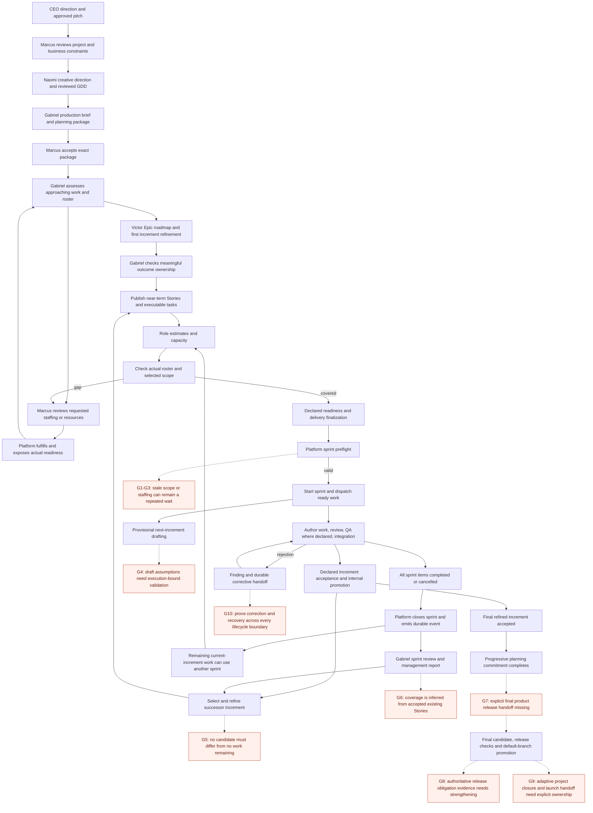
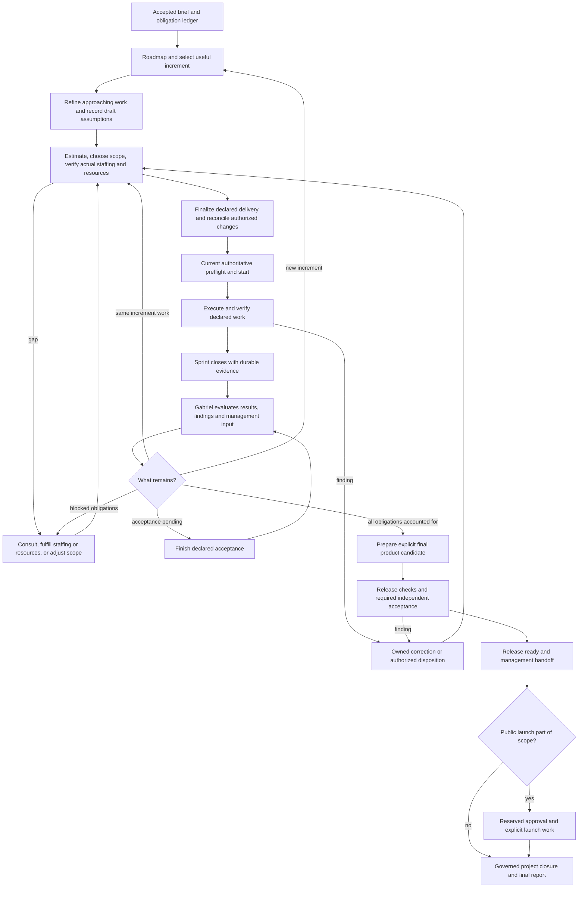

# Planning through project completion

Coordinated lifecycle implementation and source-review record, 2026-11-14. **The source implementation and package verification are complete; published runtime pilots remain to be run.**

The source investigation and gap diagrams below preserve the pre-change baseline. See [implementation record](#implementation-record-2026-11-14) for the implemented symbols, executed checks, package versions and deployment boundary.

This is the consolidation plan for the next coordinated change. It supplements [adaptive game planning](adaptive-game-planning.md), [ticket-defined workflows](features/work-management/ticket-defined-workflows.md), and [corrective delivery lifecycle](features/work-management/corrective-delivery-lifecycle.md). It distinguishes implemented mechanisms from missing end-to-end handoffs. Older incident documents describe historical versions and must not substitute for current source.

Follow-up source investigation: [three lifecycle code journeys](planning-lifecycle-code-trace.md) traces fresh startup, adaptation after a sprint, and final release/correction/closure. It includes the representative specialist audit and the recommendations now incorporated below. Remaining runtime experiments are explicitly identified.

## Recommendation

Complete the lifecycle around the existing work system. Reuse canonical tickets, declared workflows, resource requests, operating state, execution receipts, findings, and outboxes. Introduce shared reconciliation and explicit finalization where needed. Avoid a second workflow engine or a mandatory cast of game roles.

The target is a project that can progress from an approved brief to verified completion, with understandable owned waits and recoverable handoffs. It must work when a sprint contains only research, several sprints serve one increment, one Epic needs several Stories, staffing changes, management changes direction, or release verification finds a defect after implementation sprints close.

No engineering plan can promise that this is the last defect ever found. The acceptance boundary below makes this the intended last architectural repair of this lifecycle, rather than another fix for the next visible ticket.

## Evidence and confidence

The diagrams describe checked-in source, not a new live observation of Prism Break. Code paths were inspected across C-Sweet, the Agent SDK, Producer, Technical Director, Video Game Director, and representative Game Designer, Narrative Designer, Level Designer, Playtest Researcher, QA and Build/Release Engineer implementations/manifests. Existing tests were inspected by name and source references; they were not executed for this documentation review. Existing tests establish useful intended coverage, not proof of the whole proposed lifecycle.

Confirmed gaps below are directly visible in source. Risks are plausible paths that need a regression or an integrated journey before being called reproduced defects. Proposed API/type names describe responsibilities; implementation should reuse existing types wherever practical.

## Reviewed baseline flow, with gaps

Solid connections describe implemented paths. Dashed connections mark incomplete handoffs or behavior needing proof. G identifiers refer to the gap register.

The platform supports flat, agent-declared workflow graphs. Story/Epic/Release review sequences in this diagram come from the SDK planning recipe used by these agents. They are not universal platform requirements. A box labeled QA does not require QA on every document or before every sprint.

## Reviewed baseline responsibilities and validation

| Boundary | Current owner and source | What exists today |
|---|---|---|
| Direction and project authority | Director `PlanningIntake`, `ProjectApprovalReview`, `CreativeReviewHandoff`; Producer project foundation and accepted handoff | Exact accepted document references, scoped creative review, project/team authority, durable continuation. Gabriel submits; Marcus accepts. |
| Staffing and tools | Producer coverage proposals; Director `StaffingRecovery`; platform `ResourceFulfillmentService`; SDK `ManagerResourceReview` | Proposal, independent authorized decision, fulfillment, current roster/resource reads. Approval is distinct from installed, available, eligible capacity. |
| Roadmap and refinement | Technical Director `ProgressivePlanning`, planning generation/construction/validation; Producer `ProgressivePlanning` and ownership review | Future Epic ownership, bounded Story detail, provisional drafting and accepted bases. Semantic coverage review supplements structural validation. |
| Sprint preparation | Producer `ReconcileSprintEstimationAsync`, `SprintPlanning.MissingSprintStaff`, `PreparedScope` | Role estimates, capacity-bounded scope, staffing check before readiness, persisted preparation receipt. Some checks cover the whole approaching Story because its plan binds all its task authors/reviewers. |
| Review choice | SDK `PlannedDeliveryReview`; Producer `MissingSprintStaff` | Code-delivery and declared verification distinguish specialist QA from manager document acceptance. Readiness consultation is selected for verification-bearing work. These are recipe heuristics, not a universal semantic assessment. |
| Declared delivery | Producer `WorkflowStaffing.StaffWorkflowAsync`; SDK `HierarchicalProjectDelivery` and `TicketWorkflowPlanning` | Visible workflow tickets, explicit predecessors and handlers, branch/candidate bindings and task finalization. Platform `ConfigureTicketsAsync` rejects mismatches between canonical declaration and configured execution. |
| Sprint start | Producer `ReconcileSprintReadinessAsync`; platform `WorkOrchestrationService` and `WorkDeliveryTaskAuthorization` | Current scope, roster/profile, assignment, planning/delivery and evidence checks; authoritative preflight followed by start with concurrency/idempotency checks. A draft is not permission to execute. |
| Task execution | Developer/specialist runtime; platform `WorkOrchestrator` | Assigned execution, current attempt authority, source/artifact evidence, declared reviews and integration. A negative review is different from an infrastructure failure. |
| Sprint completion | `WorkOrchestrator.ReconcileAsync` completion block | All execution items Completed or Cancelled closes the sprint; state and completion wake are persisted together. This alone does not establish goal success or increment acceptance. |
| Sprint evaluation | Producer `AdaptiveSprintReview.ReviewAdaptivePlanAsync`, `RecoverSprintReviewsAsync` | Durable review receipts, frozen sprint report, findings, QA/build/decision evidence, proposed actions, management report receipt and recovery. Current assessment can react before sprint completion. |
| Successor work | Producer `ReadProgressiveContinuationAsync`, `AdvanceProgressivePlanningAsync`, attention/event handlers | Current-Story prerequisite continuation and accepted-increment successor discovery; restart/duplicate safeguards. Drafting can overlap execution; publishing/executing successor work retains acceptance boundaries. |
| Delivery acceptance | Platform `WorkDeliveryService.Runtime`, `Tickets`, `Corrections` | Explicit graph execution and completion, exact-candidate promotion checks, durable correction handoffs, separately observable plan completion. |
| Final product completion | SDK default-target branch support; platform release-dependency guard; Producer alternative `ManagerDelivery` path | Lower-level mechanisms exist. The adaptive path does not explicitly join them into final product release and project closure. The older manager-brief path is separate and must not be assumed to cover it. |

For validation, distinguish three questions: **is the request structurally valid**, **is this actor authorized against these current inputs**, and **does the work meaningfully satisfy its obligation**. Code owns the first two. Attributed agent/human judgment and actual verification supply the third. A valid JSON object or a green board status cannot answer all three.

Drafting does not require a fully hired team. Current estimation does require accountable eligible authors for the tickets being estimated; when none are available Gabriel proposes author coverage first. Preserve that distinction: Gabriel/Victor can forecast and decompose before fulfillment, with estimates labeled provisional, while an unavailable worker cannot supply a fabricated capacity commitment. Reviewer/build capacity is resolved before activating the operations that require it. Toolchain uncertainty may call for a bounded feasibility task; requiring its own future production evidence before it can run would create a dependency cycle.

## Gap register

### G1 — Approved amendments stop short of their dependent delivery plan (confirmed)

`ScopeAmendment` can revise and re-finalize a task. `WorkDeliveryTaskAuthorization` correctly rejects a task whose planning revision or delivery digest differs from the enclosing scope snapshot. `HierarchicalProjectDelivery.PrepareCoreAsync` returns an Active/Paused plan without reconciling its pins. `FinalizeSprintDeliveriesAsync` also considers existing delivery specifications finalized rather than evaluating their freshness. `ReconcileSprintReadinessAsync` turns failed preflight into another timed wait.

Existing `WorkDeliveryService.ReconcileCurrentPlanningAsync` is valuable: it checks canonical task criteria, preserves graph structure, blocks active writers/promotions, supersedes executions and revokes grants. It requires an explicit paused-plan control and refreshes current snapshots broadly. Do not automatically invoke it to accept all edits merely because one amendment was approved.

**Change:** an authorized amendment must durably identify the exact changed items/revisions and affected dependents. Reconcile only that accepted change; reject unrelated drift. Classify unchanged graph/text updates separately from changed workflow topology. Structural changes use a declared successor graph. Persist the change receipt and recovery handoff atomically. Require new reviews only where evidence bindings became invalid; preserve unaffected evidence and history.

### G2 — Roster freshness is treated as an eligibility failure without a complete renewal path (confirmed)

`WorkOrchestrationService` rejects selection evidence if roster revision or profile digest differs, before its active-membership and role/specialization checks. That protects stale authority, but an unrelated team hire can make a still-qualified assignment fail. Active-plan reuse can bypass assignment rebuilding.

**Change:** revalidate the same selected person using current membership, installation, capabilities, grants, independence, requirements and profile. Renew evidence only if that selection remains valid. A changed profile must be assessed for actual policy effects, never blindly rebound. If the person no longer qualifies, create an owned staffing decision. Preserve started/completed assignment history; replacement execution uses explicit reassignment and current authorization.

### G3 — No common actionable result for blocked handoffs (confirmed architectural gap)

Existing paths expose errors, `DeliveryStaffingException`, personal waits, correction records and proposal statuses. Many waits are durable, but a string does not reliably tell another manager or the UI which existing operation resolves the condition. Some recovery code matches exact rejection sentences (`StaffingRecovery.SubmitCoverageAsync`).

**Change:** extend the existing readiness/control responses with structured blocker categories and references: affected work, observed/expected revisions, responsible actor, durable dependency, permitted next action and resumption condition. Keep friendly explanatory text. Agent recovery consumes the category/current state, not title/error-string matching. A retry re-evaluates current state; it does not approve scope or reset attempts. Use bounded discovery after missed events and package changes.

### G4 — Draft, readiness and staffing policies need one consistent declaration (risk plus confirmed duplication)

Lookahead and draft recovery exist. Staffing is assessed in Producer and SDK recipes and again at platform authorization. `WorkflowRequirements` includes a stage-key-to-role mapping; `PlannedDeliveryReview` infers specialist review from role/delivery/verification fields. A declared explicit workflow can therefore encounter different assumptions in different preparation paths.

**Change:** derive needs from the selected work's declared deliverable, workflow steps, evidence and resource requirements. Reuse one interpretation across estimation/staffing/finalization/preflight. Keep current useful defaults as overridable recipes. Agents choose review purpose and risk justification; code checks eligibility and independence for the operations they declare. Validate a draft's assumptions against actual prerequisite evidence before publication/commitment. Assumptions may support drafting but never satisfy execution dependencies. Fix only the invalid draft portion.

**Follow-up findings:** representative shared AgentKit handlers generate points from criterion/dependency counts and set available capacity to the sum requested. Producer selection then budgets author points, without a separate reviewer/build bottleneck assessment. Replace these defaults with attributed effort/uncertainty and independently assessed available commitments; code retains arithmetic and binding validation. Producer-owned work can also require an estimate-review partner, with QA as a fallback. This must not silently turn QA hiring into a prerequisite for routine management work. The inherited QA readiness handler checks structure/provenance rather than semantic testability. Run those machine checks in shared validation; commission semantic readiness advice only when the work calls for it.

Do not require every future Story's staff to be hired before starting unrelated work. If current plan activation binds too much approaching work, Gabriel should select a smaller coherent plan or deliberately staff that larger scope. Never silently drop a reviewer from an already declared acceptance operation.

### G5 — An empty candidate set can be mistaken for completion (confirmed missing distinction)

`SuccessorCandidates` offers synthetic first Stories for empty Epics and existing dependency-eligible children otherwise. It uses detailed keys as an assumed basis for draft choices. `AdvanceProgressivePlanningAsync` can return Complete when no next candidate exists and the currently detailed work is accepted. Its legacy branch checks unresolved retained Story counts; the adaptive branch lacks an equivalent explicit unresolved-obligation check.

**Change:** distinguish pending acceptance, undiscovered/refinable scope, dependency-blocked scope, decision-held scope, and genuinely complete scope. Detect dependency cycles/missing references at publication and again when plans change. If candidates are empty while obligations remain, name the blocked obligation and its owner. Do not close planning. Add a model-guided refinement-complete judgment for an Epic; one accepted synthetic first Story is not automatically proof that the Epic needs no further Stories.

### G6 — Outcome verification can overstate progressive coverage (confirmed)

`AdaptiveSprintReview.OutcomeCoverage` marks an outcome verified when its Epic owners exist, each has existing Stories, and all those Stories appear in completed plans. It does not directly establish that the full approved outcome/constraint was verified at its current revision. This is especially weak while more Stories may still be needed. `completeFullyDefinedEpics` likewise reasons over current board children.

**Change:** preserve stable obligation and criterion identities plus approved text/revision. Separate owned/planned, refinement complete, evidence supplied, verified and formally changed/deferred states. Exact acceptance evidence must support the obligation being claimed, including applicable cross-cutting constraints. Agents judge semantic sufficiency; code verifies reference, revision, candidate and authority bindings. Constraints may be project-wide or cross-cutting; never require every paragraph to belong to an Epic. Amendments retain previous approved wording and disposition history.

### G7 — No explicit adaptive final-product release handoff (confirmed)

The adaptive Producer completes its planning commitment when `advance.Complete` is true. Selected increments target the internal project integration branch. SDK support for default-target plans is not an automatic final-release coordinator: the whole-project path can return the latest completed plan once executable leaves are done, and completed Epics no longer supply ordinary unfinished scope. The separate `ManagerDelivery` path serves `video-game-manager-brief.v1`, not this adaptive production flow.

**Change:** add an explicit durable final-product preparation commitment, discoverable after all approved obligations are accounted for. Select the accumulated integration head, approved scope revision, unresolved findings, retained release obligations, actual toolchain and target. Declare final candidate/build/verification/acceptance work on the board; a finalization helper must not reuse an arbitrary latest increment plan as product-release evidence. Prepare during earlier sprints where useful, but close against the actual final candidate.

### G8 — Release dependency completion is weaker than its historical documentation (confirmed)

Current `WorkDeliveryService.ReleaseObligationsCompleteAsync` retains dependency IDs across plan history, including cancellation, which is valuable. For each dependency it currently checks a nonarchived canonical task with Completed status. Historical progressive-continuation prose describes requiring authoritative execution and independent QA; that stronger statement does not match the current implementation here.

**Qualification from deeper tracing:** `WorkDeliveryTaskAuthorization.PreventManualCompletionAsync` already blocks direct Done for workflow tickets, bound delivery and execution-profile work. A manual bypass for all dependencies has not been established. Strengthening the release predicate is about establishing authoritative completion and evidence applicability at the boundary, including other allowed dependency types, rather than assuming all canonical completion can currently be forged by a board move.

**Change:** require the dependency's declared verification/completion receipt and relevant exact-candidate binding. The requirement is the workflow the obligation actually declares, not universal QA on every release dependency. Test that manual Done, cancellation, omission, stale evidence or another build cannot satisfy a required check. Distinguish an independent packaging/administrative obligation from candidate-specific verification so valid evidence is reusable for the right reasons.

### G9 — Last sprint, release readiness, launch and project closure are not one joined adaptive lifecycle (confirmed missing handoff)

Sprint completion and plan completion exist. The adaptive path lacks explicit final closure orchestration comparable to the older manager-brief path's lifecycle proposal. Public launch remains reserved authority in existing role boundaries.

**Change:** Gabriel records an explicit release-ready result with build/run instructions, verified and changed obligations, known accepted risks and evidence. Marcus receives the result and routes any reserved release/launch decision. Governed project completion records the delivered outcome at its approved scope revision. Public deployment, store submission and ongoing operations are separate explicit assignments; an internal demo need not acquire a public-launch gate. If launch is pending, show that state rather than “planning finished” or an invented active sprint. No empty successor sprint is created after completion.

### G10 — Component recovery coverage is broader than end-to-end proof (verification gap)

Correction handoffs, restart discovery, sprint review reporting, successor starts and package recovery have existing code/tests. They still need to be exercised together through amendment, roster drift, a closed sprint, final acceptance and project closure. In particular, a final QA defect must create durable corrective work even when every implementation sprint is closed. Reporting failure must not suppress correction or continuation.

**Change:** one integrated multi-agent journey suite using real callbacks and authoritative services, plus a live pilot. Inject interruptions around each durable effect. Every nonterminal state must identify an owner and either a runnable action, a specific external dependency, or an explicitly paused decision. Repeated unchanged wakeups are not progress.

**Follow-up findings:** ordinary product rejection already isolates dependents, while a plan-level planning/assignment validation failure stops nonterminal work across the plan. Preserve necessary shared candidate/authority stops but evaluate local freshness through actual dependency edges. Existing automatic correction is a specialized single-Code-source Release recipe: it preserves original assignments, hardcodes review ordering, and creates/starts a separate repair sprint outside normal Producer estimation. Keep it as a valid recipe where applicable; route broader artifact/multi-source/domain correction to an actual manager-owned planning handoff and shared preparation. Follow explicit supersession lineage: successfully corrected original plans may be Cancelled while their accepted follow-up supplies the positive evidence.

## Target coordination contract

Use the same reusable interaction at each boundary:

1. Read the authorized current project, work, roster, decisions and evidence.
2. Determine what is ready, what changed, and which dependencies are affected. Code computes keys/revisions/authority; the model supplies judgments only.
3. Let the accountable agent choose an authorized next action: refine, consult, staff, execute, correct, release-prepare, escalate or finish. Ordinary in-scope choices do not acquire an extra approval.
4. Persist the accepted action, its input basis and the next handoff. The platform commits authoritative state and its outbox atomically; cross-service/agent steps recover from idempotent command receipts rather than pretending to be one distributed transaction.
5. Wake the next owner. Duplicate delivery reuses the action; missed delivery is recovered by bounded current-state discovery. Revoked authority and changed inputs stop unsafe application.
6. Complete the handoff only after its effect is accepted or an explicit owned dependency is recorded. Preserve historical results and distinguish product rejection from processing failure.

This is a contract over existing domain operations, not a single giant model call or a new all-purpose state store. Extend current correction/proposal/preparation records where possible. Code may automatically renew an unchanged eligible assignment; semantic scope changes need the already-required authority. Graph edits and product judgments cannot be inferred from freshness alone.

### Standard interactions for existing and future agents

Each scoped contribution carries its purpose, approved source references, current input basis, deliverable or question, expected result/evidence, accountable requester and permitted authority. Use existing SDK coordination and delegation rather than private messaging infrastructure. The recipient can accept, return a supported result, request clarification, identify a missing dependency, or reject an infeasible request with reasons. Transport completion must not masquerade as acceptance of the deliverable. A requester durably records how the result affects the plan or which action remains open. Optional advice does not block unrelated execution; an explicitly required input does.

Expose a lifecycle projection for the user from existing authoritative records. Suggested labels below are explanatory states, not a second execution state machine:

| Situation | Accountable next action |
|---|---|
| Planning/refinement | Gabriel requests or incorporates the named contribution; Victor or the selected specialist owns its result. |
| Staffing decision pending | Marcus/current authorized approver decides the exact proposal; Gabriel can choose covered alternatives. |
| Approved resource not ready | Fulfillment service owns install/certification status; surface any actual operator dependency. |
| Readiness drift | Current board manager reconciles authorized revisions or staffing; platform identifies affected inputs. |
| Executing | Assigned current worker owns its attempt; dependency waits identify the actual predecessor. |
| Product finding | Named correction manager coordinates repair/disposition; required independent verification remains outstanding. |
| Processing failure | Runtime/platform or assigned recovery owner names the repair and safe retry condition; no product verdict is inferred. |
| Sprint finished, acceptance pending | Declared acceptance owner finishes that work; Gabriel evaluates the sprint without claiming increment completion. |
| Next scope blocked | Gabriel identifies remaining obligation, dependency or decision and the actor who can resolve it. |
| Release ready, reserved decision pending | Marcus routes the scoped decision; the user can inspect the candidate and exact approval request. |
| Completed, cancelled or deliberately paused | No automatic new execution; cancellation drains/revokes pending work, and only authorized resume reopens a pause. |

The user's nudge action should request re-evaluation of the existing owned handoff and return what happened or what remains required. It must not create another proposal, bypass an approval, resume a deliberate pause, or reset attempt limits simply because the user clicked Retry.

### Second judgment

Reuse existing authoritative receipts for hires/spend beyond delegation, QA finding disposition or acceptance changes, and Marcus-confirmed holds for a specific CEO decision. Check the receipt when applying the action, including after restart. A proposal or model opinion is insufficient. Other ready work continues. Routine refinement, in-scope resequencing and evidence-backed sprint progression remain Gabriel's responsibility. QA verifies the deliverables that call for QA; it is not a universal startup role.

### Complexity and team structure

At kickoff and each material review, Gabriel evaluates rule uncertainty, interacting systems, content volume, technical novelty, target platforms, testability and capacity against approaching work. Each proposed contribution names the deliverable/decision, needed capability, time of need, current coverage and why existing staff or a bounded consult is insufficient. Marcus reviews governed resource commitments. The platform checks actual eligibility and fulfillment.

Classic Breakout may need no dedicated Game Designer. Interacting power-ups may justify consultation or sustained balancing capacity. A narrative game may need a Narrative Designer before substantial engineering; an art-heavy game may need Art/Technical Art direction early. Existing specialist agents participate through the same scoped contribution protocol. Core roles are justified by required responsibilities, with authority and independence preserved; no score deterministically chooses a headcount.

## Intended continuation and finalization

Sprint review precedes committing the next sprint's direction. Provisional drafting can happen earlier. A completed sprint may be a prerequisite/research sprint; its goal can remain open without reopening completed history. Increment acceptance may finish after sprint closure. Release checks and correction can require additional sprints when they contain sprint work; some are asynchronous non-sprint workflow operations. “Last sprint” is known from the accepted remaining obligations, not a hardcoded sequence number. A late finding means additional work, not permission to close anyway.

If launch is part of the approved delivered outcome, closure waits for its authorized execution and verification. If public launch is outside that outcome, delivery can close with an explicit separate launch handoff. Maintenance and post-launch research likewise become explicit follow-up scope instead of keeping the original planning loop alive indefinitely.

## One coordinated implementation, with internal checkpoints

| Step | Deliverable | Primary code ownership | Exit condition |
|---|---|---|---|
| 1 | Freeze failing fixtures and lifecycle invariants | Platform/agent tests and docs | Capture revision drift, roster drift, empty candidates, partial Epic coverage, last increment and late release finding without changing history. |
| 2 | Structured readiness and reconciliation contract | Work Management Contracts, platform services/broker/API, SDK typed client | Common actionable blocker results and explicit approved change basis. Existing authority/revision/idempotency checks remain enforced. |
| 3 | Exact amendment propagation and staffing renewal | Platform delivery/orchestration services; shared SDK preparation helpers | An accepted amendment reaches affected snapshots; unrelated edits fail; unchanged eligible people renew; invalid people lead to staffing work. Active writers/promotions and owner pauses are respected. |
| 4 | Shared declaration-driven preparation | SDK recipes, Producer, Technical Director and software manager consumer | Staffing, reviews, delivery kind, prerequisites and assumptions agree from draft through preflight. No game title or error-text recovery rules. |
| 5 | Review, coverage and continuation completion | Producer planning/review; shared obligation evidence bindings where appropriate | Every sprint evaluated; empty candidate sets explained; future scope stays visible; an accepted Story cannot certify unfinished Epic outcomes. Protected decisions remain scoped. |
| 6 | Final candidate, release and closure handoffs | Shared SDK final-product helper; platform release guard; Producer and Director | Final integration candidate gets declared checks; late failures produce corrective work; authoritative completion and launch handoff occur exactly once. |
| 7 | Operator visibility, integrated proof and release | Platform UI/health, manifests, packages, cross-role journey suite | User sees owner/dependency/next action and can safely request re-evaluation. Tests, packaged consumers and pilot pass before claiming lifecycle completion. |

Step 4 also replaces criterion-count estimates and demand-derived capacity with actual agent judgments, distinguishes structural readiness from semantic consultation, and shares preparation with corrective work. Step 5 separates historical sprint observations, current decisions and independently recoverable report delivery. Review dispositions must support refine/wait/no-suitable-candidate without fallback selection, and decision bases must include material same-key content changes.

Use one consolidated release set after these internal checkpoints pass. Avoid repeatedly publishing a partial repair just to discover the next handoff. Contract changes require semantic versioning and synchronized consumers; SDK changes require its package bump, template/sample checks and pack verification. Agent version bumps precede release notes. If developer execution cores change, apply Adrian/Daniel parity and run the required parity script. Otherwise leave those cores outside scope.

Retained Prism Break requires a normal, authorized reconciliation path for the already applied amendment and staffing evidence. Fresh-business tests alone do not demonstrate that recovery. Publish packages and update through Installed Agents; never patch installed payloads, approved manifests, digests or database status rows.

## Acceptance matrix

| Journey or interruption | Required observable result |
|---|---|
| Clean Breakout | Roadmap visible; first useful PoC starts before future Stories/tasks are all detailed; actual runnable verification supports input/rebound/brick removal. |
| Classic versus interacting power-ups | Staffing explanation changes with actual design workload; consult/hire/current-team choices can all pass if justified. Existing Designer does not force whole-backlog planning. |
| Narrative and software variants | Different first increment and capabilities; shared preparation/reconciliation behavior succeeds without Breakout-specific branching. Software whole-project setup remains compatible. |
| Approved scope amendment before start | Task, delivery and dependent snapshot agree; exact preserved criteria verified; no manual retry or imported approval needed. |
| Concurrent unrelated edit | Reconciliation refuses to accept the unrelated revision under the amendment receipt; identifies its owner. |
| Unrelated hire / selected person removed | First renews a still-eligible assignment; second blocks the affected work and requests reassignment/coverage. Changed policy, revoked grants or independence also block as appropriate. |
| Active writer / deliberately paused plan | Change waits at a safe boundary; reconciliation cannot overwrite running work or resume an owner pause. |
| Cancellation or authority loss during a handoff | No new assignment/promotion/launch; pending grants and dispatch are fenced through existing cancellation paths, history remains, and no successor is created. |
| Prerequisite-only sprint | Sprint closes and gets a review; same Story's remaining work starts in a subsequent sprint without demanding acceptance of unfinished work. |
| One Epic, two increments | First accepted Story leaves remaining obligations visible; second starts after current prerequisites and review; Epic verifies only when its complete obligations have evidence. |
| QA collision defect during scoring draft | Finding retained; affected work reprioritized; valid scoring detail kept; repair independently verified; unaffected work can proceed. |
| Management scope change / pending second judgment | Only affected direction waits; changed obligations retain authorized lineage; rejected/pending decisions cannot take effect. |
| No eligible candidate, work remains | Specific dependency/decision/refinement blocker; no false completion and no empty sprint. |
| Duplicate/out-of-order/missed wakes; restart/update | Exactly one logical next action; state discovery recovers after lost notifications and after accepted effects with lost replies. |
| Reporting/model failure | Authoritative execution/correction survives; report delivery can recover separately. Invalid model output gets bounded correction and an actionable owner. |
| Estimate wording and capacity | Splitting an equivalent criterion cannot mechanically dictate more effort; increasing requested work cannot automatically increase declared availability. Reviewer/build bottlenecks inform selection. |
| Producer-only artifact work | A routine estimate does not invent a QA hiring dependency. Any required estimate reviewer actually supports the requested protocol. |
| Same-key candidate change and missed reviews | Current decision is invalidated by material changed content; retrospective sprint facts remain distinct from newer management direction. |
| Non-Code or multi-source correction | Named manager receives a real refinement handoff and chooses a valid workflow/sprint; unsupported topology does not become an endless unowned wait. |
| Last planned sprint completes | Sprint review occurs; explicit final-product commitment is created; no generic “planning complete” dead end. |
| Final required checks | Manual Done, stale build, omitted dependency or cancelled plan cannot satisfy retained release obligations. Legitimately reusable evidence retains exact applicability. |
| Defect after implementation sprints close | New owned corrective work and any needed sprint; old successful history remains; repaired final candidate receives required verification again. |
| Internal-only delivery / public launch | Internal completion needs no invented public gate. Public launch requires its actual reserved authorization and assigned execution; denial/wait is visible. |
| Terminal replay | Exactly one completion/release handoff and report receipt; no Sprint N+1, orphaned planning commitment or repeated launch. |

Verification layers: focused unit regressions; real callback journeys using authoritative platform services; PostgreSQL transaction/outbox/concurrency tests; real Git integration/promotion; real build/browser evidence for exact candidates; package-only consumer/template/self-test/pack checks; then the published-release pilot. Mocks that always accept preflight do not prove the incident is fixed.

Run clean and collision-finding Breakout journeys, then power-ups, narrative planning and the software compatibility journey. Test retained Prism recovery separately. Use the same brief/model/capacity when comparing timings. Measure brief/package-to-first-ticket, execution start, verified PoC, sprint-close-to-successor-start, final-increment-to-release-ready, tokens, time in each named dependency and discarded planning. Do not count repeated reports or waits as progress. Broader repeated pilot sampling remains as specified in adaptive-game-planning.md.

## Source and test map for implementation

- Producer `SpecialistAgent`: accepted planning reconciliation, `ReconcileSprintEstimationAsync`, `ReconcileSprintReadinessAsync`, event/attention recovery, adaptive completion return.
- Producer `ProgressivePlanning`: `SuccessorCandidates`, `AdvanceProgressivePlanningAsync`, `HasAcceptedProgressiveIncrements`; `ProgressiveContinuation`: prerequisite and accepted-plan discovery.
- Producer `AdaptiveSprintReview`: review receipts/effects, `OutcomeCoverage`, report delivery and `RecoverSprintReviewsAsync`.
- Producer `SprintPlanning`, `WorkflowStaffing`, `SprintDeliveryFinalization`, `ScopeAmendment`, `DeferredScopeAmendment`, `SprintRecovery`, `StaffingRecovery`; separate `ManagerDelivery` path.
- Technical Director progressive planning, canonical planning context, dependency pin planning, construction/validation and scope amendment planning.
- Director planning intake/followthrough, project review, staffing recovery and sprint-review report receipt handling; Creative Director/specialists contribute scoped attributed evidence.
- SDK `HierarchicalProjectDelivery`, `TicketWorkflowPlanning`, `PlannedDeliveryReview`, `RoleTaxonomy`, resource/coordination clients and durable state helpers.
- Platform `WorkDeliveryService.PlanningReconciliation`, `.Runtime`, `.Tickets`, `.Corrections`; `WorkDeliveryTaskAuthorization`, `WorkOrchestrationService`, `WorkOrchestrator`, `WorkSprintService`, work-management broker and resource fulfillment services.
- Existing test starting points: Producer `ProgressiveSprintHandoffTests`, `SprintProgressionTests`, `AdaptiveDeliveryTests`, `AdaptiveApprovalTests`, `StructuredScopeAmendmentTests`, `DeferredScopeAmendmentTests`, `WorkflowStaffingTests`, `SprintDeliveryFinalizationTests`; platform `TicketWorkflowTests`, `HierarchicalDeliveryServiceTests`, `HierarchicalGitDeliveryTests`, `DeliveryCorrectionTests`, transaction variants; SDK increment planning and staffing tests. Extend them, then join the missing boundaries in the cross-role journey suite.

## Implementation readiness

The next change should be evaluated against this complete lifecycle, with the gap register and acceptance matrix as its scope. The architectural direction is recommended; the decisions below remain open pending focused investigation. Record per-gap source changes, executed evidence, final package versions and retained-project recovery results here. A packaged build is not live validation; an accepted sprint is not final release; a release-ready artifact is not public launch.

### Source investigation results and remaining proof

The requested investigation is complete at source level; detailed paths, qualifications and diagrams are in [three lifecycle code journeys](planning-lifecycle-code-trace.md). These recommendations replace the earlier open research questions. Static analysis does not establish live timings or prove concurrency behavior.

| Area | Finding and recommended decision | Remaining acceptance proof |
|---|---|---|
| Plan boundaries and failure isolation | Product rejection is already dependency-local; stale planning/assignment validation is plan-wide. Separate local readiness from shared authority/candidate integrity, using explicit dependencies and writer fencing. | One stale task among two independent paths and a shared candidate; partial promotion and stale dispatch. |
| Obligation completion and evidence validity | Existing children/completed plans overstate scope sufficiency. Gabriel owns explicit refinement sufficiency; qualified acceptance owners verify exact obligations. Global constraints need applicable evidence, not one Epic per paragraph. | One Epic through two increments, a cross-cutting constraint and changed criterion through final closure. |
| Genuine agent discretion | Candidate-required validation and fallback override a legitimate no-selection choice. Introduce explicit action dispositions, validated conditionally. | Candidates exist but refinement, consultation or a scoped wait is chosen; no unintended fallback or completion. |
| Review history versus current decisions | Recovered reviews mix historical snapshots with current facts; assessment fingerprints omit some material revisions; report exceptions can precede effects. Separate retrospective record, current decision basis and report-delivery handoff. | Missed reviews plus newer direction; same-key candidate edits; dispatch/read failures. |
| Bootstrap and real capacity | Exact accepted handoffs, actual roster and asynchronous certified resources already exist. Replace mechanical estimates/capacity; account for review queues and remove hidden estimate-review staffing assumptions. | Live phase timings remain unmeasured. Exercise missing author/reviewer/provider and independent capacity commitments. |
| Specialist interoperability | Representative specialists already estimate and execute canonical artifact work; only Game Designer has the inspected typed scoped-advice path. Copied AgentKit files diverge. Share contribution contracts/mechanics, retaining domain adapters and advertised capabilities. | Narrow Narrative/Playtest contribution through real callbacks; a new participant using the standard contract; unsupported operations explicit. |
| Final release and closure authority | Reuse exact-candidate promotion and governed Workstream lifecycle changes. Add adaptive final preparation, obligation evidence and explicit correction lineage. Packaging is not launch; no generic publication executor was established by this audit. | Internal-only closure; launch in scope with an actual authorized executor; late findings, accepted follow-up and terminal replay. |
| Recovery and compatibility boundaries | Existing CAS/receipts/outboxes are suitable. Paused broad reconciliation is insufficient for selective amendments or already promoted history. Shared preparation must also cover corrective work. | Interrupt each boundary, replay retained state after a package update, lose authority, and verify one accepted effect without silent scope adoption. |

Use these findings to finalize reconciliation, contribution and decision contracts before production changes. Real callback/service characterization and the paired live pilot remain the verification gates; no new harness or tests were added during this source-only investigation. Exact types and affected-evidence rules need implementation-level review against these accepted responsibilities, rather than a new game-specific process. Publish only after the complete lifecycle and retained-project recovery checks pass.

## Implementation record (2026-11-14)

The change completes the lifecycle around the existing platform. No second scheduler, new game taxonomy, automatic public launch, business reset, installed-payload patch or live agent message was introduced. Agent judgment chooses effort, independent availability, scoped advice, next action and refinement sufficiency; platform code owns identities, approved-source references, assignments, concurrency, command receipts and execution evidence.

### Implemented boundaries

| Gap | Implemented symbols and behavior | Executed regression evidence |
|---|---|---|
| G1 | SDK `DeliveryInputReconciliation`; Producer `ReconcileAppliedScopeInputsAsync`; platform `ReconcileCurrentPlanningAsync`. An exact applied owner amendment refreshes its dependent unpromoted plan inputs. New snapshots retain original inputs; older snapshots supply originals whose digest must match the accepted pin. Text edits cannot adopt unrelated staffing, ownership, delivery operations or graph changes. | `PlanningLifecycleJourneyTests.FreshArtifactPlanAndRetainedOwnerAmendmentUseTheSameAuthorizedReconciliationAcrossReplay` covers both new and legacy snapshots, positive authorization after repair, preserved criteria and duplicate commands. `LegacyReconciliationRejectsAnInventedOriginalStaffingSnapshot` rejects forged history. |
| G2 | `WorkOrchestrationService.ValidateAssignmentEvidenceAsync` revalidates the selected installation against current membership, role/skills, manifest and granted capabilities. An unrelated hire does not invalidate a qualified person. Changed profile policy remains an owned reassessment. | `UnrelatedHireKeepsTheSameEligibleSelectionButMembershipPolicyAndGrantsRemainAuthoritative` exercises benign roster growth, removal, revoked capability and changed profile/role. |
| G3 | `WorkOrchestrationValidationError.OwnerOrganizationUserId` / `NextAction`, existing correction owner/state and durable planning cards expose the actionable owner and dependency. Re-evaluation reads current state; it does not manufacture approval. | Native preflight/authorization compatibility tests and current correction/reconciliation tests. Existing board/card controls remain the operator surface. |
| G4 | SDK `WorkPlanningJudgments`, `WorkPlanningReadiness`, `WorkContributions`, `DurableWorkHandoff`. Seventeen agent adapters share effort/capacity and scoped advice mechanics. Models return judgments; code binds item IDs, roles, revisions and provenance. Producer-owned effort has no hidden QA estimate partner. Adaptive structural readiness no longer requires a QA conversation. The pre-existing non-adaptive protocol remains compatible. | SDK judgment, correction and contribution tests; Producer own-estimate, handoff and staffing suites; package-only tests for every changed agent. Narrative and Playtest use the same contribution contract. Capacity remains an attributed assessment, not a calendar reservation; current execution authorization and concurrency still apply. |
| G5 | Producer `ReviewChoice.Disposition` supports select/refine/wait/conclude with conditional validation. `AdvanceProgressivePlanningAsync` respects a valid no-selection decision. Full-source sufficiency in `ReconcileFinalProductAsync` prevents an empty candidate set from closing incomplete scope. | `LifecycleReviewDecisionTests`; progressive planning/handoff regressions; SDK scope-sufficiency validation. Remaining obligations lead to an owned planning decision rather than false completion. |
| G6 | Coverage needs an explicit semantic verification judgment over approved obligations as well as accepted delivery references. `VerifiedSources` maps indexes back to code-owned obligation keys. Same-key candidate content and current evidence participate in review identity. | Progressive coverage/ownership tests; full-source sufficiency and final approved-source validation. Existing children being Done alone cannot mark an outcome verified. |
| G7 | SDK `FinalProductDelivery` and Producer `ReconcileFinalProductAsync` create a distinct visible final-product workflow over accepted increment evidence and the approved source. Integration-to-default targets are explicit. Accepted correction lineage can replace a rejected final candidate; cancellation alone is not acceptance. | `SprintReworkAndAcceptanceLeadToOneExplicitFinalProductAndEvidenceBoundClosure`; SDK final lineage tests; real Git integration/default-branch tests. No empty successor sprint is created. |
| G8 | `ReleaseObligationsCompleteAsync` retains dependencies across plan history and requires current authoritative accepted execution bindings. The guard applies at actual default-branch promotion, so internal preparation cannot form a circular release gate. | `ReleaseDependenciesRequireAcceptedCurrentEvidenceAndSurviveCancellation`, task/aggregate delivery and Git promotion regressions. Manual Done, stale planning and cancelled evidence do not satisfy the guard. |
| G9 | Contract `WorkstreamDeliveryCompletion`; SDK `CompleteWorkstreamDeliveryAsync`; platform `WorkstreamDeliveryCompletionService` / `WorkstreamDeliveryCompletionValidator`. A separate explicit native grant records verified delivery under current accountable-manager authority. Project state, receipt, released reservation and notification outbox are saved atomically. It does not advance lifecycle stages or grant scope/launch authority. | Final-product journey checks incomplete/foreign/stale proof, exact closure, terminal replay, one receipt and unchanged lifecycle stage. `FinalReportingTests` proves failed reporting retries independently across restart without starting execution. |
| G10 | SDK `DeliveryCorrectionCoordinator` accepts the manager's normal preparation callback. Artifact repairs retain document delivery; indexed judgments can allocate findings across several sources. Platform `CoordinateCorrectionAsync` binds those exact source inputs and requires their declared independent reviews plus fresh complete-candidate acceptance. Unknown/new topology creates an owned refinement card instead of inventing work. | SDK artifact/multiple-source/lost-response tests; Producer configured-planner continuation; platform correction and task rework suites. `ValidatePlanAuthorityAsync` fences cancellation and withdrawn manager participation/grants. |

Reconciliation deliberately refreshes acceptance executions within the affected **unpromoted plan** and retains their previous history. It does not reuse an old verdict under a new candidate identity. Independent declared paths remain runnable when another path has stale local inputs, proven by `StaleTaskBlocksItsConsumersWhileAnIndependentDeclaredPathCompletes`. Active task writers, successful/partial promotions and deliberate owner pauses cannot be overwritten by the amendment helper. Topology changes or already promoted history require an explicitly declared successor rather than broad automatic adoption.

### Three journeys and verification limits

1. **Fresh startup:** Producer/Technical Director callbacks exercise incremental publication, effort, roster/staffing reconciliation, readiness and successor handoff. Shared advice is exercised for Narrative and Playtest roles. Native platform services independently verify activation, input authority and current staffing/capabilities. Producer-only document planning does not require a QA hire.
2. **Sprint completion and adaptation:** progressive handoff tests cover accepted increments, research/prerequisite continuation, collision findings while scoring remains a draft, management changes, restart and duplicate wakes. Native task runtime tests exercise technical review, QA rework, integration and sprint completion; delivery services exercise local failure isolation and accepted-input reconciliation.
3. **Last increment and late findings:** the native task-runtime/delivery journey reaches increment acceptance, creates final verification through actual board/delivery services, accepts the explicit final product, closes with exact source evidence and replays without a new sprint. Correction tests independently join retained findings to successor acceptance. Final reporting is separately replayable.

These are callback/service journeys with controlled model replies and provider fixtures. The native task-runtime helper seeds the sprint execution; it does not reproduce the whole fresh-business UI/network deployment in one process. Real Git tests exercise repository promotion and conflicts. Live model behavior, real browser/build evidence for the pilot and PostgreSQL concurrency are separate proof boundaries.

Executed checks:

- 79 Work Management Contracts tests; package version **5.7.0** verified in NuGet metadata.
- 876 SDK tests plus two SDK sample tests; package version **5.28.0** and its Contracts **5.7.0** dependency verified in NuGet metadata.
- 93 focused platform lifecycle/authority tests passed.
- 83 broader work-management/real Git compatibility tests passed. Six PostgreSQL integration tests were skipped because `CSWEET_COMPUTE_TEST_DATABASE` was not configured; transactional/concurrent database execution is not claimed.
- 2,292 tests across 17 changed agent repositories; every agent self-test and NuGet pack passed with `UseLocalCSweetAgentSdk=false` and `UseLocalCSweetWorkManagementContracts=false`, using the newly packaged dependencies and a fresh task-local cache.
- Platform AgentHost Release build passed with those sibling SDK/contracts references disabled.
- Fresh standalone template generation passed seven tests and its self-test using packaged dependencies.
- Developer core parity passed across 71 files after explicit identity substitutions. Review found pre-existing browser-verification drift; the Software Developer now shares the Engineer's declaration/receipt behavior and regression tests.

The local build logs and verified packages are under `.artifacts/lifecycle/` (ignored build artifacts). No running service, installed agent or live Prism Break record was patched.

### Coordinated agent versions

All entries passed tests, self-test and pack using the packaged dependencies. Current manifest, implementation/project version and versioned release-note heading agree.

| Repository | Version | Tests |
|---|---|---|
| CSweet.Agent.Producer.VideoGame | 6.12.0 | 549 |
| CSweet.Agent.TechnicalDirector.VideoGame | 6.8.0 | 251 |
| CSweet.Agent.GameDesigner | 3.2.0 | 8 |
| CSweet.Agent.NarrativeDesigner.VideoGame | 3.1.0 | 4 |
| CSweet.Agent.LevelDesigner.VideoGame | 3.1.0 | 4 |
| CSweet.Agent.PlaytestResearcher.VideoGame | 3.1.0 | 4 |
| CSweet.Agent.QA.VideoGame | 5.9.0 | 208 |
| CSweet.Agent.BuildReleaseEngineer.VideoGame | 3.1.0 | 4 |
| CSweet.Agent.Engineer.VideoGame | 4.5.0 | 378 |
| CSweet.Agent.SoftwareDeveloper | 2.4.0 | 378 |
| CSweet.Agent.ArtDirector.VideoGame | 3.1.0 | 4 |
| CSweet.Agent.Artist.VideoGame | 3.1.0 | 4 |
| CSweet.Agent.AudioDesigner.VideoGame | 3.1.0 | 8 |
| CSweet.Agent.TechnicalArtist.VideoGame | 3.1.0 | 4 |
| CSweet.Agent.UiUxAccessibilityDesigner.VideoGame | 3.1.0 | 4 |
| CSweet.Agent.CreativeDirector.VideoGame | 4.2.0 | 49 |
| Csweet.Agent.Director.VideoGame | 0.8.0 | 431 |

### Publication and retained-project recovery

Publish Contracts **5.7.0**, then SDK **5.28.0**, deploy the C-Sweet platform changes, publish the coordinated agents above and use the Installed Agents update flow. Gabriel's manifest requests the new model-hidden `platform.workstream.delivery.complete.v1`; review that request through the normal grant flow. Other new advice/estimate mechanics use existing grants. Public launch still requires its own authorized executor and declared work.

Prism Break does not need a new business or reconstructed tickets. The retained planning cycle, accepted brief, applied scope-amendment receipt and paged original item snapshots remain the recovery basis. On current-state reconciliation, Gabriel validates that the recorded amendment still matches canonical planning, supplies original delivery inputs whose digest matches the saved pin, then updates the dependent unpromoted plan. Victor's work can proceed only when normal current assignment and preflight checks pass. A missing/changed authorization, active writer or owner pause remains an actionable wait; retry cannot approve it.

After publishing, run the retained Prism recovery and the clean Breakout pilot. Then inject the high-speed collision finding during scoring draft, followed by the power-up workload that should prompt an evidence-backed specialist staffing decision. Include the narrative/software compatibility cases from the plan. Measure first-ticket/first-execution/verified-PoC and sprint-to-successor timings, model versus coordination versus publication time, discarded planning, and final acceptance-to-completion. Package verification does not establish those live timings or guarantee an error-free future run.

### Release metadata verification

The follow-up audit checked all 19 versioned repositories: 17 agents, Agent SDK 5.28.0 and Work Management Contracts 5.7.0. Agent manifests, project/implementation versions (including the Producer's build-derived version), dependency pins, versioned note filenames/headings and source-file inclusion agree. The Contracts Visual Studio ignore rule hid its new release notes; a narrow root Markdown exception now keeps them in the Git source inventory while release build artifacts remain ignored. Its README histories distinguish the new 5.7.0 lifecycle contracts from the previously released 5.6.0 browser-scenario contracts.

C-Sweet itself uses the version supplied by the Windows distribution workflow or Git release tag rather than a fixed repository package version. Its lifecycle change summary and publication order are recorded above; no application release tag was created. New note files are present and eligible for commit; this audit does not stage, commit or push them.
