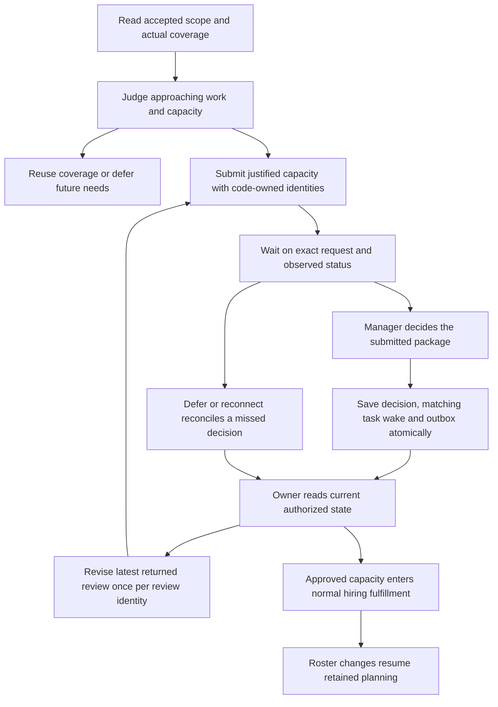

# Staffing review continuation and full narrative text

Implemented for the [QFN Games / Brickfall incident](run-reviews/qfn-games-brickfall-2026-11-15.md).
The observed failures were a clipped staffing purpose, fixed assignment fields that could not express
the model's judgment, cached first-review feedback and decision wakes that retained an already satisfied wait.

## Shared interaction

`PersonalTodoDependency` is an optional public reference on wait/defer records. The initial resolver
supports `resource-change.v1`; its resource ID and observed immutable status identify the exact wait.
`WorkItemMutationEngine.ReadDependencyVersionAsync` verifies organization, owner, installation and
team/project against current resource state. Events never supply execution authority. Other resource
kinds can add resolvers without changing agent roles, card prose or third-party agent inheritance.

`WorkItemMutationEngine.RecoverDependencyWaitsAsync` runs on resource decisions, defer and normal
reconciliation. It handles decisions made before a defer, lost notifications and duplicate/out-of-order
wakes. Work changes and available-event outbox rows share the caller's transaction. Reads are paged;
resource mutations restrict reconciliation to their organization. Current claims are preserved. Other
waits and independently ready work remain unaffected. Normal transitions clear the dependency along
with other waiting state.

`RevisesRequestId` identifies a returned/rejected proposal being answered.
`SupersedesRequestId` identifies the approved staffing baseline used for deltas. `ResourceChangeService`
validates revision ownership/scope, rejects a stale unanswered review, and returns the one existing
replacement even when a caller retries with a different command key. A filtered unique index and the
organization transaction lock protect concurrent submissions. Existing occupied staffing is retained.
The approved team baseline may have been submitted by its Director before the Producer took ownership;
it remains the baseline for capacity deltas. Review routing, in contrast, is scoped to the current requester and manager.

## Agent judgments and recovery

SDK `StaffingWorkDescription.Apply` preserves purpose, timing, accountability and engagement and binds
a named current reporting relationship. Code owns IDs, canonical role/capability grants and source
bindings. Producer `AssessKickoffCoverageAsync` selects the newest applicable review, keyed by current
scope, roster, review, model configuration and planning contract. `neededNow=false` documents future
work without opening an immediate hire. Required artifact-producing capabilities come from the actual
technical planning handoff. There is no default QA-at-kickoff or standard team-size requirement.

Repeated legitimate manager reviews are distinct from invalid-command correction. A platform validation
rejection reaches the model once under a new assessment key. A second rejection retains a durable
blocker naming the Producer and approving manager; unchanged wakes cannot regenerate indefinitely.
Changed relevant evidence or model configuration permits reassessment.

Producer `EnsurePlanningCommitmentAsync` reads current applicable reviews and upgrades legacy waits
under `OwnershipContractRevision` rather than matching English error text. It requeues the same
commitment through existing revision/claim guards. New waits carry the exact dependency. A fresh
business follows the same current-state interaction.

An approved team-wide slot waits for actual roster fulfillment; it does not attach a project-specific
review dependency to a team-wide request or reopen manager approval. Hiring events and current-roster
discovery resume that distinct wait.

## Narrative content

The Producer's 700-character purpose and 2,048-character rationale clipping is removed. Staffing work,
timing, explanations, assumptions, constraints, alternatives, expected effects, hiring objectives,
team descriptions, manager reviews and decision comments retain their full text through the relevant
broker contracts, services and PostgreSQL columns. Production brief/review validators and recovery
explanations no longer reject or trim solely because a model is verbose. Identity/key/catalog rules
and authority validation remain separate from narrative content.

`McpToolCatalog` derives resource proposals, hiring recommendations and wait-defer input schemas from
the wire DTOs, including optional nullable legacy fields. This prevents a stale handwritten text cap
from contradicting storage/service behavior. Existing clients may continue omitting candidate references.

Migration `StaffingReviewDependenciesAndNarrativeText` widens narrative columns to `text`, adds nullable
dependency/revision-lineage columns and the revision-deduplication index. It preserves existing records;
legacy waits and proposals need no data rewrite. Rolling the migration back after long text is stored
requires explicit data handling because old narrow columns cannot represent the new content.

## Verification and rollout

Regression coverage includes SDK third-party roles and named relationships; public legacy wait JSON;
successive returns; interrupted submission replies; exact ownership/project isolation; reworded waits;
decision-before-defer and lost-event recovery; unchanged wake idempotence; preserved independent work;
full Unicode text through broker/storage; and real PostgreSQL migration and interrupted transaction
retry. Producer tests retain a minimized Brickfall incident fixture and the existing task identity.
The PostgreSQL fresh-planning journey exercises two populated sprints, review/rework and final completion
with controlled model and staffing boundaries. Automated protocol tests do not establish live model quality.

Verified: contracts 83 tests, SDK 932 tests, Producer 590 tests, Director 450 tests, targeted platform
coverage 381 tests (including the additional PostgreSQL fixtures), and generated-agent template 7 tests.
All pass. Agent/platform consumers were also checked against the packed dependencies with sibling SDK
and contract references disabled. The four package versions and their dependency metadata were checked
from the generated `.nupkg` files.

1. Publish Work Management Contracts **5.11.0**, then SDK **5.35.0**.
2. Deploy the platform update with its normal migration process and restart the relevant services.
3. Publish Producer **6.18.0** and Director **0.13.0**, then update both through Installed Agents.
4. Let normal attention/reconnect recovery inspect Brickfall's existing planning commitment. Verify a
   replacement for the latest return, the manager decision, fulfilled technical coverage and actual
   project tickets. Keep the business, approved documents and existing tickets.

No live record, approved package or installed payload was patched by this implementation. The run
comparison remains at its last observed live milestone until a post-publication observation confirms progress.
