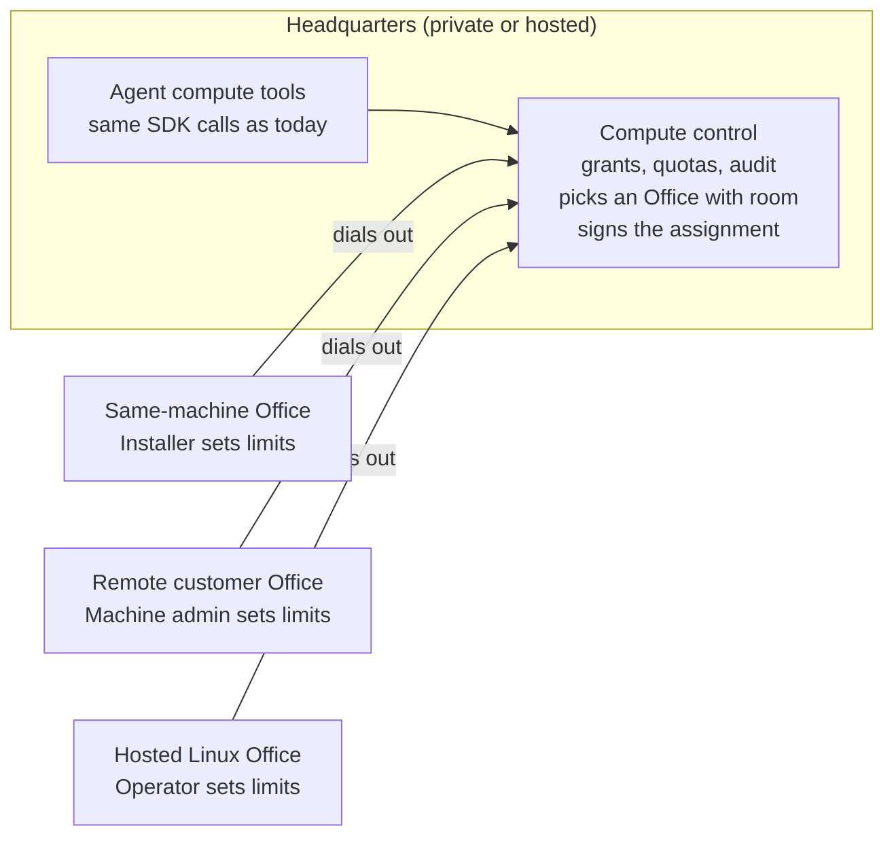
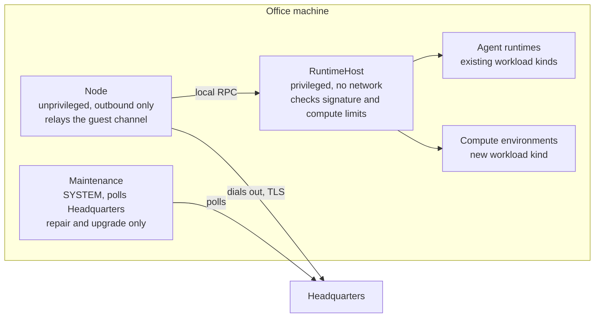

# 02 Design

[Overview](README.md) · [Current behavior](01-current-behavior.md) · [Work plan](03-work-plan.md)

## Target design

Headquarters decides; the Office does the machine work.

Every Office opens its own outbound connection to Headquarters, so the same design serves a
private Headquarters and one hosted by C-Sweet. A business can use any mix of the three kinds of
Office. Headquarters places each compute environment on an Office that allows compute and has
room. Give each persistent compute disk an owner and home Office. Restart on that Office with
the same disk identity and generation. Placement elsewhere requires a verified transfer or
restore and fencing of the old writer. A compute environment gets its own disk, even when its
agent has a persistent runtime disk on the same Office.

The Windows Office process layout is shown below. The Linux and macOS installers supply their
own privileged runtime and service management. The SYSTEM Maintenance service is Windows-specific.

## What stays and what moves

`IComputeProvider` describes the lifecycle vocabulary. Wiring the new transport requires
integrating the live claim, result and receipt flow documented in [Current behavior](01-current-behavior.md).

| Concern | Stays in Headquarters | Moves to the Office |
| --- | --- | --- |
| Agent tools (`request_compute_environment` and the other six), SDK `context.Platform.Compute` | Yes, unchanged | |
| Grants, quota admission, operations, idempotency, audit | Yes, unchanged | |
| Choosing where an environment runs | Yes: picks an enrolled Office that reports compute support and free capacity | |
| Creating, starting, stopping and destroying the VM | | RuntimeHost, through the existing Hyper-V, Firecracker and Apple helpers |
| Commands, browser tests, build and evidence archives | Authorizes each one | Runs it in the guest over the guest channel |
| Published test ports | Serves the test URL | Relays the guest's loopback port over the guest channel |
| Outbound internet | Grants it | The Node's tunnel enforces the grant and the blocked ranges |
| Limits | Plan and CFO spend limits | RuntimeHost enforces the Office's own ceilings |

## Contract (Office.Contracts 0.14.0, additive)

- `WorkloadKind.ComputeEnvironment` and a `ComputeEnvironmentWorkloadSpecification`: guest image,
  resource limits, features, optional `NetworkPolicy`, optional `PersistentDisk`, and the
  Headquarters environment and operation identities.
- Office inventory flag `supports_compute_environments`, default false. Headquarters sends the new
  kind only to an Office that reports it, as it already does for public internet and persistent
  disks.
- Guest protocol additions for compute operations (execute, browser test, archive transfer, port
  stream), negotiated by version so older guests are unaffected.
- Preserve the existing `AssignmentEnvelope` encoding and frozen vectors. A new specification
  has its own digest and signed bytes. Pin a new vector and preserve existing numeric kind IDs.
- Version: additive, so a minor bump from 0.13.0 to 0.14.0 under `docs/versioning.md`. Both
  consumer pins move together.

## Lifecycle

| Compute action | In the Office |
| --- | --- |
| Provision | A signed assignment. RuntimeHost checks the signature and its fencing ledger before any VM exists, as for agent runtimes |
| Execute, browser test, archives, publish port | Typed requests over the guest channel, each authorized by Headquarters |
| Stop, destroy | A stop receipt confirms the VM stopped. Confirm VM removal and the authorized disposition of its disk separately before releasing the corresponding reservations |
| Start after stop | A fresh VM on the same persistent disk |
| Keep alive | `WorkloadResourceLimits.MaximumDuration` bounds one assignment to seven days. Recheck current grants, policy and budget before issuing a successor. Only a persistent environment can carry its files forward |
| Office update | Count live environments during drain. Resume from the last confirmed operation and disk state after upgrade. An interrupted guest command can have an unknown outcome |

A signed create authorizes one VM. For each later guest operation bind the authorized action,
business, installation, environment, generation, operation ID, expiry and request digest. Record
acceptance before execution. If a receipt is lost, retrieve the observed result by operation ID.
An arbitrary guest command may have changed state before a disconnect. Report an unknown outcome
when its result cannot be recovered and require a new caller decision to execute again.

Record operation state and its notification in one Headquarters transaction. On startup or
reconnect, discover pending operations in bounded pages and read current authority before acting.
Keep a local reservation through uncertain teardown. During an outage, enforce lease expiry
locally and preserve disks according to the original grant. Fresh work requires fresh authority.

## Networking

Compute environments have no virtual network adapter. Outbound access uses the Office's brokered
tunnel (`OfficeInternetTunnel` on the Node, `GuestInternetProxy` in the guest), under the compute
network grant. Published ports are relayed from the guest's loopback over the guest channel to
Headquarters, which mediates access. Today's publisher binds to loopback. For remote access
require current business membership and publication authority, serve guest content on a separate
origin without Headquarters credentials, and close streams on expiry or revocation. No Office
host listener is added. This replaces the
`CSweet Outbound` adapter, the `Default Switch` dependency and `ComputeLocalPortPublisher`.

## Images

One compute image profile (Ubuntu 24.04, Python, Node, Docker, browser-test runner) built in the
Office release pipeline for each backend and certified on the host, like the runtime images. No
compute image should be built on a customer machine. Bind the image and tools to a signed release
manifest. Verify installed bytes and certify the selected backend, architecture and feature set
before advertising it. The compute guest program
(`csweet/src/CSweet.Compute.Guest`) runs beside the Office guest broker inside that image.

## Approval and limits

Every Office carries a compute policy written by whoever installed it, stored in the
administrator-owned settings that the unprivileged Node cannot change. RuntimeHost refuses a
compute assignment the policy does not allow.

| Office | Who approves | How | When |
| --- | --- | --- | --- |
| Same machine as a private Headquarters (Windows) | The owner | A compute step in the Office installer: allow compute, and maximum CPU, memory, disk and number of environments | Once, during first-run setup, with the existing install-time UAC |
| Customer-owned Office on another machine, any Headquarters | That machine's administrator | The same installer step on Windows; flags on `csweet-configure-office` on Linux; the macOS installer | Once, at install |
| Hosted Office | The hosting operator | The fleet provisioner installs a machine ceiling. Headquarters additionally enforces the customer's current plan | At provisioning, with subsequent fleet changes authenticated by the operator |

Rules that apply everywhere:

- **Off unless allowed.** An Office with no compute policy reports
  `supports_compute_environments = false` and refuses the new kind.
- **Policy has a machine owner.** Bind the enrolled Office to an administrator-owned policy.
  Customer Headquarters and the existing repair/upgrade handoff have no authority to raise
  its limits or enable compute. For v1, keep that ceiling fixed across routine repair and upgrade.
  A hosted plan increase takes effect only within the installed ceiling. Define a separately
  authenticated owner change before supporting increases to the machine ceiling after install.
- **Admission is atomic on the Office.** Reserve aggregate CPU, memory, disk and environment
  count under the same lock or transaction as accepting the operation. Account for existing
  Office workloads, retained disks and reservations with unknown outcomes. Treat inventory as
  a placement hint. Recheck policy and free capacity at execution.
- **Headquarters limits sit on top.** Scoped grants, quotas and CFO spend limits still apply. On
  the hosted platform the plan's ceiling applies outside the customer's own settings.
- **No capacity is a notice, never a prompt.** If no enrolled Office allows compute or has room,
  the hire still succeeds. The owner sees an item in the app and on the work board, and waiting
  work resumes when capacity appears.

## What the owner sees

The Compute page drops its "preparing local compute" progress and shows which Offices offer
compute and how much is in use. Hiring is unchanged.

## Alternatives considered

| Alternative | Why not |
| --- | --- |
| Run all of Headquarters elevated (self-elevating launcher) | One prompt per start; dies at logoff; gives agent-facing code (AgentHost, API, GitHost) administrator rights; does nothing for a hosted Headquarters |
| Run Headquarters services as LocalSystem | Unattended, but the worst blast radius, and Windows only |
| A privileged broker service on Headquarters (`CSweet.Machine`) | Duplicates what Office already has; still Windows only; a hosted Headquarters has no hypervisor to drive |
| Keep today's compute provider and ship it with Office | Quicker, but keeps a LocalSystem service that both talks to the network and controls Hyper-V, a second signing key and replay journal, a network adapter on guests, and no Linux path |
| Carry today's signed compute packets over the Office channel (see T1) | Workable; keeps a second verifier inside RuntimeHost |
