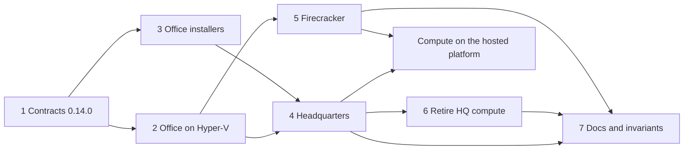

# 03 Work plan

[Overview](README.md) · [Design](02-design.md) · [Verification](04-verification.md)

## Phases and gates

Each phase ends with a gate that can be tested before the next begins. Phase 0 is optional and
only helps today's development setup.

| Phase | What | Gate |
| --- | --- | --- |
| 0 (optional) | Disable interactive compute setup in unattended mode and report the missing provider immediately | A hire in unattended mode reports the actionable state within a minute, with no Windows shell launch |
| 1 | Office.Contracts 0.14.0: the new workload kind, its specification, the inventory flag, guest protocol additions | Package-only tests pass in Contracts, Office and Headquarters; frozen assignment vectors unchanged; new vector test added |
| 2 | Office on Hyper-V: RuntimeHost runs the new kind; compute image profile in the release; operations, port relay and tunnel egress over the guest channel; compute policy and ceilings | On a Windows Office with nobody logged in, a signed assignment produces a ready environment; a command, a browser test and a published port work; a request over the ceiling is refused |
| 3 | Office installers: compute step on Windows, flags on Linux, macOS option; Node reports compute support and capacity | A fresh install with compute allowed reports it; one without refuses the new kind |
| 4 | Headquarters: Office-backed compute provider; scheduling onto Offices; no compute setup on hire; Compute page shows Office capacity; no-capacity notice | The Game Engineer is hired and gets an environment with no prompt anywhere. Breakout build and browser evidence pass end to end |
| 5 | Firecracker: compute image and operations on Linux Offices | The Phase 4 gate passes with Headquarters on a Linux server without virtualization and a Linux Office. This is the gate for offering compute on the hosted platform |
| 6 | Retire Headquarters-local compute per machine after confirming ownership, drain, data disposition and cleanup receipts. Route Office repair and upgrade through unattended maintenance | V11 and V13 pass, including the unsuffixed service and legacy retirement tasks. No post-install route can reach an interactive launcher |
| 7 | Documents and invariants | Docs describe only behavior that exists |

Phases 2 and 3 can overlap. Phase 5 can start once Phase 2's guest work is stable, and does not
block Phases 4 and 6 for private Windows installations.

Until Phase 4 passes, the current compute path stays available behind a development switch so
live runs are not blocked.

## Work by repository

### CSweet.Office.Contracts (0.13.0 to 0.14.0)

- `Workloads/WorkloadModels.cs`: `WorkloadKind.ComputeEnvironment`;
  `ComputeEnvironmentWorkloadSpecification` with `Validate()` bounds.
- `ControlPlane/office_control.proto`: inventory flag `supports_compute_environments` in the next
  free field; matching enrollment property.
- `Guest/`: compute operation frames under a new guest protocol version.
- Tests: JSON round-trip, a new signing vector, unchanged frozen vectors.
- Docs: `docs/workloads.md`, `docs/versioning.md`.
- Release, then update both consumer pins together and validate with local references disabled.

### CSweet.Office

- `Runtime.Core` and `RuntimeHost`: accept the new kind through the existing authorization gate
  and attempt journal; compute policy and ceilings; reaper covers the new kind.
- `Runtime.HyperV.Helper`, then `Runtime.Firecracker.Helper`: create a compute environment from
  the compute image, with the persistent disk when the specification carries one. No network
  device.
- `Node`: report compute support and capacity; relay compute operations and published ports over
  the guest channel; count compute environments as active for drain.
- Guest image: a compute profile containing the compute guest program, Docker, Node, Python and
  the browser runner (from `csweet/build/compute-linux`); internet through `GuestInternetProxy`.
- Installers: `Install-CSweetOfficeRuntimeHost.ps1`, `New-CSweetOfficeMsi.ps1`,
  `install-office.sh`, `csweet-configure-office`, the macOS installer: compute policy input and
  storage.
- Docs: a new security invariant; pages under `10-system`, `20-security`, `30-workloads`,
  `40-operations`.

### csweet (Headquarters)

- Trace one operation from `ComputeBroker` through `ComputeProviderWorkService.ClaimAsync` to
  `ComputeResultReconciler`. Map current claims, retries, observations, quota reservations and
  receipts onto Office assignments before replacing the transport. Registering an
  `IComputeProvider` implementation alone cannot change the live path.
- `ComputeDefaultsService`: stop creating `ComputeLocalSetup` on hire; resolve an Office instead.
- `ComputeRegistry`: node and template records derive from enrolled Offices and released images.
- `ComputeBroker.Workload`, `ComputeEvidencePartAccess`, `ComputeBuildInputAccess`: send
  operations through the Office guest channel.
- `src/CSweet.Api/Compute`: remove `ComputeLocalSetupWorker`, `ComputeLocalSetupEndpoints`,
  `ComputePreparationProgress`, `ComputeSetupObservation`, and the provider HTTP endpoints once
  nothing calls them.
- `src/CSweet.UI/Components/ComputePreparation.razor`: replace with Office capacity status.
- Delete `src/CSweet.Compute.HyperV`, the compute installer scripts under `scripts/`, and most of
  `src/CSweet.Compute.Runtime`. Keep `src/CSweet.Compute.Contracts` for the agent-facing types.
- In `ExecutionFleetService.LocalSetupLaunchMethod`, route post-install repair and upgrade to
  Maintenance even on a configured development machine. If unavailable, surface repair status
  in the app. Allow interactive elevation only from an explicitly started first install.
- Supply an unattended bootstrap for operator-provisioned hosts. Check virtualization and any
  required reboot during install. Services must resume before login with machine-scoped state.
- Run legacy cleanup using the explicit elevated migration/install or existing authorized
  machine tooling. Fence new legacy dispatch first. Inventory exact-owned VMs, disks, tasks,
  enrollment and service names. Preserve persistent data unless its owner authorizes disposal.
  Confirm retirement before removing old endpoints or tables. A disconnected legacy host must
  remain discoverable for cleanup after it reconnects.
- Docs: `docs/implementation/compute-*.md`, `shared-linux-images.md`, `debug-guide.md`,
  `docs/features/hosted-platform/02`, `05`, `08`, `10`,
  `Documentation/Architecture/AGENT_ISOLATION_SECURITY_OVERVIEW.md`.

### CSweet.Isolation

- `tools/LinuxImage`: the compute profile moves to the Office release pipeline. No change to
  authorization encoding, ISO layout or socket GUID derivation.

### Agents and SDK

- No contract change expected. Confirm the Software Developer, Game Engineer, QA and Technical
  Director agents behave when compute is waiting for Office capacity rather than "preparing".

## Effects on other plans

| Plan | Effect |
| --- | --- |
| Windows MSI installer | The Headquarters MSI needs no Hyper-V, no compute payload and no compute image. The Office installer stays separate and carries the compute consent |
| Hosted platform / C-Sweet Cloud | Compute on hosted Offices depends on Phase 5. Hosted Office provisioning must write the compute policy |
| Agent self-install (persistent disk) | Reuses the disk mechanism with independently owned compute disk identities |
| Agent git access | Unaffected |
