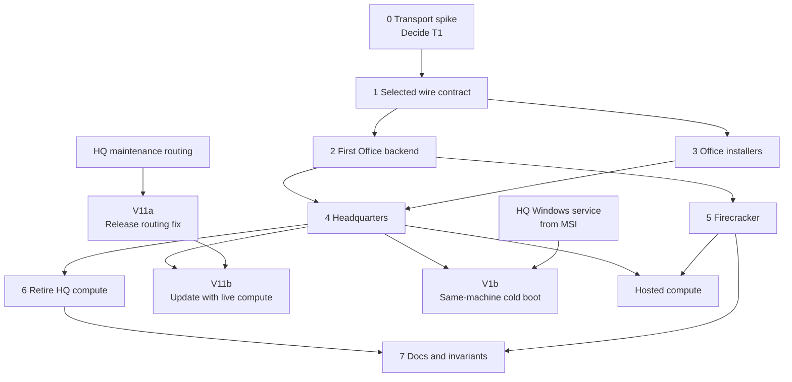

# 03 Work plan

[Overview](README.md) · [Design](02-design.md) · [Verification](04-verification.md)

## Phases and gates

Two pieces of work can start independently. Headquarters can ship the repair and upgrade routing
fix against an already installed Office. The compute team starts with the transport spike in
Phase 0. Both can use the current Office.Contracts release and defer production image selection.

**Independent Headquarters release.** Change `ExecutionFleetService.LocalSetupLaunchMethod`
so an enrolled Windows Office receives authorized repair and upgrade handoffs through
`ClaimOfficeMaintenanceAsync`, including when the development launcher is configured. Preserve
drain, identity and certificate checks. If the installed Office cannot service the handoff,
surface that state in Headquarters. Gate release on V11a using today's Office and workloads.

| Phase | What | Gate |
| --- | --- | --- |
| 0 | Prototype T1 with a disposable guest. Compare an Office workload assignment with relaying the existing signed compute packet. Exercise VM creation and a separately authorized guest command | Drop the acknowledgment after the command records a side effect, restart Office over retained state and redeliver the same operation. Verify one VM, one reservation and one command effect. Recover the receipt or report the outcome as unknown. Record the evidence and selected transport in T1 before Phase 1 |
| 1 | Define and package only the wire changes required by the selected transport, including capability negotiation | Existing signing vectors and old-peer behavior pass. Pin vectors for new signed data, verify the package version, and test both consumers with sibling references disabled |
| 2 | Implement the selected transport on the first agreed backend and image (T2/T3 recommend Hyper-V and a Linux guest). Add guest operations, port relay, egress and Office-side ceilings | V1a passes after reboot with a separately running Headquarters. A command, browser test and published port work, and an over-limit request is refused |
| 3 | Add compute consent and capacity reporting to Office installers for supported backends | A fresh install advertises compute only when policy and backend certification allow it. An Office with compute disabled refuses a compute request |
| 4 | Route live compute claims and results between Headquarters and eligible Offices. Reconcile receipts, remove the local setup trigger on hire and show capacity or a durable wait | The Game Engineer is hired and gets one environment on the selected Office with no prompt. The existing build and browser evidence flow passes end to end, including receipt recovery on redelivery |
| 5 | Firecracker: compute image and operations on Linux Offices | The Phase 4 gate passes with Headquarters on a Linux server without virtualization and a Linux Office. This is the gate for offering compute on the hosted platform |
| 6 | Retire Headquarters-local compute per machine after confirming ownership, drain, data disposition and cleanup receipts | V13 passes, including the unsuffixed service and legacy retirement tasks |
| 7 | Documents and invariants | Docs describe only behavior that exists |

Phases 2 and 3 can overlap. Phase 5 can start once Phase 2's guest work is stable, and does not
block Phases 4 and 6 for private Windows installations.

Under the T6 recommendation, existing development installations can explicitly enable the legacy
compute path until Phase 4 passes. Keep it off by default and unavailable in managed deployments.
In unattended mode, report missing Office capacity promptly. Never fall back to the local
installer when placement fails. After Phase 4, stop new legacy provisioning and retain observation
and cleanup for existing resources until their Phase 6 retirement receipts arrive.

The Office team owns V1a. The Headquarters Windows MSI team owns V1b, which also requires the
installed Headquarters stack and its dependencies to start before Windows sign-in. V1b gates the
same-machine Windows release. V11b gates unattended updates with **live compute** once Phase 4
can place a real environment. [Verification scenarios](04-verification.md)

## Work by repository

### CSweet.Office.Contracts

The following changes describe the workload-kind candidate. Phase 0 determines which fields and
frames to publish. If T1 selects packet relay, document its transport and reuse the existing
signed payloads. Apply the package versioning rules to the resulting public change.

- `Workloads/WorkloadModels.cs`: `WorkloadKind.ComputeEnvironment`;
  `ComputeEnvironmentWorkloadSpecification` with `Validate()` bounds.
- `ControlPlane/office_control.proto`: inventory flag `supports_compute_environments` in the next
  free field; matching enrollment property.
- `Guest/`: compute operation frames under a new guest protocol version.
- Tests: JSON round-trip, a new signing vector, unchanged frozen vectors.
- Docs: `docs/workloads.md`, `docs/versioning.md`.
- Release, then update both consumer pins together and validate with local references disabled.

### CSweet.Office

- `Runtime.Core` and `RuntimeHost`: enforce Office compute policy and ceilings at execution.
  Apply the verification and replay rules proven in Phase 0 and extend the reaper to compute.
- `Runtime.HyperV.Helper`, then `Runtime.Firecracker.Helper`: create a compute environment from
  the compute image, with the persistent disk when the specification carries one. No network
  device.
- `Node`: report compute support and capacity; relay compute operations and published ports over
  the guest channel; count compute environments as active for drain.
- Guest image: a compute profile containing the compute guest program, Docker, Node, Python and
  the browser runner (from `csweet/build/compute-linux`); internet through `GuestInternetProxy`.
- Installers: `Install-CSweetOfficeRuntimeHost.ps1`, `New-CSweetOfficeMsi.ps1`,
  `install-office.sh`, `csweet-configure-office`, the macOS installer: compute policy input and
  storage.
- Docs: a new security invariant; pages under `10-system`, `20-security`, `30-workloads`,
  `40-operations`.

### csweet (Headquarters)

- Trace one operation from `ComputeBroker` through `ComputeProviderWorkService.ClaimAsync` to
  `ComputeResultReconciler`. Map current claims, retries, observations, quota reservations and
  receipts onto the selected Office transport before replacing the existing route. Registering an
  `IComputeProvider` implementation alone cannot change the live path.
- `ComputeDefaultsService`: stop creating `ComputeLocalSetup` on hire; resolve an Office instead.
- `ComputeRegistry`: node and template records derive from enrolled Offices and released images.
- `ComputeBroker.Workload`, `ComputeEvidencePartAccess`, `ComputeBuildInputAccess`: send
  operations through the Office guest channel.
- `src/CSweet.Api/Compute`: remove `ComputeLocalSetupWorker`, `ComputeLocalSetupEndpoints`,
  `ComputePreparationProgress`, `ComputeSetupObservation`, and the provider HTTP endpoints once
  nothing calls them.
- `src/CSweet.UI/Components/ComputePreparation.razor`: replace with Office capacity status.
- Delete `src/CSweet.Compute.HyperV`, the compute installer scripts under `scripts/`, and most of
  `src/CSweet.Compute.Runtime`. Keep `src/CSweet.Compute.Contracts` for the agent-facing types.
- In `ExecutionFleetService.LocalSetupLaunchMethod`, route post-install repair and upgrade to
  Maintenance even on a configured development machine. If unavailable, surface repair status
  in the app. Allow interactive elevation only from an explicitly started first install.
- Supply an unattended bootstrap for operator-provisioned hosts. Check virtualization and any
  required reboot during install. Services must resume before login with machine-scoped state.
- Run legacy cleanup using the explicit elevated migration/install or existing authorized
  machine tooling. Fence new legacy dispatch first. Inventory exact-owned VMs, disks, tasks,
  enrollment and service names. Preserve persistent data unless its owner authorizes disposal.
  Confirm retirement before removing old endpoints or tables. A disconnected legacy host must
  remain discoverable for cleanup after it reconnects.
- Docs: `docs/implementation/compute-*.md`, `shared-linux-images.md`, `debug-guide.md`,
  `docs/features/hosted-platform/02`, `05`, `08`, `10`,
  `Documentation/Architecture/AGENT_ISOLATION_SECURITY_OVERVIEW.md`.

### CSweet.Isolation

- `tools/LinuxImage`: the compute profile moves to the Office release pipeline. No change to
  authorization encoding, ISO layout or socket GUID derivation.

### Agents and SDK

- No contract change expected. Confirm the Software Developer, Game Engineer, QA and Technical
  Director agents behave when compute is waiting for Office capacity rather than "preparing".

## Effects on other plans

| Plan | Effect |
| --- | --- |
| Windows MSI installer | The Headquarters MSI owns ordinary-privilege service registration and pre-login startup for V1b. The Office installer carries compute consent. The [Windows distribution guide](../../deployment/windows-build.md) lists service registration and clean-machine startup tests as pending |
| Hosted platform / C-Sweet Cloud | Compute on hosted Offices depends on Phase 5. Hosted Office provisioning must write the compute policy |
| Agent self-install (persistent disk) | Reuses the disk mechanism with independently owned compute disk identities |
| Agent git access | Unaffected |
